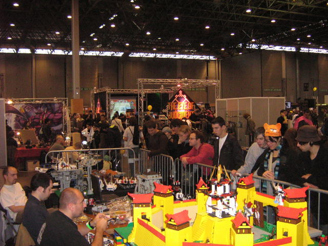
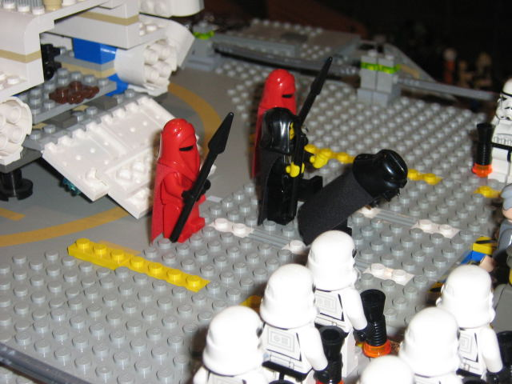
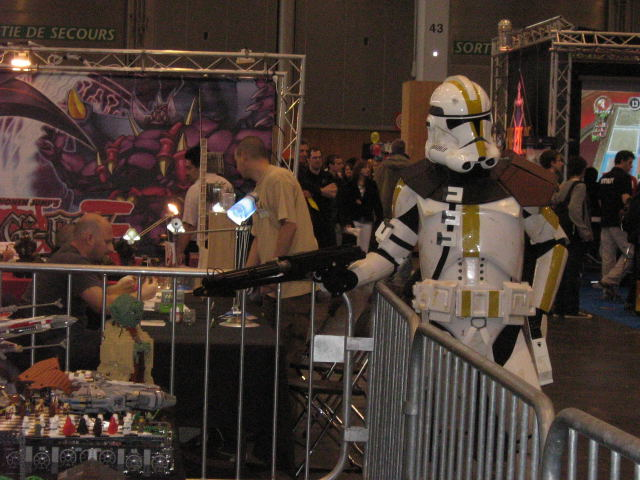
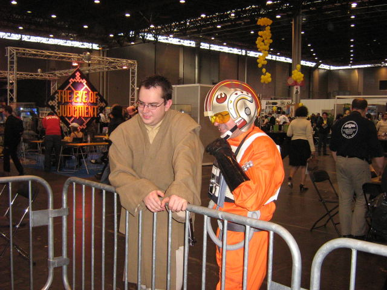
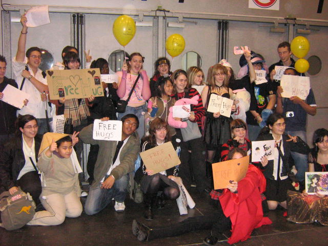
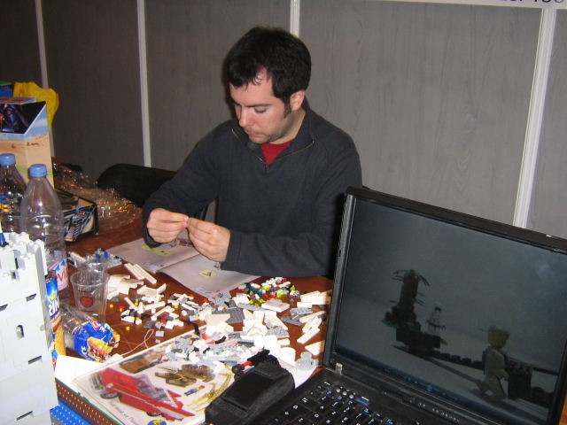

[Kultima](http://www.kultima.com/), salon de l’imaginaire, dédié à tous les fans de Sciences Fiction, Fantasy, Jeux de rôles, mais également couplé pour cette première édition avec l’édition hivernale de Japan Expo consacrée plus quant à elle à l’univers manga, avec comme fil conducteur la bande-dessinée et l’édition offrant leur support à tous les amoureux de l’aventure, de l’étrange, de l’évasion et des mondes parallèles.

Et effectivement, il faut bien reconnaître que l’univers des jeux LEGO se prête également au support de l’imaginaire et pour répondre à la demande des organisateurs nous avions préparé un petit aperçu des possibilités de réalisations LEGO avec une présentations de sets Star Wars, un plateau médiéval et une base Exo-force pour illustrer le coté Manga.

**Vue d’ensemble**

Le programme officiel mentionnait également le thème Harry Potter à qui nous avons également consacré une petite place avec un train... on ne se refait pas :)

Passons donc en revue les réalisations présentées à Kultima.

Tout d’abord Jean-Louis, qui a assuré la coordination de notre participation à cet évènement, est venu avec une partie de sa collection Star Wars et ses réalisations personnelles sous la forme de son jeu d’échecs "Endor" et de la plate-forme d’atterrissage qui a reçue la visite de l’empereur pour une petite séance de bottage de fesses...

**Vador à la botte de l’Empereur**

A l’autre extrémité de notre espace de présentation, Manu et Erik sont venus avec leur base Exo-force tout juste remballée du LEGOWORLD. Evidement un MOC sur un tel sujet n’a pu qu’attirer les moqueries des autres camarades AFOLs, un peu jaloux quand même face à l’ampleur de la bête qui résulte plus d’un travail d’exo-forcenés offrant le caractère exo-kit à l’univers manga ambiant.

A ce titre ouvrons une petite parenthèse sur le public rencontré sur cet évènement, assez différent du public familial auquel nous sommes habitués sur nos expositions de modélisme.

Tout d’abord la tranche d’age : Plus dans la tranche adolescents/jeunes adultes.

Ensuite le look : Evidement nous avons eu la visite de beaucoup de fans de Star Wars, dont bon nombre de membres la 501ème division déjà rencontrés lors de la [Nuit StarWars au Toys’R’Us de la Défense](/articles/385/).

**501ème**

**Pilote cherche X-wing...**

Mais nous avons eu aussi la visite de quelques vampires, fées, elfes, jeunes filles plus ou moins court vêtues.

Nous sommes même tombés sur un fan club qui nous est dédié, même si elles ne savent pas encore écrire correctement le nom de l’association.

**Fan club Free(L/H)ug**

A noter aussi, le rapide passage d’un coin de Soleil, en la personne de [Jean-Louis Mourier](http://www.soleilprod.com/auteur_infos.php?aId=53) à qui j’ai confié qu’en 2008, LEGO allait commercialiser des Trolls dans sa gamme Castle. J’invite tous ceux qui n’auraient pas compris l’allusion à aller chez leur libraire favori, dévorer les quelques volumes dessinés de main de maître par ce talentueux dessinateur. Cette visite m’a donné deux idées, une que je vais garder pour moi jusqu’à la prochaine édition de Kultima et l’autre qui avait déjà été évoquée, concernant la mise en place sur nos expositions d’un livre d’or pour laisser à nos visiteurs la place pour nous faire part de leur témoignage, voir d’une petite dédicace...

Et puis pour terminer ce compte rendu, une rapide présentation du plateau médiéval qui sera de nouveau de sortie samedi prochain au [PicWic de Sainte-Genneviève des Bois](/articles/281/) et le week-end suivant à l’exposition de la [Ville du Bois](/articles/614/).

Un petit mot aussi pour souligner la participation amicale de [Quelug](http://www.quelug.org/modules/news/) à notre évènement, puisque Pierre Normandin, actuellement en visite sur notre continent, est venu nous supporter (et c’est pas toujours facile...). Nous avons trouvé quand même de quoi l’occuper avec quelques boîtes SW à monter.

**Briques et Pierre**

Et puis on peut noter également sur la photo ci-dessus que les oeuvres originales de Banban ont été également présentées, même s’il n’a pu se joindre à nous. A espérer qu’une prochaine manifestation sera peut être pour lui l’occasion de venir nous rejoindre dans le cadre d’un déplacement professionnel... Qui sait ?

A signaler aussi une nouvelle adhésion durant le salon : nous avions quelques Eric, un Erik et maintenant nous aurons un Erick. Un éventuel nouveau partenaire s’est également fait connaître en nous confiant un exemplaire d’ISD Minifig à construire. Je vous donnerai plus de détails à ce sujet ultérieurement.

Visiblement ce salon, pour sa première édition a rempli son objectif et il y a fort à parier que nous allons nous retrouver bientôt pour une prochaine édition en 2008.

## Les galeries de photos :

**–** [Photos de qdm](http://photos.freelug.org/main.php/v/La-Gallerie-de-qdm/Expositions/2007-Kultima/)  
**–** [Photos d’Erik](http://photos.freelug.org/main.php/v/brickerik/expositions/2007/kultima2007)
