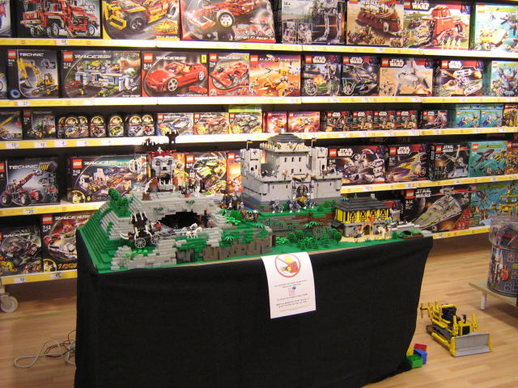
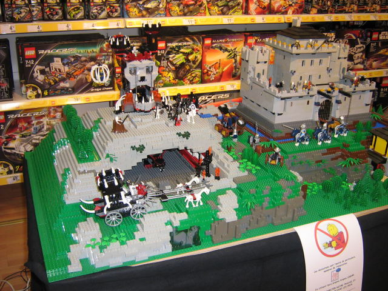
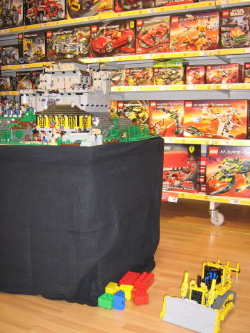

De nouveau invitée pour présenter quelques nouveautés aux clients de notre point de vente partenaire, notre association à mis en oeuvre un diorama sur le thème "Castle", histoire de mettre en avant cette nouvelle gamme au moment où se décident les achats pour les fêtes de fin d’année.

J’entretiens depuis déjà plusieurs années des rapports étroits avec le personnel du [PicWic de Sainte-Geneviève des Bois](/articles/281/), qui outre le fait de nous accueillir de façon traditionnelle, maintenant, le dimanche matin de nos assemblées générales, nous accueille également amicalement dans le cadre de petites expositions ponctuelles.

**Vue générale du Layout**

L’intérêt pour PicWic est de montrer à ses clients ce qu’il y a à l’intérieur des boîtes et pour nous de mettre en valeur notre savoir-faire et annoncer également nos prochaines manifestations d’importance, comme c’était le cas hier en préparation à notre [prochaine exposition à La Ville du Bois](/articles/614/).

Adeline a maintenant succédé à Sébastien à la tête du rayon LEGO, mais Sébastien est toujours là et toujours intéressé par les LEGO Technic, de même qu’André qui est toujours prêt pour nous apporter son concours. Merci à eux, comme à l’ensemble du personnel pour leur accueil.

Après [Kultima](/articles/680/) et avant la Ville du Bois, c’est mon "layout Castle" qui a servi de support à cette exposition.

**Vue rapprochée**

J’avais également apporté le [Bulldozer 8275](/articles/639/) que j’ai pu laisser manoeuvrer dans les mains de quelques visiteurs plus ou moins jeunes.

**Le Bulldozer 8275**

Malheureusement une grosse angine m’a contraint de restreindre cette présentation à la seule journée de samedi, mais rendez-vous est déjà pris pour de nouvelles présentations l’année prochaine, avec pourquoi pas comme thème "Indiana Jones" ?
