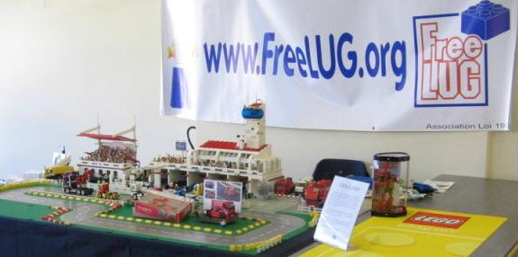

C’est lors de l’assemblée Générale des 17 et 18 février 2007 que nous avons reçu l’invitation de la commission d’action culturelle de Nohanent à participer à cette exposition. Pas besoin de réfléchir pour accepter d’être présent à un salon du maquettisme et du modélisme qui se déroule dans la région. Nohanent est situé dans la banlieue Nord-Ouest de Clermont-Ferrand. De plus, une lettre destinée aux membres auvergnats était écrite au dos d’un article résumant une exposition précédente à Chappes.

Ce fut donc ce dimanche 28 octobre, que j’arrive comme prévu dans la ville de Nohanent, pour installer un diorama représentant des courses de camions. J’ai garé ma voiture devant un superbe bâtiment "la maison des sources", qui m’inspirera sûrement pour une future construction. Les tables étaient en place, et je pus de suite commencer à installer mon diorama. D’autres maquettes étaient déjà en place, dont de très gros avions radio-commandés et un superbe cirque, entièrement en bois.

L’accueil du couple organisateur a été remarquable. Nous avons d’abord été conviés à prendre un agréable petit déjeuner, vers 8h00. Puis, l’exposition a été ouverte au public vers 10h00 et ensuite fermées vers 12h30 et nous avons pu prendre un repas chaleureux, entre les exposants et les organisateurs. Ils nous avaient préparé un plat maison délicieux. je les remercie d’ailleurs ici pour toute cette succulente préparation qui a été très appréciée. Nous avons accueilli les visiteurs de l’après midi, difficilement, sur le coup d’une bonne digestion. Mais, tout c’est très bien passé.

Les regards sur ce que l’on peut faire avec les briques sont toujours étonnés. Et pourtant, ce ne sont que quelques pièces que l’on assemble avec goût, et un peu d’imagination. Cela reste malgré tout très agréable, et on est toujours prêt à repartir.

Le soir venu, il a fallu tout ranger. Ce n’est vraiment pas le meilleur moment, lors d’une exposition. Et comme c’est en dernier, c’est le souvenir le plus récent. Mais il est vite oublié, en rapport à la journée agréable passée. Et puis, le contact avec les autres exposants est très sympa. On échange nos connaissances respectives, et on avance...

[Les photos de cette exposition](http://gallery.freelug.org/main.php/v/JAC/Exposition/Nohanent-2007/).
