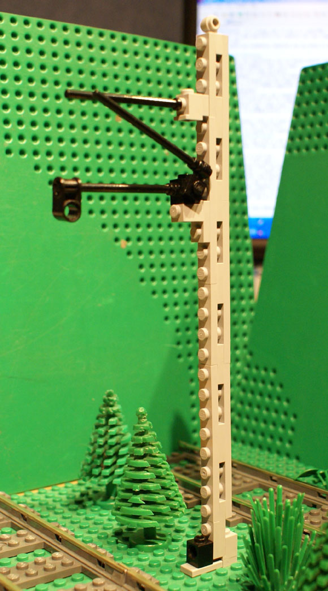
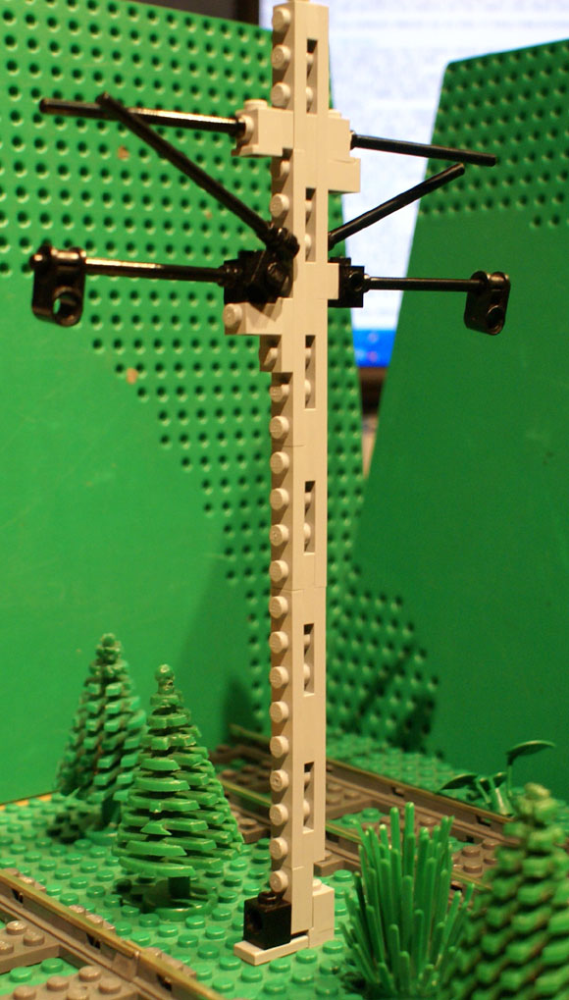

Je vous présente la première version de ma caténaire simple ou double.

Après avoir longuement "réfléchi" et travaillé sur [LDD](/articles/501/), j’ai créé mon premier poteau de caténaire.

Celui-ci peut être simple ou double. Pour être réaliste, les poteaux de caténaire devraient être posés tout les 56 tenons environ.

**Poteau pour caténaire simple**

Voici le dossier LDD pour le modèle simple : [http://shop.lego.com/Product/Factor...](http://shop.lego.com/Product/Factory/Product.aspx?p=LFH002&mid=c58a6be4-3be9-4e64-8dc6-6d7b19a8d028)

**Poteau pour caténaire double**

Et voila pour le double :  
[http://shop.lego.com/Product/Factor...](http://shop.lego.com/Product/Factory/Product.aspx?p=LFH002&mid=1c10261b-d037-4180-9c56-a3c21eb908b3)

Les photos sont sur ma galerie Brickshelf :  
[http://www.brickshelf.com/cgi-bin/g...](http://www.brickshelf.com/cgi-bin/gallery.cgi?f=287130)
