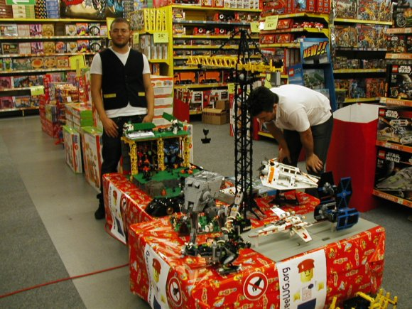

Le rendez-vous était pris pour réaliser une petite animation au MaxiToys de Garges-Lès-Gonnesse le samedi 8 décembre, pour la mise en place du partenariat FreeLUG avec cette enseigne.

Nous avions une surface d’environ 8m² à disposition, mais le peu de temps pour nous préparer, moins d’une semaine, nous a fait revoir à la baisse nos prétentions. C’est ainsi que nous sommes venus installer quelques-uns de nos sets et créations sur un espace équivalent à deux palettes.

Manu a présenté deux de ses plates-formes Exo-Force, l’AT-ST UCS Star Wars et sa piste de voitures téléguidées.

De mon côté, j’ai réalisé un petit diorama 32x32 représentant une scène de bataille StarWars pour mettre en avant les deux sets [Battle Pack 7654 et 7655](http://guide.lugnet.com/set/?q=7654%2C7655). J’ai également réalisé une petite chasse de Tie Fighters derrière le X-Wing de Luc.

Philo est passé dans la matinée et nous a laissé sa grue Power Function pour la journée. Avec son bull et celui de Manu, une démonstration de ces engins réussis a pu être faite.

Le dinosaure Creator a quant à lui remporté du succès et effrayé les plus jeunes :) Un client est reparti avec une boîte sous le bras.

Merci à Jean-Louis d’être passé nous dire coucou, à Saïd le stagiaire dévoué qui était là pour nous aider (et notamment tenir le stand pendant la pause déjeuner) et bien sûr à toute l’équipe du MaxiToys pour l’accueil et les bons moments de plaisanterie.

[Photos de la journée](http://photos.freelug.org/main.php/v/brickerik/expositions/2007/maxitoys2007/)

Amis FreeLUGiens, si vous êtes dans le coin, n’hésitez pas à passer, vous y serez les bienvenus.
