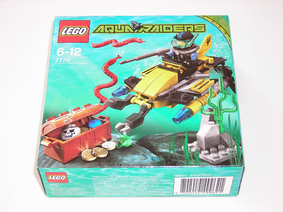
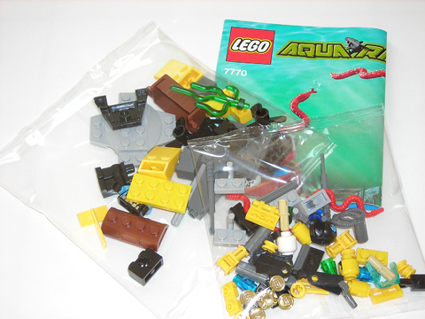
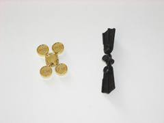
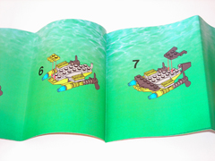
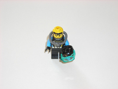
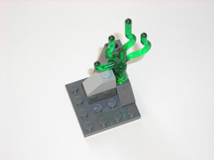
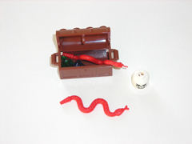
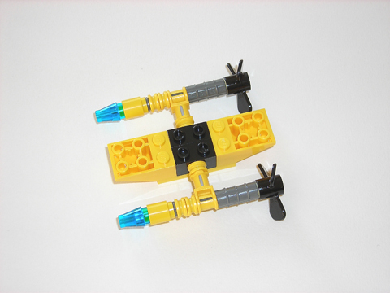
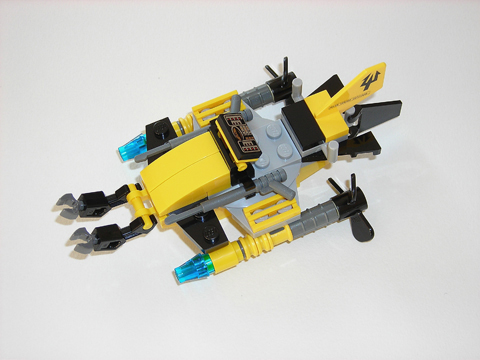
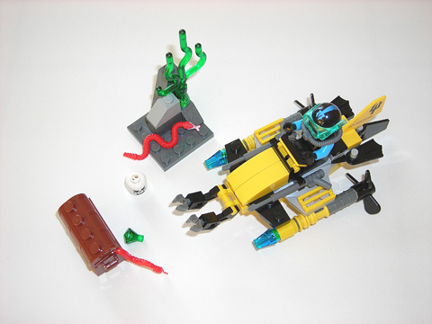

L’univers sous-marin est un thème récurrent chez LEGO depuis les années 90. En 2007 la firme danoise nous propose une nouvelle collection baptisée [AquaRaiders](http://shop.lego.com/ByTheme/Leaf.aspx?cn=468&d=70), dans la droite ligne des légendaires [Aquanauts](http://guide.lugnet.com/set/?qc=lego/system/aquazone/aquanauts) et autres [AquaZone](http://guide.lugnet.com/set/?qc=lego/system/aquazone). Jetons un oeil sur son entrée de gamme, le set 7770 - Le chasseur de trésor sous-marin.

Une fois n’est pas coutume, c’est un set à quelques euro que j’ai choisi de mettre à l’honneur. En espérant que certains d’entre vous, embourbés dans la surenchère de briques ou de mots seront sensibles à la magie de ces petites boîtes minimalistes qui firent mon bonheur d’enfant.

**–** Référence 7770 - Le chasseur de trésor sous-marin  
**–** Année 2007  
**–** 75 pièces - 1 minifig  
**–** 5,99 Euro (disponible sur le Shop@Home)

## Petit mais costaud !

**Présentation**

La boîte possède un très joli graphisme avec des couleurs lumineuses et attractives. J’aimerais retrouver ce genre de travail artistique dans la gamme City. Un voeu pieux...

**Le recto de la boîte**

La boîte contient deux sachets transparents et une notice.

**f(petite boîte) = peu de briques !**

Remarquez que les pièces d’or et les palmes sont en grappes, comme pour une maquette. C’est assez rare chez LEGO !

**Des grappes de pièces, c’est rare**

La notice est claire et précise. Elle comporte 19 étapes au total.

**Un montage simplifié à l’extrême**

**Montage**

La minifig plongeur, avec bouteille d’air et casque.

**La minifig plongeur**

Un petit rocher avec une algue fait office de décor sous-marin.

**Un décor symbolique**

Un coffre vient s’ajouter au rocher pour étendre les possibilités de jeu. On peut le remplir de pièces d’or et de pierres précieuses. Mais il faudra se méfier des serpents venimeux ! Ouaip ! Un trésor, ça se mérite...

**Un coffre bourré de richesses et de dangers !**

Le montage du scooter sous-marin est rapide et sans piège.

**Le scooter sous-marin en cours de montage**

Le scooter est simple mais très bien conçu. Il dispose de multiples fonctions. Les hélices tournent et le gouvernail est mobile. A l’avant, les bras munis de pinces peuvent saisir des objets.

Deux fusils à harpon sont accrochés de part et d’autre du châssis.

Par la suite, les palmes du plongeur prendront place à l’arrière. Il faut obligatoirement les enlever pour asseoir le plongeur aux commandes l’engin.

**Le scooter sous-marin dans toute sa splendeur !**

L’ensemble est magnifique. Même si la boîte contient peu de briques, l’essentiel est là pour de longues heures de jeu, comme sur la banquette arrière de la voiture de mon papa sur la route des vacances...

**Un petit set particulièrement réussi !**

A vous de jouer à présent !
