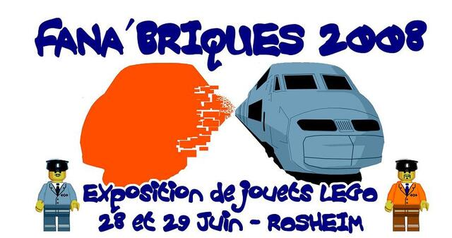

Jamais 2 sans 3...

[Fana’briques](http://fanabriques.freelug.org/) Numéro 3 aura lieu à Rosheim les 28 et 29 juin 2008.

Pour marquer ce troisième anniversaire et pour accueillir des exposants toujours plus nombreux, nous changeons de salle. Nous passerons ainsi de 700 m2 d’expo à 1.400 m2 consacrés uniquement à nos briques préférées. Nous souhaitons atteindre les 3000 visiteurs.

Après la Belgique et l’Allemagne en 2006 et 2007, des exposants de Suisse et d’Italie devraient nous rejoindre en 2008 afin de renforcer encore l’idée de « point médian » que pourrait être Rosheim auprès des AFOLs Européens.

Se faire plaisir et partager notre passion, voici une nouvelle fois l’esprit que nous souhaitons donner à Fana’briques 2008.

Se faire plaisir en venant exposer ses créations ou sa collection mais aussi en participant aux « festivités » dont voici le menu :  
**–** Tentative de Record du Monde de Vitesse du Train Grande Vitesse (T.G.V) LEGO ;  
**–** Très grand Réseau de Train LEGO piloté en DCC ;  
**–** Les jeux Olympiques Minifig et Maxifig ;  
**–** GBB ou GBC taille XXL (parions sur 100 modules) ;  
**–** Concours Création Enfants.

Des lots de valeur (la plupart sous forme de Boites LEGO) seront distribués aux gagnants des différents concours :  
Concours TGV (un prix pour chaque catégorie et un prix pour le plus beau train), Concours enfants (trois prix), concours Maxifig (trois prix) et deux gagnants tirés au sort parmi les exposants (1er lot valeur 80 euros, 2ème Lot, Valeur 40 euros).

Une surface de vente proposera des produits LEGO neufs et occasions. Les exposants pourront profiter de cet espace pour y déposer leurs articles à vendre qui seront vendus par l’équipe de l’espace vente.

Modalités espace vente :

**Espace vente**

La REF (Rencontre Estivale de FreeLUG) se déroulera peut-être lors de Fana’briques. La décision de FreeLUG sera prise fin février. Un article spécifique REF/Fana’briques sera alors créé pour vous informer. Concernant Fana’briques, seul le programme sera alors sensiblement modifié.

Le programme du week-end :

**Le programme**

## La fiche d’inscription :

Vous pouvez consulter les modalités d’accueil sur la fiche d’inscription à retourner par e-mail obligatoirement avant le 15 Mai :

**Bulletin d’inscription (pdf)**

**Bulletin d’inscription (doc)**

## TGV : le record du monde

Denis, Xavier et Loys proposent cet énorme pari : battre le record du monde du TGV établi en 2007 à 575 km/h. Tout ceci remis à l’échelle LEGO.  
La logistique est assurée par BAB (BriqueABrac) et permettra de présenter une ligne droite 9v aller-retour de 35 mètres !  
Vous pouvez participer à une ou plusieurs catégories :

1.  Catégorie « Record Officiel » :  
    MOC reconnaissable de T.G.V. ou modèle LEGO 4511 et 7745 en version 2 motrices et 3 voitures.
2.  Catégorie « Pour Voir » :  
    Les T.G.V non acceptés par la commission ainsi que tous trains officiels ou MOC.
3.  Catégorie « Décoration de la ligne » :  
    Pour habiller la ligne TGV, sur un module de 2x3 plaques (32x32), vous plantez un décor (maison, forêt, terrain de foot, chantier .....) issu de votre imagination.

Le plus rapide de chaque catégorie (Record officiel et Pour voir) se verra remettre un prix. Le public décernera un prix au plus beau module (décoration de la ligne). La commission technique remettra le prix du plus beau train.

_Voir le règlement complet "Record TGV" :_

**Modalités TGV**

## TGR : Le Très Grand Réseau

Philippe « Frogleap » vous propose de réaliser un Lay-out LEGO piloté en DCC.

L’idée : Chaque participant (aucune connaissance DCC n’est nécessaire) amène trains, décors (ville, maisons, forêts, etc.) afin de monter le TGR. A la manière [d’Orléans](http://photos.freelug.org/main.php/v/Frogleap/ExpositionsLego/2008-AMFC-Orleans/), Philippe centralise les inscriptions et se charge de réaliser le projet de lay-out. Inscriptions auprès de Philippe avant le 15 avril : frogleap chez wanadoo.fr (remplacer chez par @)

## Les Jeux Olympiques

A la veille de Pekin 2008, imaginons des Jeux Olympiques LEGO à Rosheim.

Nous allons réaliser les célèbres anneaux Olympiques en LEGO bien entendu, les écoles de Rosheim préparerons un Lay-Out Jeux Olympiques Minifigs.

Nous vous proposons de réaliser une ou plusieurs Maxifigs Olympiques sur la base du set [3723](http://www.brickset.com/detail.aspx?Set=3723-1) . Marathonien, lutteur, Gymnaste ou autre - A vos marques, prêt... Les maxifigs seront placées sur un lay-out spécial « Jeux Olympiques ».

Un Jury composé d’AFOLs remettra trois prix aux plus belles Maxifigs.

## GBB ou GBC

Sur le principe suivant, [Le Grand Bidule à Balles](/articles/362/), créez vos Modules et amenez-les !  
Nous parions sur une connexion de plus de 100 modules pour cette édition 2008 !!  
C’est un spectacle fascinant !

## Le concours des Enfants

Créativité au programme. Chaque enfant (- 16 ans) qui souhaite participer au concours, réalisera chez lui et avec ses briques, une création « LEGO » . Dimanche matin, les enfants déposent leurs créations avant 11H30. Un Jury composé d’AFOLs notera les créations et remettra trois prix.

**N’hésitez pas à nous rejoindre, nous ferons un maximum pour vous accueillir du mieux possible ! Nous y mettrons toute notre energie.**

Un grand merci à [Seb](http://www.mocpages.com/home.php/7650) pour l’affiche.

Thierry ( th.meyer@wanadoo.fr )

## Documents joints

-   **[Bulletin](https://www.freelug.org/IMG/pdf/Bulletin_d_inscription.pdf "Télécharger PDF - 30 kio")**
    
    15 janvier 2008 \- PDF - 30 kio
