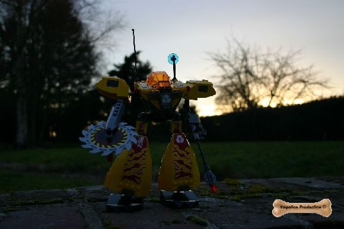
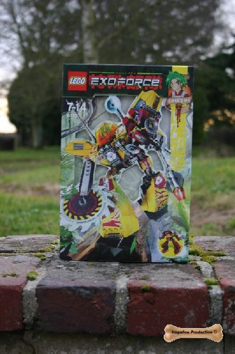
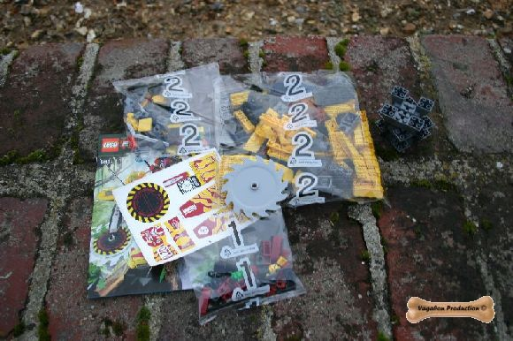
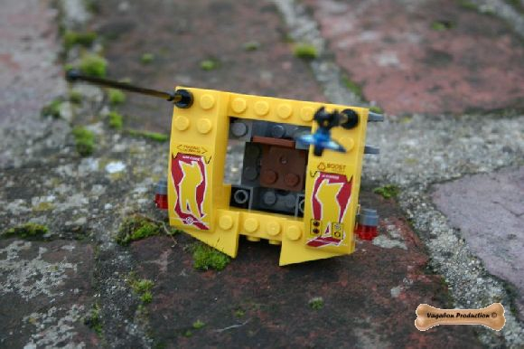
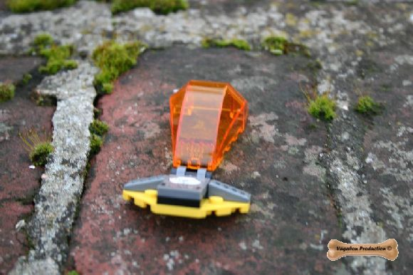
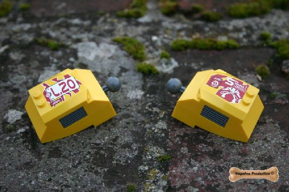
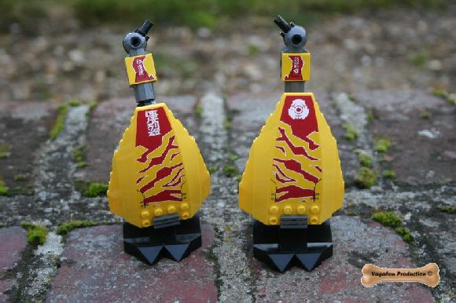
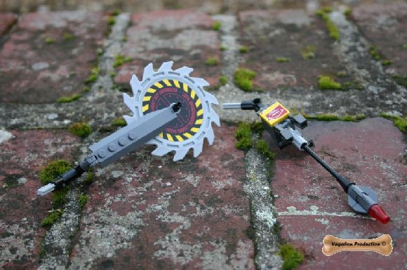
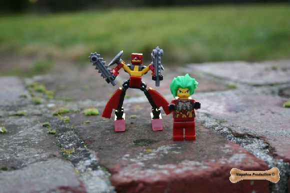
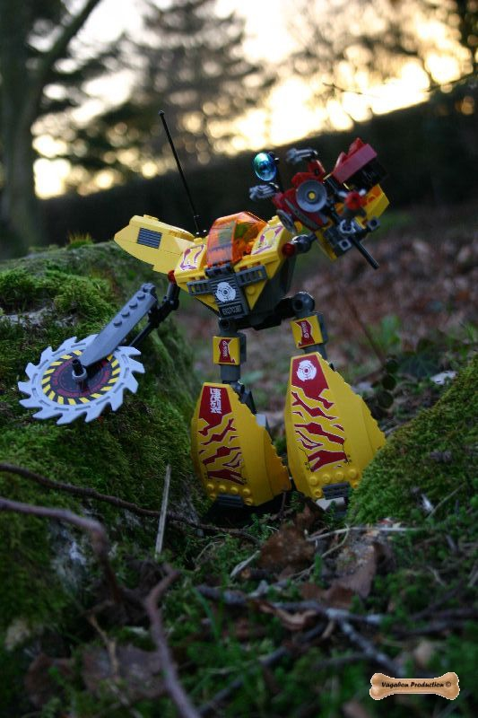

Après avoir vaillamment défendu les ponts de la montagne Sentai, Hikaru, Takeshi, Ha-Ya-To et Ryo sont partis à la recherche de la cité d’or à proximité du sommet de la montagne. Lors de l’attaque finale des robots sur la cité d’or, Keiken fut capturé et emmené dans la jungle.

Aussi nos amis décident d’utiliser leurs nouvelles machines de guerre pour lui porter secours.

Sans plus attendre, découvrons la machine de Takeshi : Le tigre d’assaut.

Tout d’abord, la boite.

Cette dernière diffère des précédentes par la présence d’une fenêtre offrant un effet de relief intéressante.

A l’intérieur, nous trouvons la notice, la planche d’autocollants, 3 sachets et quelques pièces en vrac.

La construction est typique de la gamme EXO-Force, chaque partie du modèle est construite séparément puis assemblée.

Le poste de commande

A noter la présence d’un siège, une première dans les machines EXO-Force.

Le cockpit

Les bras

Les jambes

L’armement du Tigre

Une scie circulaire pour se frayer un chemin dans la jungle et un canon qui se transforme en mini-robot.  
Ce mini robot est une nouveauté de la gamme. Chaque nouvel engin Humain ou Robot possède son mini robot de combat.

Takeshi et son mini robot

Une fois assemblé, direction la jungle pour sauver Keiken

## Conclusion

En propulsant le thème EXO-Force au coeur de la jungle, la gamme s’enrichit de modèles très colorés et impressionnants de jouabilité.

Bref, si comme moi vous êtes fan de cette gamme, les modèles 2008 vous combleront.

Les autres se consoleront grâce aux nouvelles pièces introduites dans ces sets.
