[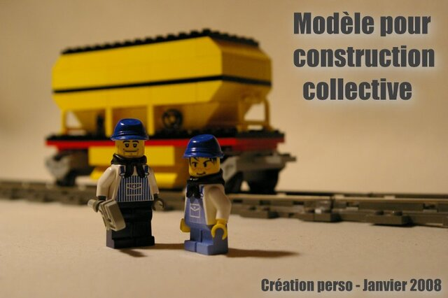](https://www.freelug.org/IMG/jpg/lego-tombereau-00.jpg)

Janvier 2008, l’association RITTE RITTE ROSS à Rosheim (67) organise deux samedi après-midi de "trains LEGO" avec la participation des membres alsaciens de FreeLUG. Après avoir assisté à la première séance, j’ai eu envie de participer de manière un peu plus active, en créant un modèle qui pourra être réalisé par chaque enfant.

[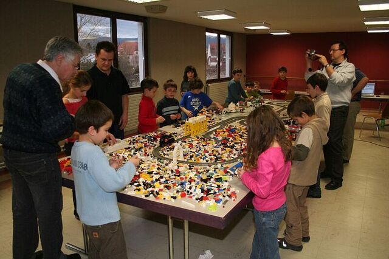](https://www.freelug.org/IMG/jpg/lego-tombereau-12.jpg)

C’est en cherchant un moyen de les motiver pour une "construction collective" que l’idée est apparue. Il s’agit de proposer à chaque enfant de construire un wagon dont l’ensemble constituera un train très long. Chacun (ils sont une quinzaine) disposera, le temps d’une après midi, d’un sachet contenant les pièces et du plan de montage. Par soucis de simplicité, il s’agira d’un modèle "générique", décliné en différentes couleurs pour que chaque enfant reconnaisse "son wagon".

Le cahier des charges est plus compliqué qu’il n’en a l’air...  
**–** Il y a entre 15 et 20 enfants, donc il faut trouver les pièces pour faire au moins 15 wagons.  
**–** Le wagon sera "monotype" pour éviter de créer de nombreuses notices.  
**–** Pour varier un peu et pour faire joli, les couleurs seront différentes, mais la notice "monochrome" devra permettre le montage du modèle en reconnaissant les pièces uniquement par la forme.  
**–** Le modèle doit être assez réaliste, mais fait avec des pièces "basiques" pour simplifier le montage.  
**–** L’ensemble doit pouvoir rouler sans incidents.

Le modèle choisi est un wagon de marchandise , dit "wagon-trémie" inspiré du modèle 4536 et du modèle 10017 de LEGO.

[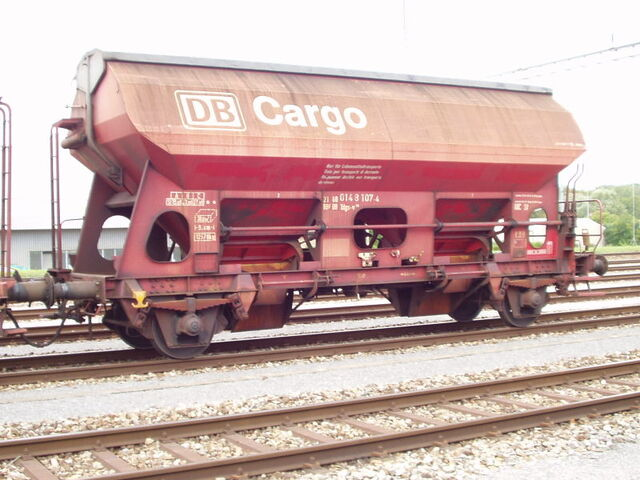](https://www.freelug.org/IMG/jpg/lego-tombereau-06.jpg)

Voici le style recherché par le modèle...

## Première étape , conception et test à la maison

Le plan ci dessous a été la première mouture.Ce modèle convenait bien, à la maison, car l’écartement des essieux étaient faibles, donc frottement réduit dans les virages, et la loco avec deux moteur pouvait tirer les 17 wagons sans gros problèmes. Les crochets "Technic" remplacent les aimants qui ne supportent pas la traction générée par de très longs trains.

Plan téléchargeable en haute définition sur mon site [http://lego.nico.free.fr](http://lego.nico.free.fr/))

[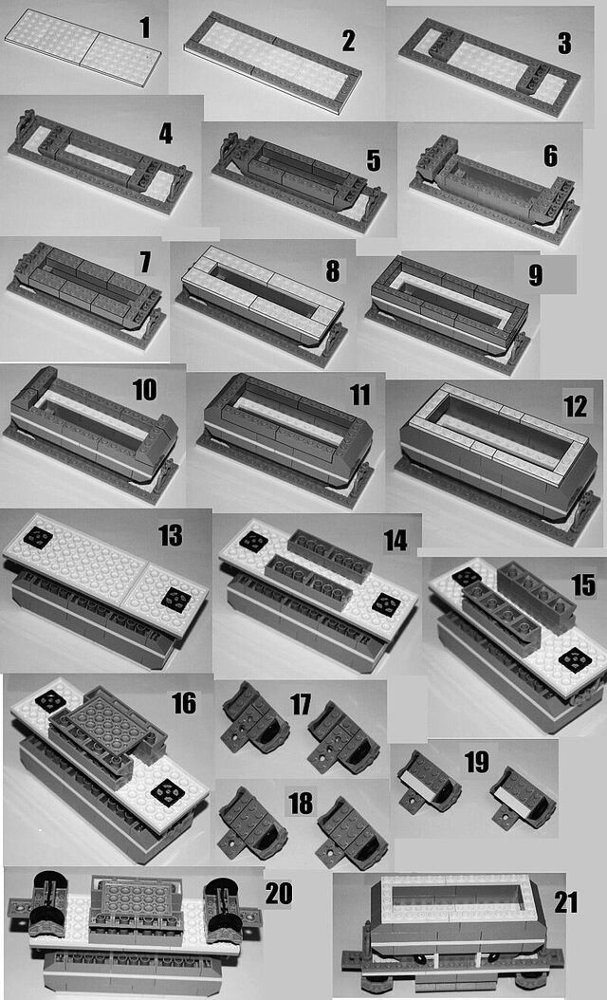](https://www.freelug.org/IMG/jpg/plan-tombereau-red.jpg)

Après m’avoir aidé à chercher les lots de pièces dans les vracs, le fiston a fait le "beta-testeur" en effectuant le montage des wagons. Le concept a ensuite été validé "in situ" pour vérifier que ma brave locomotive de FRET SNCF arrive à traîner un tel chargement. Cela nécessite deux moteurs, mais ça fonctionne.

[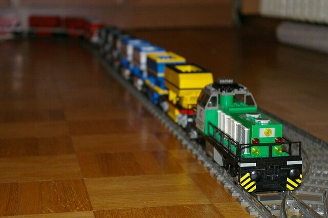](https://www.freelug.org/IMG/jpg/lego-tombereau-01.jpg)

Pour que les essieux mobiles restent alignés, ils sont solidarisés avec le wagon voisin, ce qui donne un système proche des bogies mixtes du TGV. Les aimants ne permettent pas de tirer une telle charge. Celui qui est le plus sollicité (juste derrière la locomotive) lâche sans arrêt, et puis, de toute façon, je n’en ai pas assez.

[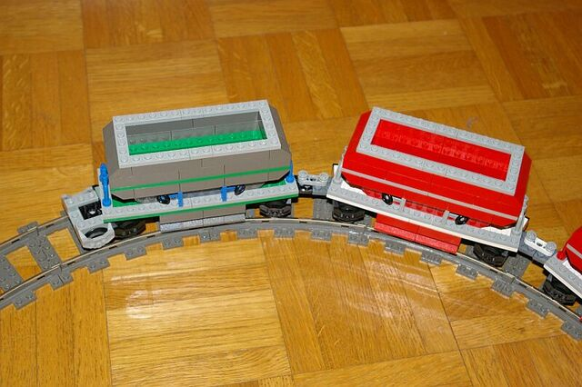](https://www.freelug.org/IMG/jpg/lego-tombereau-04.jpg)

Il faut tricher un peu aux extrémités du convoi, mais on pourrait très bien imaginer des wagons "4 essieux" en tête et en queue de train.

[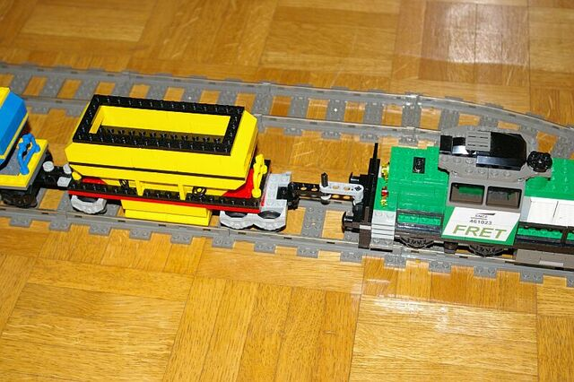](https://www.freelug.org/IMG/jpg/lego-tombereau-03.jpg)

Ca roule pas très vite, mais justement, ça a l’avantage d’être réaliste et de demander un pilotage "coulé".

[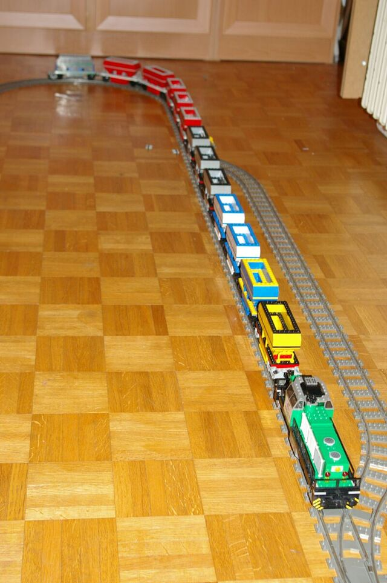](https://www.freelug.org/IMG/jpg/lego-tombereau-05.jpg)

## Deuxième étape : réflexion sur la jouabilité

En regardant le fiston jouer avec le train, un constat s’impose. Le train est beau et réaliste, mais la jouabilité est franchement mise de coté avec ce système d’essieux libres et des crochets rigides. C’est dommage parce qu’il facilitait réellement le roulage. Je revois donc ma copie pour laisser le wagon avec deux classiques essieux fixes. Tant pis pour le train d’une seule pièce, on fera des trains de 5 ou 6 wagons, et avec des aimants ou des crochets. J’imagine que ce serait trop frustrant pour les gamins de construire un wagon qui ne peut même pas rouler seul, du fait des essieux libres.

Le plan est donc revu pour proposer celui qui suit... (téléchargeable en haute définition sur mon site [http://lego.nico.free.fr](http://lego.nico.free.fr/))

[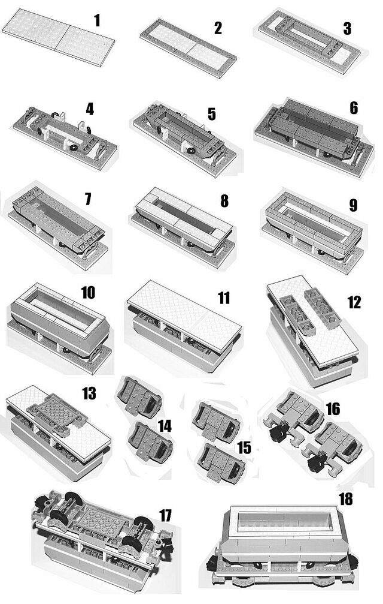](https://www.freelug.org/IMG/jpg/plan-tombereau2red.jpg)

## Troisième étape : le verdict des enfants

J’étais très curieux de voir la réaction des enfants, le samedi 26 janvier 2008 lors de la deuxième animation "Train LEGO" avec l’association "RITTE RITTE ROSS".  
D’un commun accord avec les autres animateurs de FreeLUG, on a gardé la construction des wagons pour la deuxième moitié de l’après midi, car c’est la période où il y a un relâchement de l’intérêt des enfants après 1H30 d’activité. Donc, après le goûter de 4 heures, on lance un appel à ceux qui veulent construire des wagons, et je suis surpris de voir que peu d’enfants réagissent immédiatement. En fait c’est le fait de voir les premiers wagons en construction qui a fait boule de neige et a finalement incité l’ensemble des participants de s’y mettre (il y avait 15 participants et 17 wagons, donc assez pour tout le monde).

C’était amusant de voir que d’un seul coup, l’ambiance est devenue très studieuse

[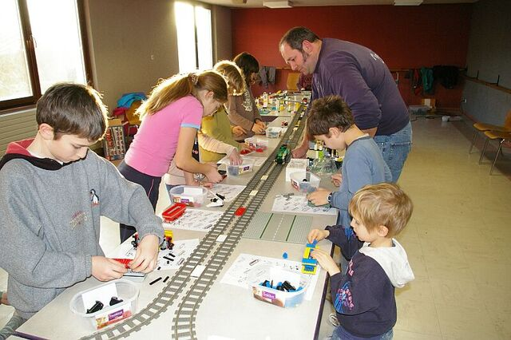](https://www.freelug.org/IMG/jpg/lego-tombereau-10.jpg)

Le manque de place sur les tables incite certains constructeurs à s’isoler.

[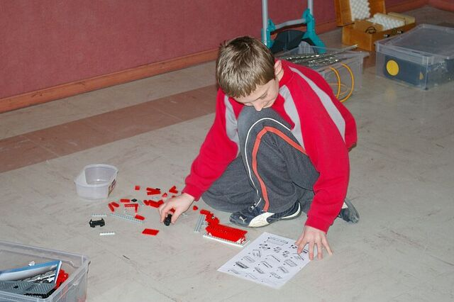](https://www.freelug.org/IMG/jpg/lego-tombereau-11.jpg)

Le train qui fait des aller-retours sur toute la longueur de la table semble inviter les wagons à venir s’accrocher (chose devenue facile avec les aimants). Les premiers wagons viennent s’ajouter au fur et à mesure de leur achèvement.

[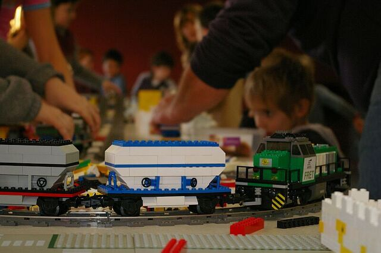](https://www.freelug.org/IMG/jpg/lego-tombereau-09.jpg)

Le circuit fait volontairement de grandes lignes droites et ne pénalise pas trop les wagons à essieux fixes.

[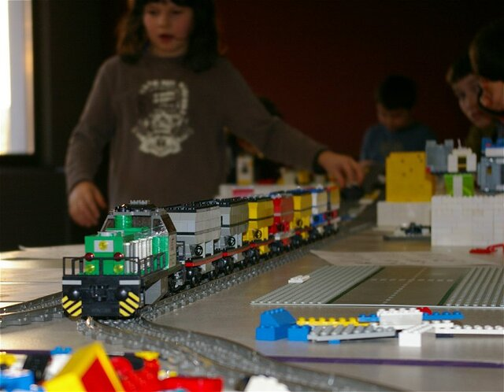](https://www.freelug.org/IMG/jpg/lego-tombereau-07.jpg)

Les aimants admettent une charge de traction de 7 à 10 wagons maximum. Les autres wagons tournent sur les autres circuits.

[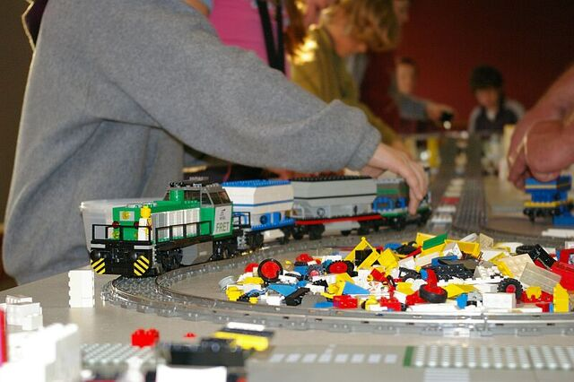](https://www.freelug.org/IMG/jpg/lego-tombereau-08.jpg)

## Conclusion

Voila , j’espère que ça donnera des idées à ceux qui animent des lay-outs montés par des enfants.

En fin d’après midi, Thierry m’a rendu attentif sur le fait que les enfants étaient manifestement fiers de ce qu’ils avaient construit "ensemble". C’est sans doute le point essentiel, justement, de réussir à donner à ce genre de rencontre un sens collectif, une émulation qu’il est difficile d’atteindre si on laisse les enfants livrés à leur imagination individuelle.

J’ai pris beaucoup de plaisir dans ce projet. Avec un peu de méthode, cela ne donne pas trop de travail. Il m’a fallu une soirée pour valider le modèle. Une soirée pour trier et rassembler les lots, et une soirée pour faire le plan et cette page. C’est bien plus interessant que de regarder la télé...

Ce genre d’expérience peut donner lieu à toutes sortes de suites. On pourrait imaginer de préparer le lay-out avec "track-designer" et de laisser le soin aux enfants de le monter. Ils sont très demandeurs en matière de conseils et d’idées, surtout pour le début du montage. Ensuite, leur imagination fait le reste.

Il n’y a pas de dates prévue pour renouveler cette expérience, mais il y a fort à parier que les enfant vont en redemander vu l’enthousiasme qu’ils ont manifesté.

A suivre.

**NICO**
