## Marc (Samrotule)

Ca faisait longtemps qu’on avait plus exposé à Seltz (4 ans).  
La salle des fêtes ayant été rénovée entretemps, c’est avec joie que nous découvrîmes le nouveau bâtiment.

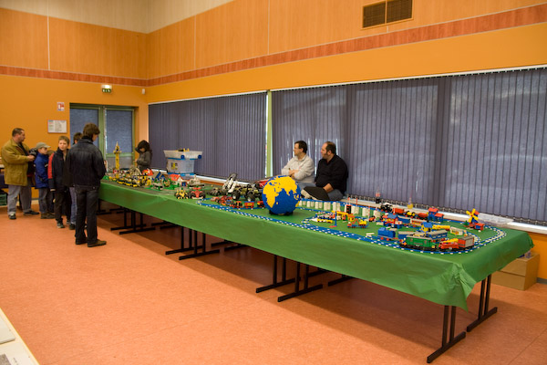

**IM\_06791.jpg**

Lors du montage de notre stand, nous avons apprécié les nappes vert/bleu. C’était du plus bel effet pour le stand.

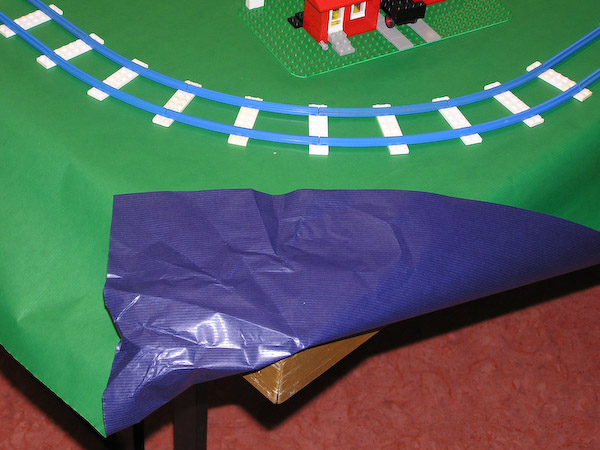

En construisant la ville, une maison (celle de mon fils Alexandre), trop près du bord, a fait le grand saut. Aïe !  
Ne sachant la reconstruire, j’ai décidé d’en faire un "tas", style maison après une explosion de...  
Cette création hors du commun, interpela souvent le public.

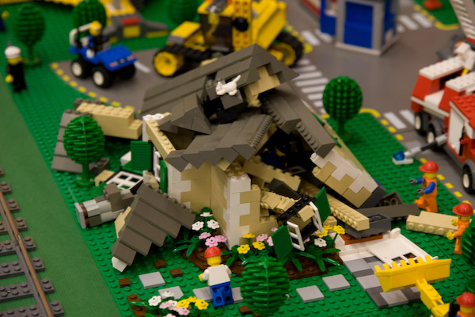

J’ai passé mon samedi après-midi à construire le [Bulldozer 8275](/articles/639/). Dimanche, il était prêt pour des démonstrations dans la salle. Le public fut ravi, sauf un petit chien que j’ai effrayé avec mon Bull. Le chien n’a pas apprécié du tout.

## Marc Klein

C’est avec plaisir que j’ai rejoint Marc et Thierry pour une exposition à Seltz, au nord de l’Alsace. J’ai apporté, comme à mon habitude quelques modèles Technic placés entre la ville de Marc et les modèles des années 1970 de Thierry.

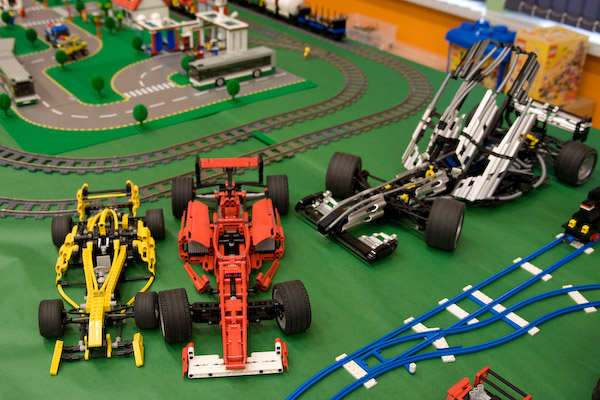

Quelques voitures de formule 1 à différentes échelles.

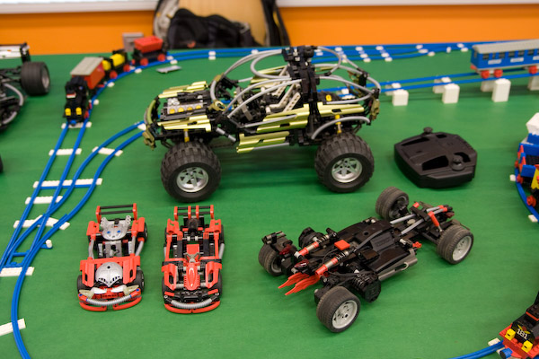

Le dimanche, en fin d’après-midi, l’exposant voisin de notre stand a commencé à gonfler la montgolfière. Mais la hauteur sous plafond n’était pas assez grande pour lui permettre de prendre toute son ampleur. C’était quand même assez impressionnant.

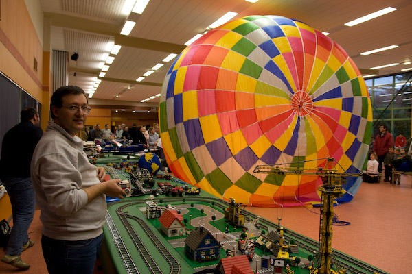

## Thierry

Un samedi et un dimanche autour du LEGO.

Avant d’animer [l’atelier RRR](https://www.freelug.org/spip.php?article715), je me suis rendu à Seltz pour construire un petit layout fait de sets des années 70 et exposer l’imposant globe construit par Nico67.  
Marc S. était déjà à pied d’œuvre. Marc K, imprévisible, comme à son habitude, nous rejoignait pour exposer des modèles Technic. Philippe Chatin était là aussi, sans LEGO mais avec une superbe collection de voitures de rallyes modèles réduits et de photos de rallyes prises par lui.

Je n’ai pas idée du nombre de visiteurs, mais le dimanche après-midi le flux était constant. C’est le côté sympa de l’expo, discuter avec le public (dont Nico57) fit partie.  
Merci à Marc S. (son layout est toujours un plaisir à voir, les minifigs nous parlent ! - Elles racontent des histoires) pour avoir géré mes absences.

Petite critique à l’organisateur (ça n’engage que moi et peut-être suis-je le seul concerné) : Aucun accueil, et ni boisson ni repas offert. Dur Dur.

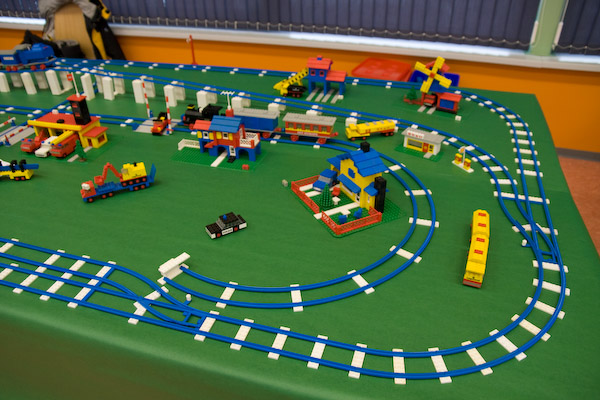

LEGO des années 70

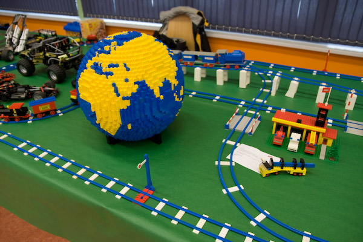

Le globe de Nico

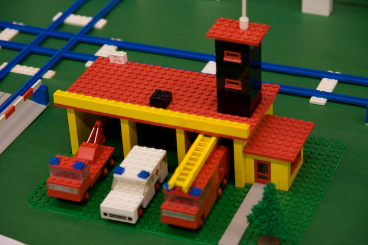

[Caserne de pompier 347](http://guide.lugnet.com/set/347_1)

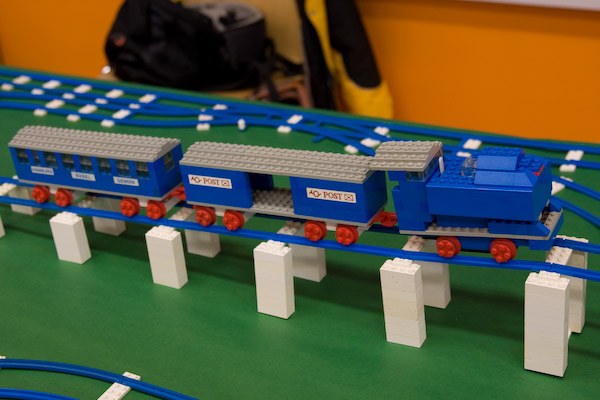

[Train 113](http://guide.lugnet.com/set/113_2)

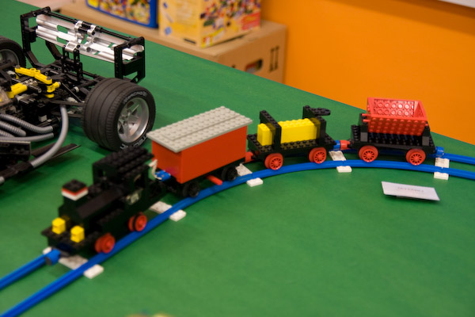

[Train 171](http://guide.lugnet.com/set/171)

## Les scènettes de Marc

Comme à son habitude, Marc illustre ses layouts de petites scènettes.

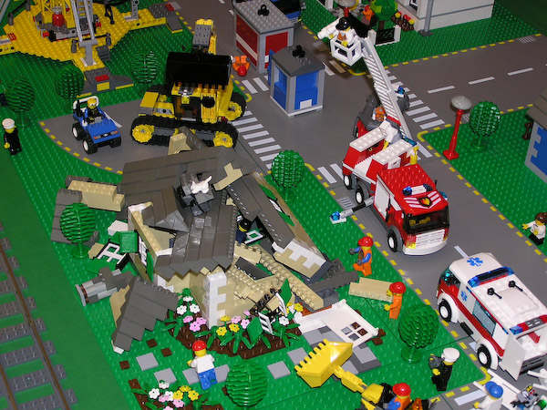

Le gros moyens de déblaiement et les secours sont déjà sur place autour de la maison détruite par l’explosion.

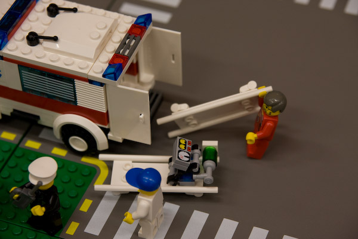

L’ambulance pour les blessés.

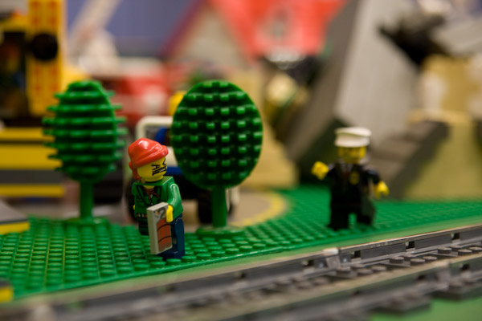

Pendant que la police poursuit un suspect

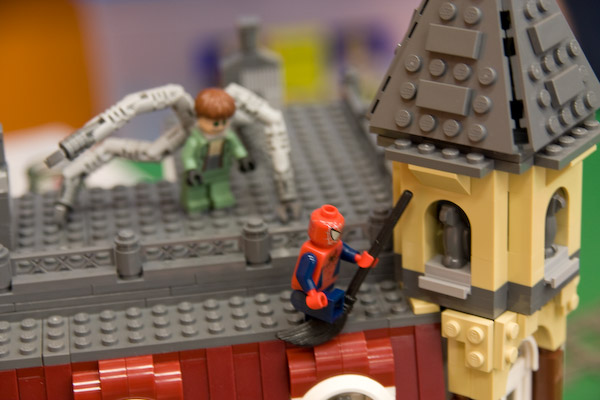

Spiderman se prépare avec le balai de Harry Potter.

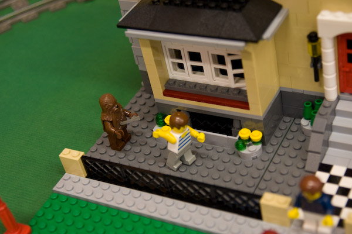

Et Chewbacca est devenu fou...

## D’autres photos

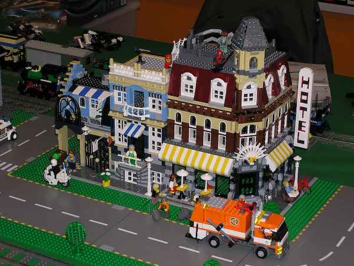

.

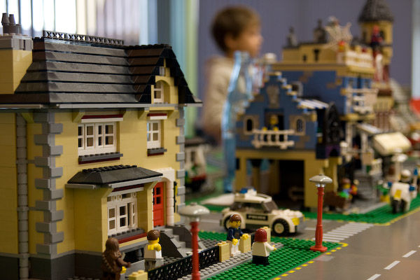

[Les photos de Marc Klein](http://marc.klein.free.fr/seltz2008/)
