Dans la suite des nouveautés 2008, qui promet des merveilles par ailleurs, LEGO nous propose une nouvelle maison dans la gamme CREATOR. Cette fois ci, c’est une maison d’été que l’on peut construire.

La collection CREATOR s’enrichit d’une quatrième maison.  
Après la 4886, maison très simple, on a eu droit à la 4956, maison mieux finie et avec un garage, puis récemment à la 4954, une grande maison avec garage séparé.  
Ces maisons, à l’échelle minifig, permettent de compléter sa ville au milieu des casernes de police et de pompier.

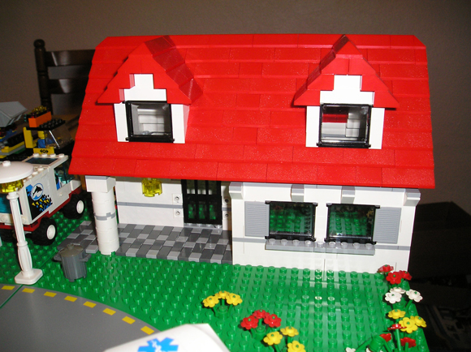

**boite 4886**

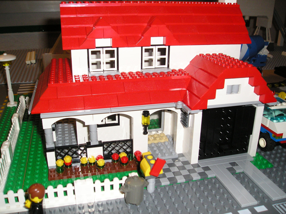

**boite 4956**

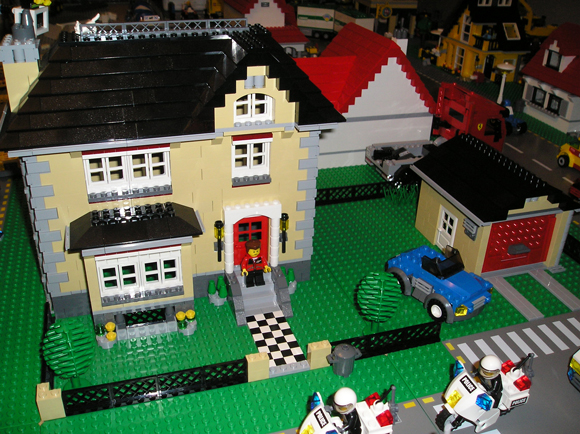

**boite 4954**

LEGO nous propose donc pour cette nouvelle collection une petite maison d’été.  
Je dis "petite" puisque qu’elle ne prend pas beaucoup de place, et elle n’a pas de garage.

## Descriptif de la boite

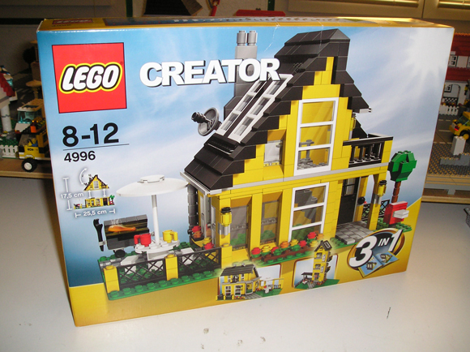

**la boite**

**–** Nom de la boite : la maison d’été  
**–** Numéro de la boite : 4996  
**–** Nombre de pièces : 522  
**–** Date de commercialisation : janvier 2008

On la trouve sur le [shop](http://shop.lego.com/ByTheme/Product.aspx?p=4996&cn=348) pour 29,99€ et dans le commerce.

Derrière la boite on retrouve les différentes possibilités de montage offertes par les notices.  
Le modèle principal, un petit bar que je décris brièvement plus bas, et un petit immeuble.

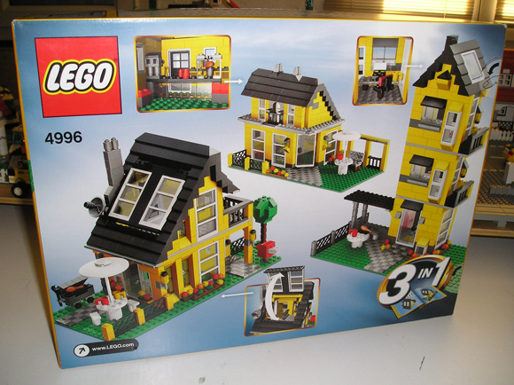

**la boite de derrière**

## Montage

On retrouve 8 sachets à l’ouverture de la boîte, avec une plaque verte 16x32, ainsi que deux plates 2x16 jaunes.

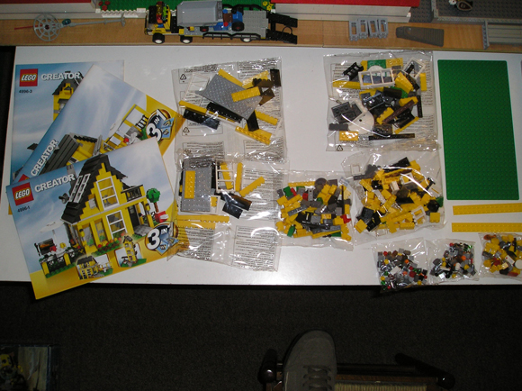

**la contenu**

Après ouverture des sachets, on trouve quelques nouvelles pièces.

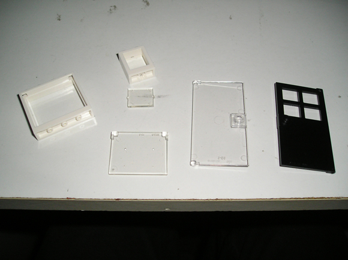

**nouvelles pièces**

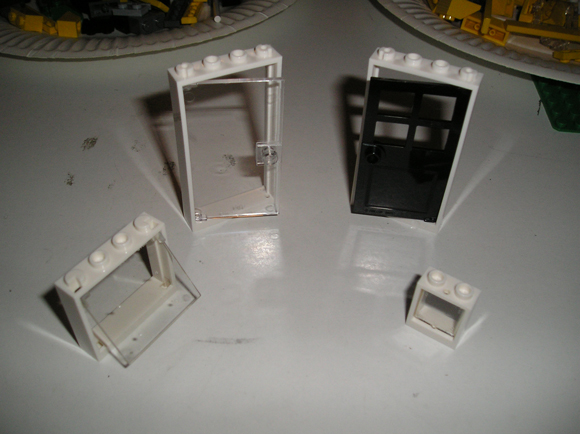

**nouvelles pièces 2**

On a déjà aperçu la petite vitre dans l’avion postal. Maintenant il y a le cadre qui va avec.

La nouvelle fenêtre, avec ouverture vers le bas, est sympa.  
La porte noire est une reprise de [l’ancienne](http://www.peeron.com/inv/parts/3861?img=9668).  
La porte entièrement vitrée est nouvelle elle aussi.

Après les nouvelles idées qui fourmillent dans la tête par la découverte de ces nouvelles pièces, on démarre donc la construction de cette maison d’été.

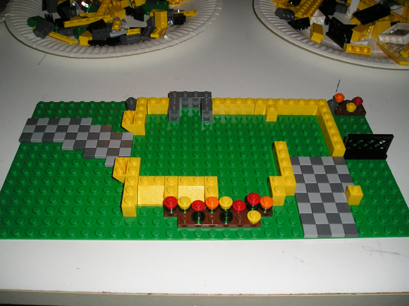

**étape 11**

La construction se fait sans difficulté.  
Les murs sont montés rangée par rangée.

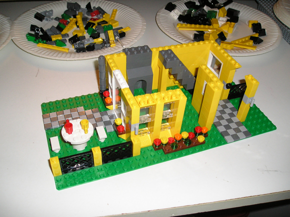

**étape 26**

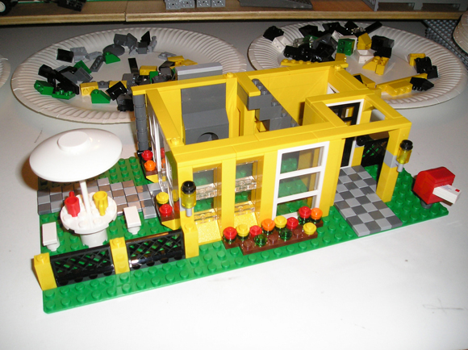

**étape 31**

Le rez-de-chaussée achevé, on s’attaque au toit.

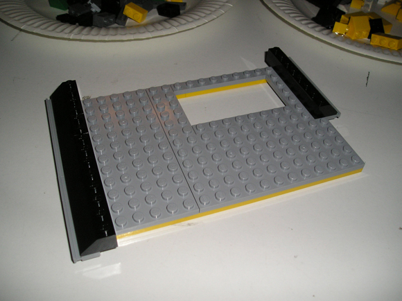

**étape 9**

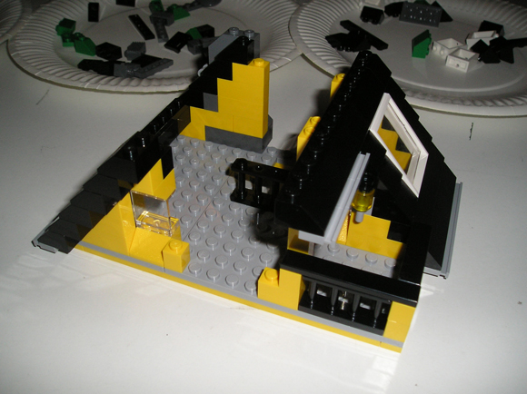

**étape 23**

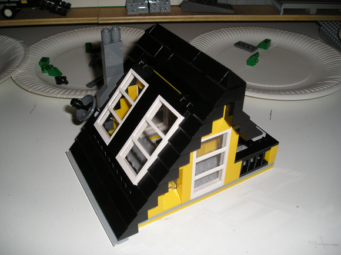

**étape 36**

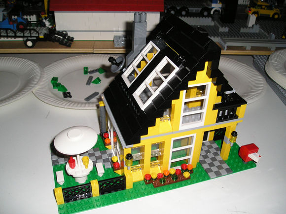

**assemblage final**

Magnifique petite maison d’été.  
A noter la présence d’un barbecue... et oui en été c’est la saison des barbecues.

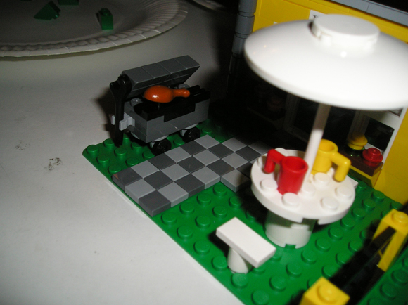

**barbecue**

Le toit peut s’enlever comme lors des boîtes précédentes.  
Mais ici, l’intérieur du toit est aménagé. On peut y accéder par un côté du toit, par la fenêtre.

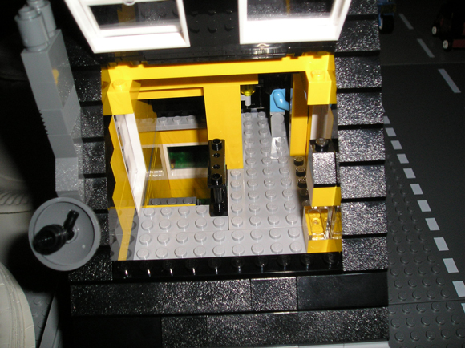

**ouverture dans le toit**

Et voilà la maison dans la ville LEGO.

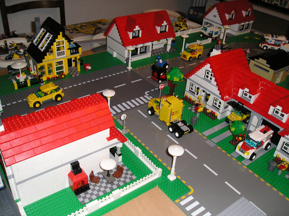

**les maisons**

Il suffit maintenant de quelques maisons pour se croire dans un lotissement.

## Modèle alternatif

Dans les deux autres possibilités de montages proposées, il y a un petit bar. C’est celui-ci que j’ai choisi de construire.  
Ci-dessous un bref aperçu du montage.

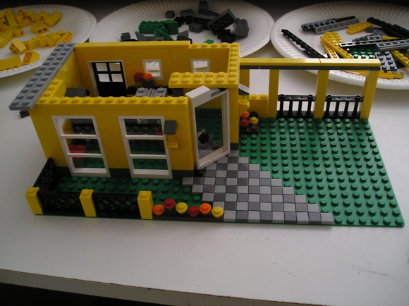

**en cours de construction**

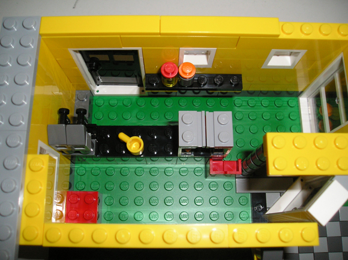

**l’intérieur**

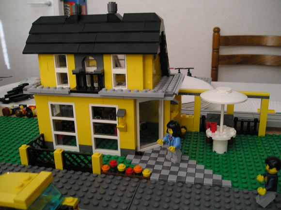

**modèle alternatif fini**

L’idée est bien bonne d’avoir fait un petit bar pour compléter sa ville. Il faut l’avouer que dès qu’il y a deux clients, le bar est plein, mais l’idée est là. Ca fait plaisir de voir de nouvelles choses en LEGO.  
Et puis le bâtiment peut très bien servir de maison.

## Conclusion

Magnifique nouvelle boîte LEGO.

A noter la présence d’une boîte aux lettres ainsi que d’une enveloppe, ce qui montre bien l’intérêt de LEGO pour la nouvelle collection postale.

J’adore le barbecue, bien fait et donne plein d’idées à faire dans ses villes.

Il y a quelques petits accessoires comme deux verres, une cuisse de poulet... et puis avec le barbecue et la parabole, on peut les réutiliser dans d’autres situations.

Bref, une boîte bien réalisée, agréable à construire, de nouvelles pièces, de nouvelles idées, enfin bon tout ce qu’on demande !
