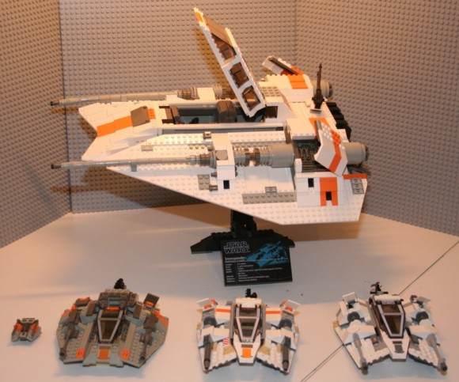
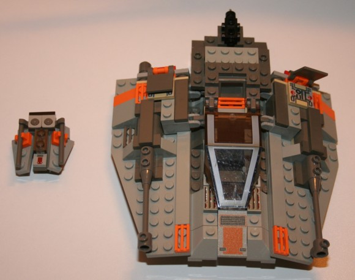
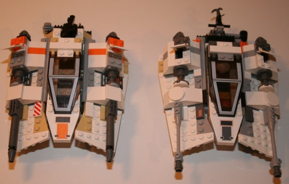
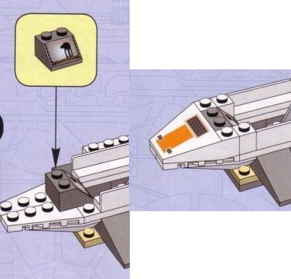
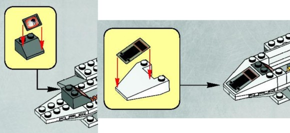
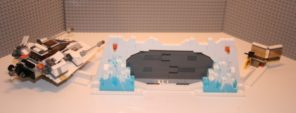
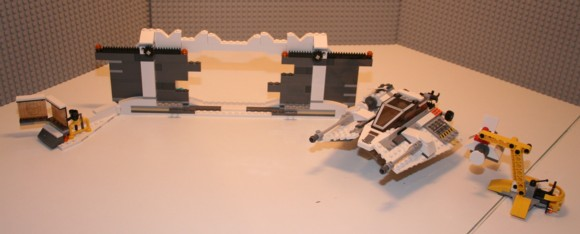
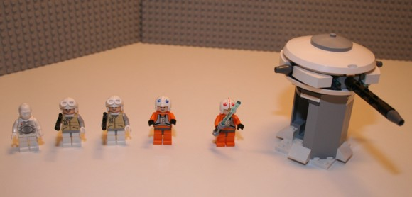
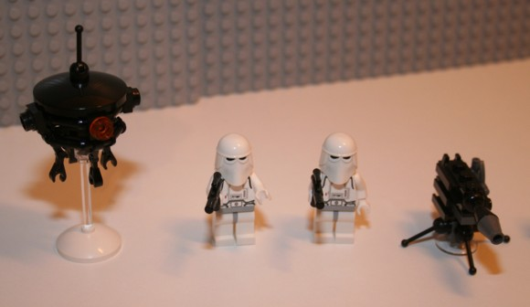
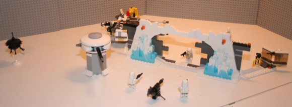

Le second semestre de l’année 2007 aura été celui des rééditions des engins de guerre Star Wars avec un nouvel AT-AT, un nouvel Infiltrateur Sith, un nouveau chasseur de Naboo, un nouveau Faucon Millenium, un nouveau transport de troupes militaires. La base rebelle de Hoth est l’une des rares nouvelles boîtes Star Wars présentant une scène vraiment jouable avec un grand nombre d’éléments et contient une réédition du snowspeeder faisant de ce vaisseau le recordman des versions officielles.

## Le snowspeeder version 5

En fait il s’agit de la troisième version « jouet » du snowspeeder après celui des références 7130 et 4500 ; les deux autres versions correspondent au mini vaisseau de la référence 4486 et au magnifique collector référence 10129.  
La photo de famille donne une idée des proportions des uns et des autres.

**Photo de famille : au fond la version collector et de gauche à droite à l’avant le mini, la réf. 7130, la réf. 4500 et la réf. 7666**

**Les snowspeeders gris : on notera que l’avant est droit et que les canons ne dépassent pas des ailes.**

**Les snowspeeders blancs : celui de gauche (réf. 4500) est le plus similaire au collector mais les canons sont trop gros alors que pour celui de droite (réf. 7666) les canons sont mal alignés avec leur prolongement.**

L’examen de cette version montre qu’il s’agit d’une sorte de croisement entre les deux précédentes versions : la couleur et la construction générale sont similaires à celles de la référence 4500 mais les canons à l’avant sont ceux de la référence 7130 (le vaisseau est en gris). Bizarrement, les canons ne sont pas correctement alignés avec leur partie arrière ce qui les rend assez inesthétiques. Si on peut considérer que ce nouveau snowspeeder est presqu’un frère jumeau de la précédente version, il marque cependant une régression importante pour ce qui est du remplacement des briques sérigaphiées par des briques simples sur lesquelles on colle des autocollants.

**L’écran de contrôle et le nez faits de pièces sérigraphiées de la référence 4500**

**L’écran de contrôle et le nez faits d’autocollants de la référence 7666.**

C’est d’autant plus incompréhensible que les briques avec autocollant (celle du cockpit et celle du nez du vaisseau) reprennent exactement le même dessin que celles sérigraphiées (les concepteurs de LEGO perdraient-ils la mémoire ?). Personnellement, j’ai toujours eu horreur des autocollants puisque leur tenue dans le temps est loin d’être leur point fort. C’est pourquoi, je considère que leur usage sur ce vaisseau est une véritable régression.

## La base rebelle de Hoth

Le second élément d’importance de la boîte est la base rebelle qui se limite ici à la porte d’accès et deux extensions (une pour un petit poste de contrôle et une pour un coin réparation du snowspeeder). Il est assez difficile de se faire une véritable opinion sur la taille de cet ensemble à partir de l’image sur la boite et j’avais peur d’être déçu. En fait, c’est même l’inverse puisque l’ensemble est bien proportionné et il est aisé de faire passer le snowspeeder par la porte. Evidemment, les esprits chagrins regretteront de ne pas pouvoir sortir par cette porte avec le X-Wing et le Faucon Millenium (mais rien n’empêche d’agrandir la porte en largeur et en hauteur).

**La porte vue de l’avant avec les deux extensions : à gauche le stand de réparation du snowspeeder et à droite le petit centre de contrôle.**

**La porte ouverte vue de l’arrière : on notera le mécanisme à créneaux et roues dentées permettant d’actionner les deux volets de la porte ainsi que la grue de réparation du snowspeeder.**

## Les autres éléments et les minifigurines

Au snowspeeder et à la base viennent s’ajouter une tourelle de défense très réaliste (avec un système simple et ingénieux permettant de lui faire tirer des rayons laser qui sont en réalité les barres transparentes des sabres laser) et une sonde espion impériale. Ces deux éléments complètent joliment la scène et augmentent la jouabilité de l’ensemble. Pour finir, cette boîte est fournie avec 7 minifigurines dont Luke et Dake qui pilotent le snowspeeder, un droïde de protocole K3-PO (version blanche de C3-PO) exclusif, deux rebelles en tenue de combat et deux snowtroopers armés.

Bien que le nombre de minifigurines reste toujours insuffisant pour créer une impression de bataille, il faut souligner l’effort de LEGO qui fourni de plus en plus de minifigurines dans ses récentes boîtes.

**Les cinq minifigurines rebelles (de gauche à droite : K3-PO, deux rebelles, Dack et Luke) et le canon de défense.**

**La sonde impériale, les deux snowtroopers et un canon léger de l’empire.**

## Conclusion

Voilà une boîte originale, dans le monde Star Wars dominé par les vaisseaux et engins de combat, et complète permettant à un enfant de rejouer la mythique bataille de Hoth. Mis à part le prix (60 euros pour 520 pièces), le seul point négatif est le snowspeeder avec ces autocollants et une ressemblance un peu trop marquée avec le précédent (mais si vous n’avez pas la référence 4500, vous serez ravi d’avoir ce modèle). Mon fils a passé une soirée à monter et à jouer avec ce montage et je suis certain qu’il y jouera encore en complètant la scène avec un X-wing, un Faucon Millenium, un AT-AT...

**La bataille : la base rebelle de Hoth est sur le point d’être prise par les troupes impériales.**
