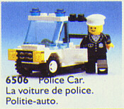
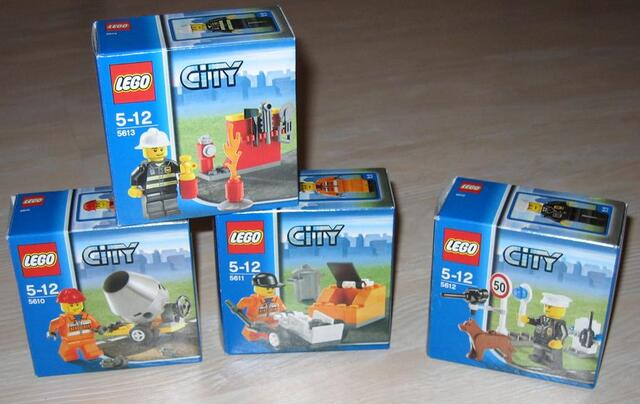
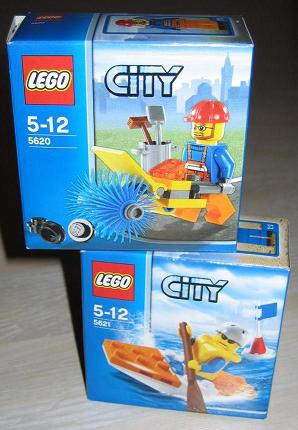
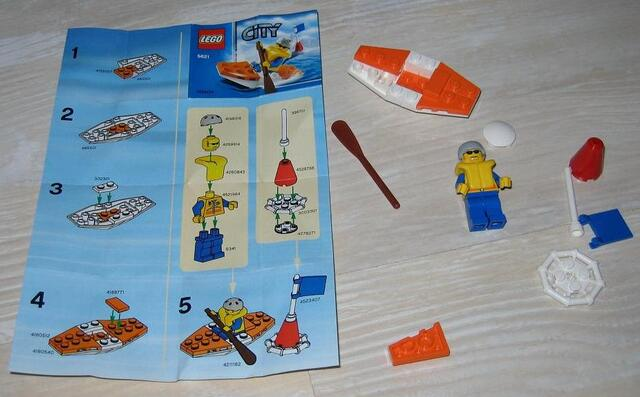
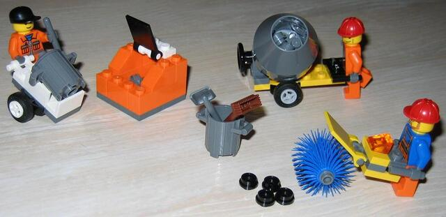
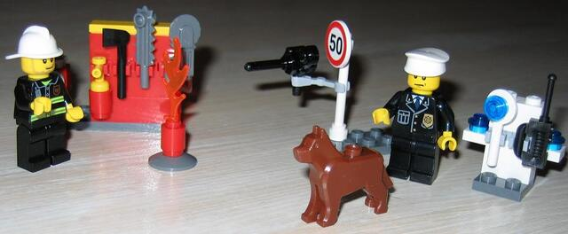
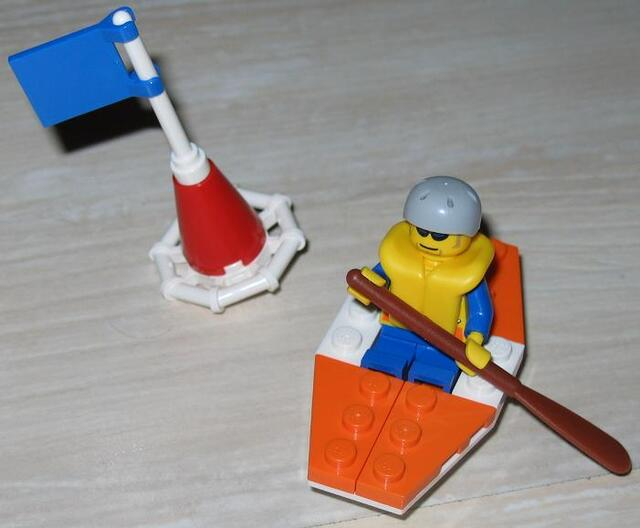
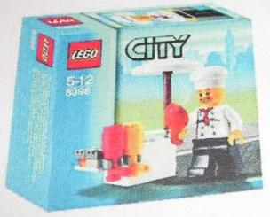

Cette année 2008 voit l’arrivée de nouveaux "tout petits" sets : les sets LEGO Impulse.

Ils comportent une minifig pourvue de ses accessoires. D’une vingtaine de pièces, on les trouve en général autour de 3€.

Leur rapport nombre de pièces / prix n’en font pas des boîtes bon-marché. Mais ce sont avant tout des boîtes à destination des plus jeunes. Ces boîtes me font d’ailleurs retomber en enfance, à mes débuts avec nos chères briques LEGO. A cette époque les gammes LEGO étaient beaucoup plus fournies en petites boîtes, qu’étant enfant je recevais de temps à autre sans raison particulière.

Ma première boîte LEGO System est d’ailleurs la 6506 qui pourrait rentrer dans cette catégorie "Impulse".

**le 6506 - mes débuts avec les LEGO System**

Dans ce premier article je vais vous présenter les six boîtes City Impulse qui sont sorties en 2008.

Quatre sont sorties dès le début de l’année :

**Impulse City de Janvier 2008**

et deux sont venues compléter la gamme cet été :

**Impulse City de Juin 2008**

Ces sets sont très faciles à monter ce qui en fait un beau petit cadeau pour un enfant très jeune.

**Seulement 5 étapes de montage pour des heures de jeu !**

On peut constater que cette année la part belle est faite aux constructeurs avec trois sets "chantier", complétés classiquement par un pompier, prêt à intervenir pour éteindre les incendies, et un policier qui surveille la circulation et garde à l’œil les chauffards.

**Avec les hommes en orange Legoville sera toujours propre**

**Legoville est sous haute surveillance...**

Finalement la boîte la plus originale pour cette année est la dernière : un canoë et son sauveteur en mer.

**La mer est calme aujourd’hui...**

Les grands déçus de ces boîtes 2008 se satisferont peut-être en 2009. Il semblerait en effet que LEGO sorte un peu plus des classiques... A suivre !

**A suivre pour 2009**

Attention cette boîte n’est peut-être pas un design définitif

Pierre - Tribolego
