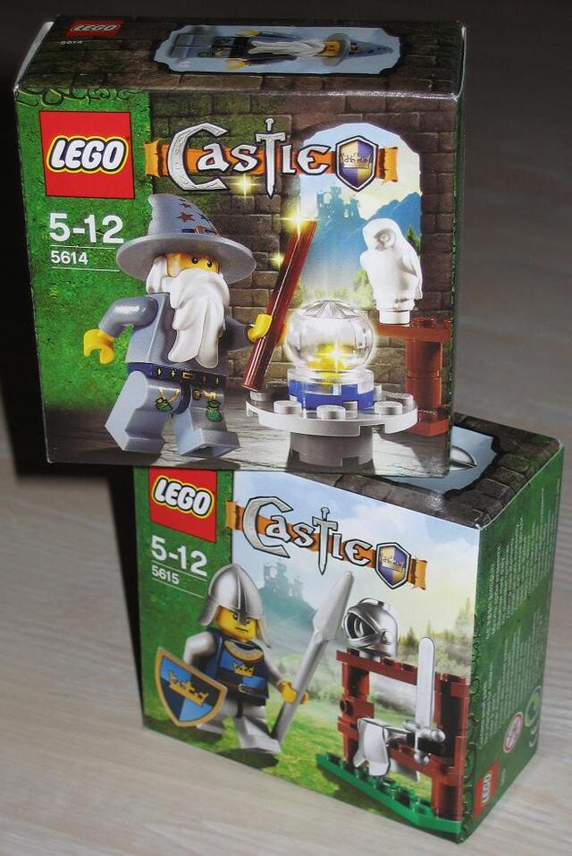
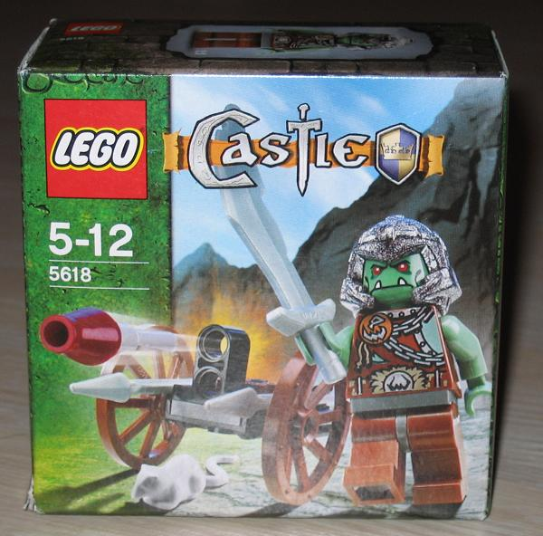
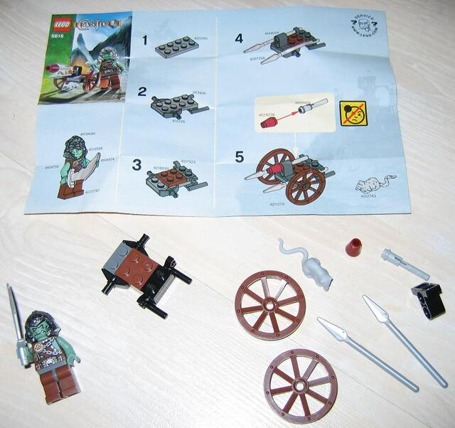
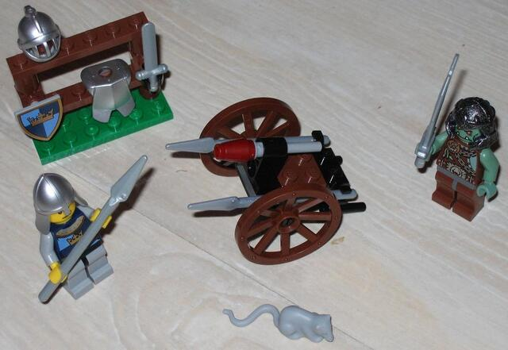
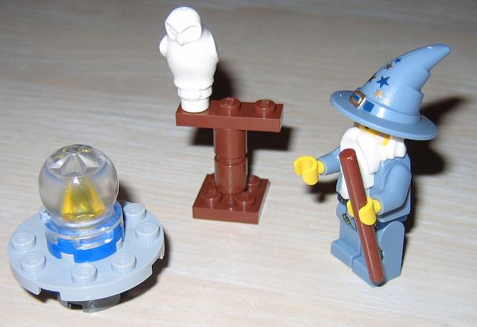
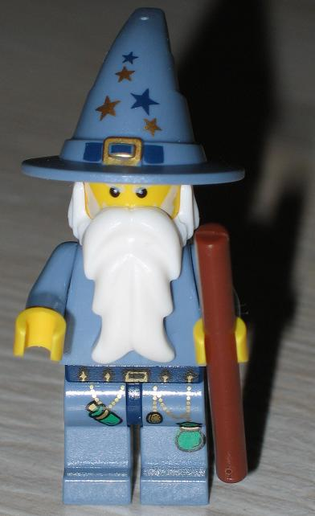
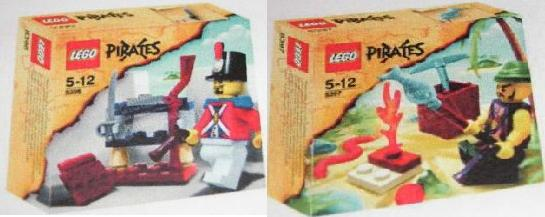

Dans mon [premier article sur les sets impulse, je vous parlais de ceux de la gamme City](/articles/722/). Cette deuxième partie est consacrée aux sets Impulse de la gamme Castle.

Comme pour la gamme City, les plus jeunes fans de Castle n’ont pas été oubliés par LEGO avec cette nouvelle gamme de petits sets.

Deux sont sortis dès le début de l’année :

**Impulse Castle de Janvier 2008**

Complétés par une nouvelle boîte cette été :

**Impulse Castle de Juin 2008**

Les montages de ces sets sont simples et comportent de nombreux accessoires : armes, casques et autres animaux...

**Un montage simple pour des heures de jeu**

Les sets 5615 et 5618 ne raviront pas les plus vieux mais sont parfaits pour les plus jeunes d’entre nous.

**Des sets simples parfait pour les plus jeunes**

Mais pour nous les plus vieux le trésor de cette gamme réside en la boîte 5614 :

**Le plus original de cette gamme**

Cette boite contient en effet une minifig exclusive de la gamme Castle : le magicien gris !

**Abracadabra !!**

Pour ce qui est de l’avenir des sets Impulse Castle rien n’a encore filtré de la future gamme LEGO 2009.  
Il est par contre intéressant de noter la présence de sets Impulse parmi les futurs nouveaux sets Pirates 2009.

**A suivre pour 2009**

Attention ces boîtes ne sont peut-être pas des designs définitifs

Voila j’espère que comme moi vous avez pu apprécier pleinement ces petites boîtes qui raviront sans doute les plus petits pour des heures de jeu !

**Tribolego**
