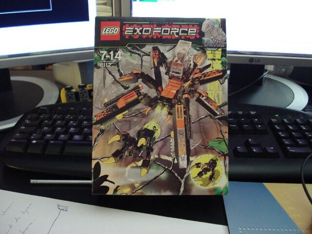
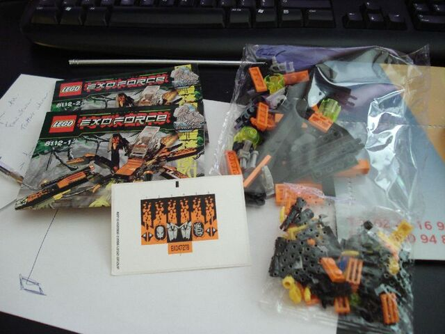
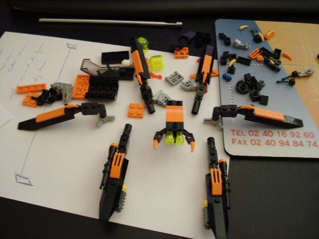
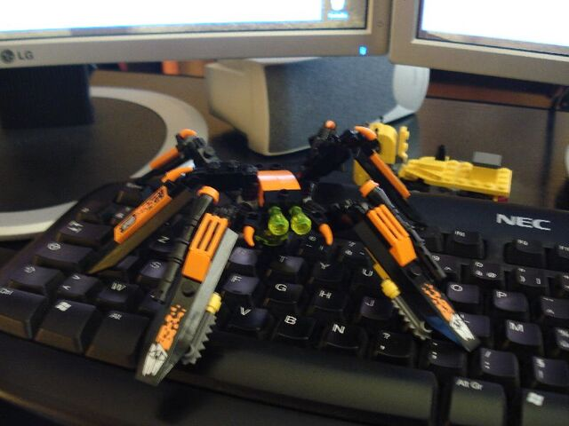
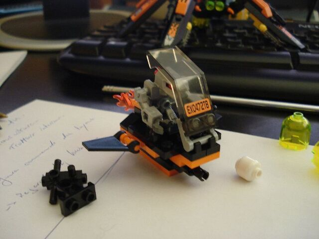
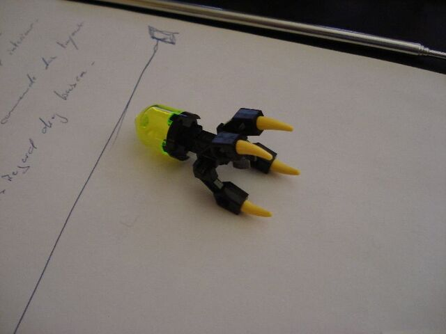
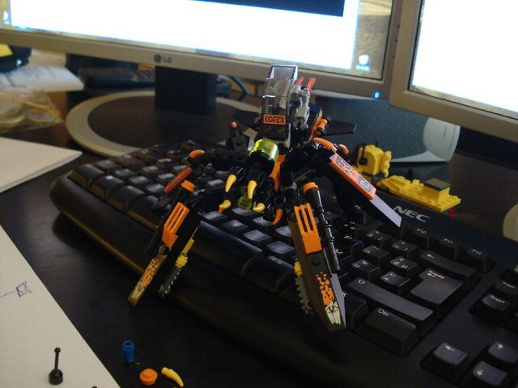

8h00 - Une bonne journée de boulot commence, en route pour deux chantiers.

11h00 - Retour vers l’agence, mais avant un petit détour par le TRU local :)

Les sets Exoforce 8112 et 8118 en mains, je reprends la direction du bureau.

_15h00_ Que faire pour se détendre entre deux projets ?

Prendre un café avec les collègues, discuter avec les secrétaires, il y a tant de choses à faire.

Pour ma part, ce sera le montage du 8112 :)

**La boite**

Voyons le contenu : 2 Sachets de pièces, 2 notices laissant supposées un montage en modules et une planche d’autocollants.

**Contenu**

Après un montage rapide des éléments de la première notice, passons à l’assemblage.

**Phase 1**

Et voilà, première partie finie,

**Assemblage**

Attaquons de suite la seconde, le poste de pilotage de Devastator qui se transforme en véhicule de combat aérien

**mini**

c’est maintenant au tour du mini robot, nouveauté de la gamme 2008, chaque véhicule humain ou robot en est doté.

**Robot**

l’assemblage final, nous donne une superbe araignée robot dotés de crochets capables de transpercer une armure.

Capable de se faufiler dans les moindres recoins de la jungle du mont Sentaï afin de surprendre les combattants Exoforce.

**Final**

Conclusion, me voilà détendu et prêt à rependre mes différents projets la tête remplie de combats au coeur de la jungle entre [le Tigre d’assaut](/articles/707/) et l’Arachnide Combattant.
