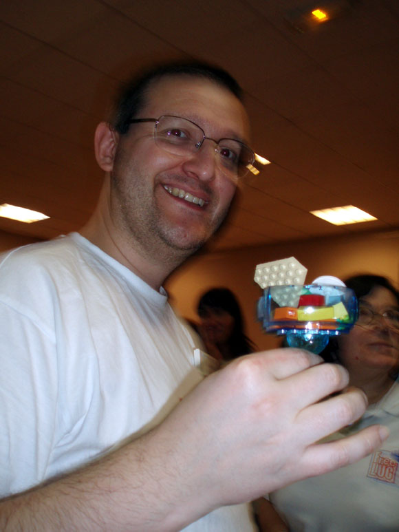
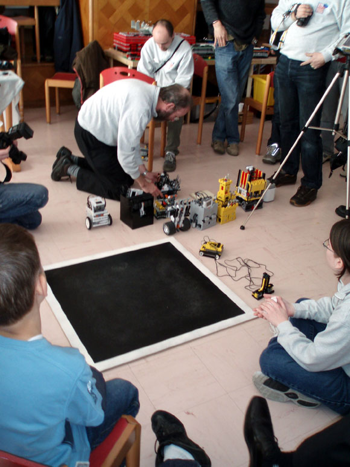
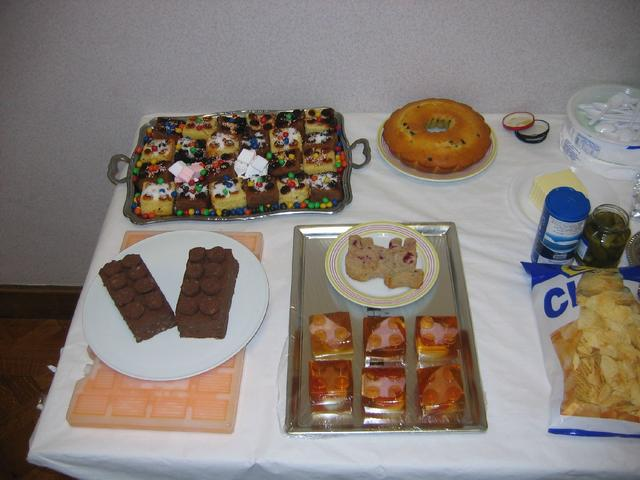
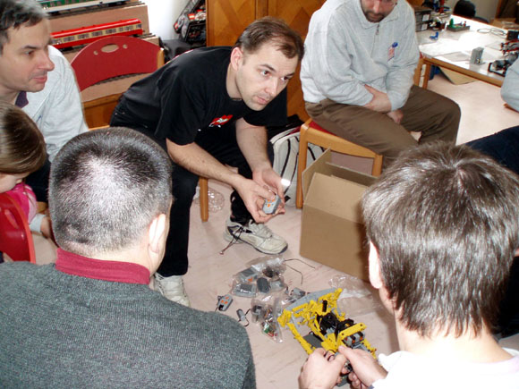
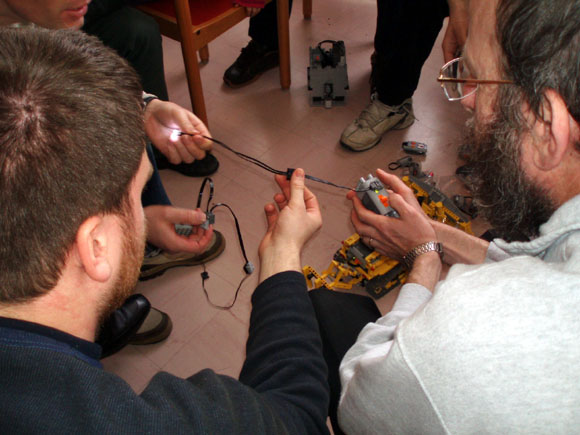
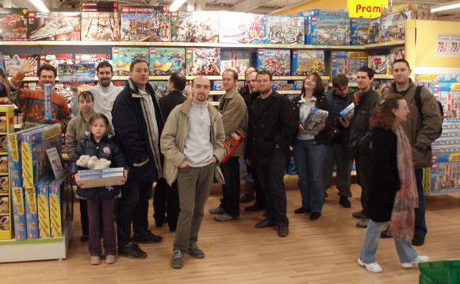
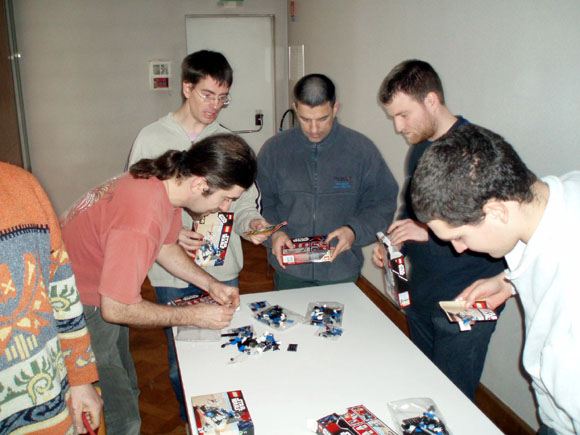
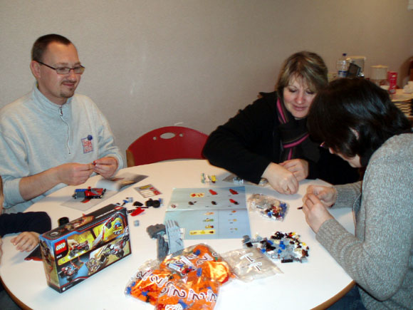
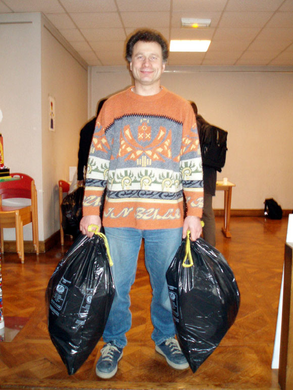
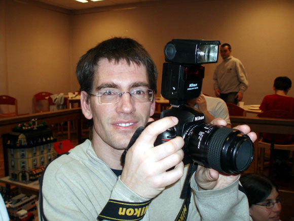

Comme tous les ans en cette période, l’Assemblée Générale FreeLUG est l’occasion pour ses membres de se retrouver le temps d’un week-end.

Et comme chaque année, c’est avec plaisir que nous nous rencontrons (à nouveau), découvrons de nombreuses créations et partageons de bons moments.

## Concours de MOC

Cette année, un concours de MOC (création personnelle) a été lancé, avec pour seule contrainte de ne pas dépasser 50 pièces. L’objectif était de permettre à tous les adhérents de proposer une création qui ne soit pas cachée derrière des créations monumentales. Et pourtant, un certain nombre ont trouvé la contrainte trop forte !

Le concours était divisé en deux catégories, adultes et enfants. Les huit enfants participants ont pu repartir avec un lot.

Côté adulte, le jury a du départager les 30 participants. La moto de Pierre a remporté le concours.

## Concours de Sumo

Une autre activité du week-end qui s’est déroulée autour du déjeuner du dimanche fut le concours sumo. Depuis 2003, nous n’avions pas organisé de concours de sumo. L’arrivée du NXT et du nouveau système Power Functions ont relancé l’activité, et cette année il y a eu six participants en catégories sumo autonome (avec 8 sumos) et huit participants en catégorie sumo téléguidé.

**Catégorie sumo autonome**

Gilles remporte [le bulldozer 8275](/articles/639/) et Philo [le camion nacelle Power Functions 8292](/articles/725/)

**Catégorie sumo téléguidé**

Pascal remporte le camion nacelle Power Functions et Marc un ensemble d’éléments Power Functions.

[Les vidéos des combats](http://gallery.freelug.org/Sumos/)

## Concours de gâteaux

Les briques LEGO en plastique n’étaient pas les seules bienvenues : nous avions lancé également un petit concours original de gâteaux sucrés ou salés en forme de briques.

Les yeux et papilles se sont régalés !

## Présentation Power Functions

Dimanche après-midi, Philo et Didier E ont fait un petit atelier présentation du système Power Functions et présentaient notamment les nouvelles lumières. Le thème des trains Power Functions a également été abordé, et quelques réponses ont été apportées sur les "linear actuator", ces nouveaux éléments Technic à venir au second semestre 2008.

## Virée au PicWic

Comme chaque année, le dimanche matin est l’occasion de se rendre en groupe au Pic-Wic de Sainte-Geneviève, partenaire FreeLUG.

Encore une occasion pour nous de vider littéralement le rayon :)

## Draft

Le passage au Pic-Wic suscita l’envie d’organiser un draft. La boîte choisie fut le [battle pack StarWars 7667](http://guide.lugnet.com/set/7667)

## Autres activités

Bien sûr, à côté de tout cela, la rencontre de l’AG, c’est aussi de nombreuses discussions, des échanges de briques ou encore la construction de quelques boîtes fraîchement achetées.

Enfin, il ne faut non plus oublier qu’une telle rencontre, c’est un peu d’organisation, et que ça nécessite quelques tâches, notamment celle du nettoyage...

## Le mot de Phil-C

Après 2005 "pour voir" et rencontrer les membres de l’association, 2007 avec la délégation alsacienne pour se représenter et partager nos créations et idées, me revoici avec les membres alsaciens pour ma troisième AG Freelug.

Passés la déconvenue du confinement de la salle assez réduite et à peine assez grande pour nous accueillir tous, la bataille pour trouver un peu de place où poser ses constructions ("_c’est une AG pas une expo_", oui m’sieur le Président :o) ) et enfin les longueurs de l’AG (vraiment longue cette année) et son déballage organisé (très bien organisé au passage) de questions et autres détails, nous pouvions entrer dans le vif du sujet.

Et ce qu’il y a de bien à l’AG, c’est qu’il y en a pour tout le monde...

[Les petits](http://photos.freelug.org/main.php/v/legophil/AG2008/AG-2008_081.JPG.html), [les grands](http://photos.freelug.org/main.php/v/legophil/AG2008/AG-2008_086.JPG.html), [seul](http://photos.freelug.org/main.php/v/legophil/AG2008/AG-2008_060.JPG.html)  
(euh oui vraiment seul apparemment, mais fais pas cette tête Jean-Marc on est pas loin ! :o)) ), [à deux](http://photos.freelug.org/main.php/v/legophil/AG2008/AG-2008_082.JPG.html) [ou en groupe !](http://photos.freelug.org/main.php/v/legophil/AG2008/AG-2008_080.JPG.html)

En résumé, un bon moment qui passe très vite et laisse tout juste le temps de voir tout ce qu’il y a à voir, de discuter des différentes créations de chacun selon ses intérêts, d’assister aux différentes animations...

J’ai bien apprécié le concours de MOC pour encourager la créativité, j’ai même eu un prix !!

Chose appréciable encore, j’ai pu pour la première fois assister au concours de sumos, goinfrés non pas de riz mais d’électronique, et j’espère pouvoir participer au prochain dès [Fana’briques](http://fanabriques.freelug.org/), qui heureusement arrive déjà à grands pas pour continuer de passer de bons week-ends autour de la brique.

Merci à tous pour ce week-end et rendez-vous en juin pour Fana’briques !

## Galeries de photos

Galerie de photos :  
**–** [FreeLUG](http://photos.freelug.org/main.php/v/FreeLUG/Evennements/AG_2008/)  
**–** [Photos de LeGnome](http://www.brickshelf.com/cgi-bin/gallery.cgi?f=304020)  
**–** [Photos de Daniela et Sylvain](http://gallery2.freelug.org/main.php/v/Daniela+et+Sylv1/2008-AG/)  
**–** [Photos de Gilles](http://gallery2.freelug.org/main.php/v/gmifr/AG+2008/)  
**–** [Photos de Richard L.](http://photos.freelug.org/main.php/v/Charlie/AG2008/)  
**–** [Photos de Phil-C](http://photos.freelug.org/main.php/v/legophil/AG2008/)  
**–** [Photos de Sebastien](http://www.brickshelf.com/cgi-bin/gallery.cgi?f=305013)  
**–** [Photos de Pierrick](http://gallery2.freelug.org/main.php/v/-PZ/AG+2008/)
