L’année 2008 voit le retour sur les écrans des aventures du mythique Indiana Jones dans un 4ème et ultime (?!) volet. LEGO ne pouvait manquer ce rendez-vous. Au programme, de nombreux sets s’inspirant de scènes fortes du film à venir et des précédents. Ainsi ce set 7621 et la périlleuse escapade dans la fosse qui abrite l’arche perdue... euh trouvée pardon !

Résumé :

**–** Set 7621 - La fosse aux serpents ([Indiana Jones](http://shop.lego.com/ByTheme/Leaf.aspx?cn=519&d=70))  
**–** Nombre de pièces : 277  
**–** Année de commercialisation : 2008  
**–** Prix moyen constaté : 25.99 Euro

## La boîte

Ultra compacte, la boîte arbore un graphisme thématisé du plus bel effet. Les couleurs chaudes sont harmonieuses et envoûtantes. Nous avons plus l’habitude de voir ce genre de travail sur des boîtes de figurines traditionnelles.

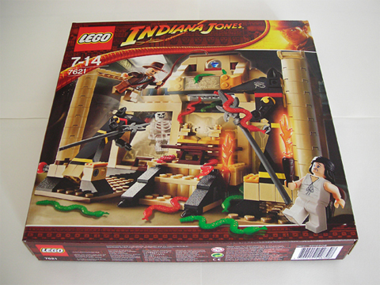

**Le recto de la boîte**

Le verso de la boîte détaille les quelques fonctionnalités du set. Aucune image tirée du film original ne vient agrémenter l’ensemble, c’est dommage...

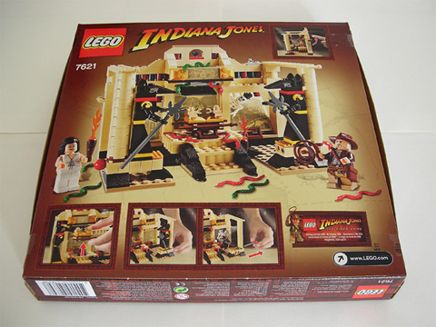

**... et son verso**

L’ouverture de la boîte révèle 5 sachets non numérotés, une planchette d’autocollants (en double pour moi !) et une notice.

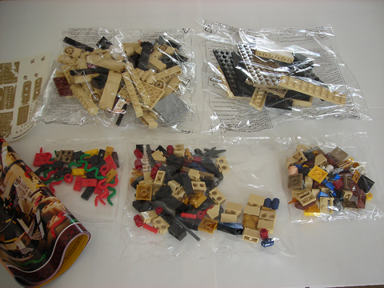

**Le contenu de la boîte**

## Le montage

Comme de coutume, nous débutons par l’assemblage des minifigs. Deux personnages se partagent la vedette de ce set : Indiana Jones et sa compagne Marion Ravenwood qui possède une tête à double expression. N’oublions pas la minifig squelette de seconde génération (avec des membres enfin stables !). La minifig d’Indy est d’une fidélité relative, mais s’avère fort sympathique. Le fouet m’a beaucoup amusé.

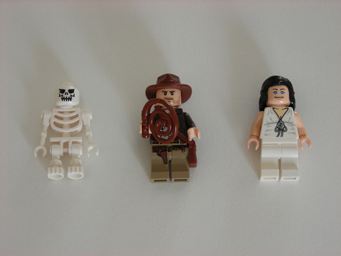

**Les 3 minifigs**

La notice est très claire (pour ne pas dire simpliste), et les étapes, au nombre de 34, s’enchaînent sans aucune difficulté. Le montage non modulaire nous impose de farfouiller ici ou là dans les sachets de vrac. Néanmoins, en quelques minutes, nous atteignons déjà l’étape 20.

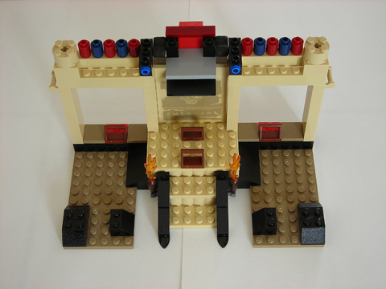

**Le décor à l’étape 20**

Les piliers sont doublés d’un axe Technic. La solidité et la jouabilité du modèle seront ainsi meilleures. Un bon point pour les enfants.

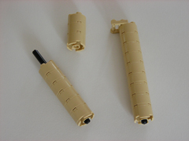

**C’est du costaud**

Au tour de l’arche d’être assemblée. Elle est bluffante malgré le choix du doré perle moins réaliste que le doré pur. Un sens de l’économie aigu qui se confirme avec l’abandon de la tampographie au profit des autocollants (dont 4 restent inutilisés si l’on en croit la notice ?!)...

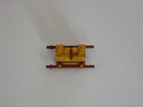

**L’arche tant convoitée**

Une arche certes très convoitée mais venimeusement gardée. Pas moins de 10 serpents grouillent dans ce set !

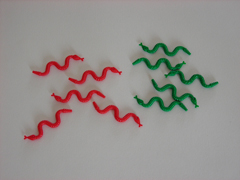

**C’est Indy qui va être content !**

Le montage touche à sa fin. Le décor est somptueux, typique du minimalisme LEGO et de l’esprit de la brique juste : ni trop ni trop peu.

Une satisfaction majorée par l’ajout de quelques fonctionnalités ludiques tels les statues basculantes et la trappe aux serpents.

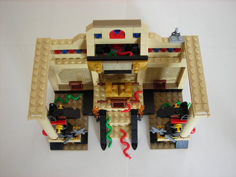

**Le décor achevé**

## Les fonctionnalités du set

Il suffit de tirer l’épingle à tête rouge pour que les statues s’abattent et défoncent les cloisons environnantes. Marion et Indy ont enfin trouvé un échappatoire.

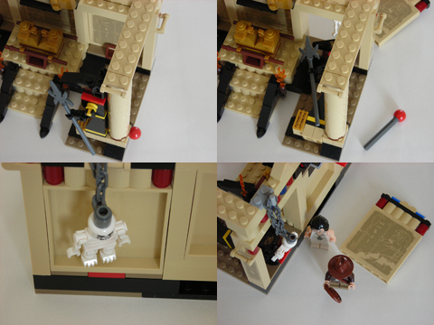

**Fonctionnalité 1**

Une pichenette du doigt suffit à déverser des flots de serpents dans la fosse. A ce titre, le mécanisme déformable (seulement composé de pièces en caoutchouc en guise de ressort) est une formidable trouvaille. Un artifice désarmant de simplicité et d’efficacité !

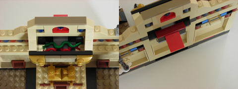

**Fonctionnalité 2**

Je vous laisse admirer quelques détails de ce set. Un travail de très belle facture pour un set de ce prix !

Pour l’anecdote, le clin d’oeil à l’univers de George Lucas est immanquable !

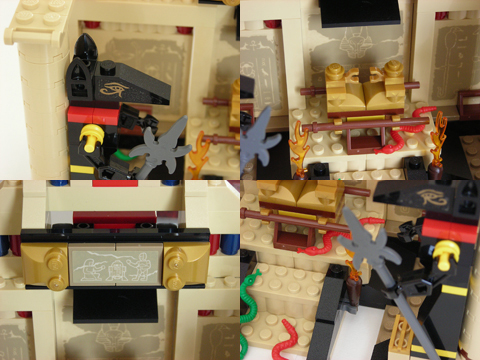

**Des vues rapprochées de ce très joli set**

## En conclusion

**Une franche réussite ! Le subjectif ratio qualité/prix/plaisir est des plus élevés.**

**Je ne sais si le nouveau long métrage me captivera autant que les précédents, et si je ferai l’acquisition d’autres références, mais le montage de cette fosse aux serpents demeura un excellent souvenir. Merci Louise !**

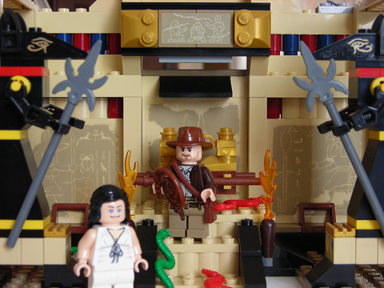

**A bientôt pour de nouvelles aventures**
