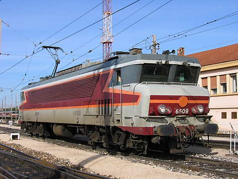
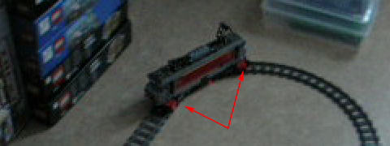
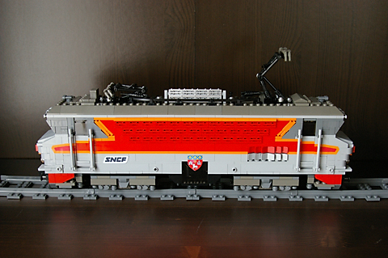
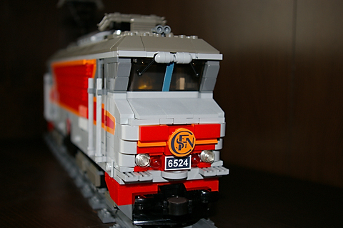
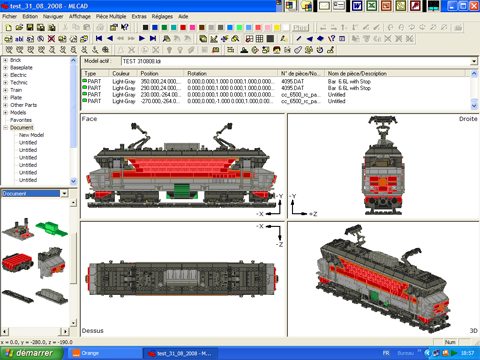
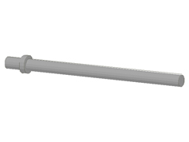
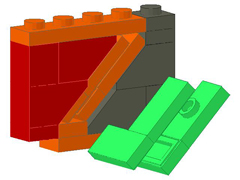
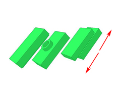

Dans la [première](/articles/779/) puis [la seconde partie](/articles/795/) de cet article nous avions partagé la genèse d’un [MOC](/articles/128/) de la légendaire locomotive électrique française CC 6500 sur la base du nouveau et controversé châssis RC. Tirons à présent le bilan de cette nouvelle manière d’aborder le train LEGO, avant d’approfondir les entrailles de la bête au travers de ses différentes notices d’assemblage.

## L’heure des comptes

**CC 6509 (Photo Roland BADOSA)**

**La CC 6524 RC sur de bons rails !**

Les boucles d’essais du prototype jaune et gris avaient validé les proportions et la cinématique du châssis...

Video Player

[Vidéo de la publication d’origine](https://www.freelug.org/IMG/mov/DSCN1975.mov)

**Les premiers tours de roues !**

Et oui ! Elle roule, n’en déplaise aux plus sceptiques ;-)

Vous constaterez qu’en dynamique une machine de cette envergure (48 tenons de long pour 8 de large) et chaussée de bogies C n’est pas une incongruité.

**Comportement**

La compatibilité avec le faible rayon original de courbure des rails LEGO ne fut à aucun moment prise en défaut. Du moins, tant que le régime évoluât dans une plage raisonnable.

Car la CC 6524 RC, tout comme sa grande soeur, est essentiellement taillée pour les courses furieuses dans les grands espaces. Si l’on souhaite exploiter tout son potentiel, il conviendra d’allonger les lignes droites et d’augmenter le rayon des courbes (en intercalant par exemple des rails droits) afin d’éviter tout risque de déraillement à haute vitesse.

Et accessoirement d’entrer dans le capital de la société Energizer ;-)

_Un bémol : l’aspect esthétique des débordements latéraux du bogie C en courbes serrées (induits par l’articulation et le désaxement de l’ensemble) est un point noir._

La piste d’un bogie C mieux axé et plus compact, qu’il soit réalisé à partir de briques LEGO ou s’appuyant sur une tout autre architecture, reste à explorer.

**Vitesse, puissance, autonomie**

Ah ! La grande équation !

Mes impressions du [Mondial 2007](/articles/593/) se confirmèrent. Le maniement d’une locomotive RC est ludique. Même si la portée de la télécommande (conçue initialement pour une chambre d’enfant) s’avère insuffisante pour couvrir la surface d’un layout d’exposition public.

Il n’en demeure qu’une locomotive RC est rapide, très rapide.

**CC 6524 RC - Vue 1**

Et l’impression de puissance d’une machine en 8 tenons de large absolument saisissante.

Tout du moins, pour ce modèle sur base RC, à vide ou en traction modérée. Car dès que le poids de l’engin se conjugue à un lourd convoi, la baisse de rendement (calquée sur les courbes de chute de la tension et de la capacité des piles ou des accumulateurs) devient inexorable. Le revers de médaille de l’alimentation embarquée...

Par pudeur, je ne m’étendrai pas sur l’appétit gargantuesque de cette belle demoiselle. L’autonomie est frustrante, aussi bien pour un enfant qu’un AFOL. Comptez moins de deux heures en bimotorisation et en charge (six wagons issus de [trains de marchandise 7898](/articles/528/)) avant d’accuser un sérieux coup de pompe. Autant s’évertuer à alimenter les réacteurs d’un A380 avec le volume d’un réservoir de mobylette. Pfff, le truc fonctionne super bien, mais pô assez longtemps :-(

**Gageons que le société LEGO saura trouver le juste compromis encombrement/poids/autonomie pour la batterie rechargeable qui équipera ses futurs trains [Power Functions System](/articles/645/) sous peine d’un fiasco retentissant auprès de la communauté AFOL.**

## Notices de montage

**CC 6524 RC - Vue 2**

La réalisation d’une notice de montage « léchée » n’était pas la finalité de ma démarche créative. Je ne le cacherai pas, je ne me suis pas foulé le stud :-) même si le logiciel mis à contribution ([LPUB 4](http://www.kclague.net/LPub4.htm)) est à même de générer des livrets comparables à ceux de notre firme danoise préférée. Toutefois, un travail de ce calibre nécessite un fichier MLCAD multi-parties au cordeau, une grande maîtrise de l’outil et surtout... beaucoup, beaucoup de temps ;-)

Ces notices des sous-ensembles principaux de ma locomotive sont avant tout destinées à des AFOLs qui ne seront pas déboussolés par l’enchaînement rapide et sans fioriture des étapes, et les quelques coquilles plus ou moins décelables... Oups ;-)

**Cabine et Nez**

**Notice CC 6500 RC - Cabine**

**Notice CC 6500 RC - Nez**

Le secret (si j’ose dire ;-)) du rendu de la CC 6524 RC réside dans cette association cabine/nez qui concentre les combinaisons de montage tarabiscotées de la locomotive ; et ce, grâce à un simple jeu de brackets. Ainsi la structure du modèle se résume à un empilement de briques des plus basiques !

-   _N’oubliez pas de construire l’ensemble cabine/nez en deux exemplaires !_

_Quelques conseils pour vos futurs MOCs :_

_

-   User du SNOT ou autres joyeusetés avec modération, et en dernier recours :-) Aucune technique savante ne remplacera jamais un empilement de formes judicieuses.

-   « Mettez à niveau » zone par zone la construction le plus rapidement possible, afin de compenser les décalages induits par les techniques AFOLs et de retrouver la configuration la plus saine, la plus solide et souvent la plus esthétique : l’empilement par plates ou par briques.

_

-   _Que ce soit en SNOT 90,180 ou autres, gardez à l’esprit le soucis de bien empiler._

**Caisse**

La caisse demeure d’une grande sobriété, le châssis RC excluant d’ailleurs toute fantaisie.

**Notice CC 6500 RC - Caisse**

**Bogie C**

**Notice CC 6500 RC - Essieu 1**

**Notice CC 6500 RC - Bogie B**

-   _N’oubliez pas de construire le bogie C constitué de l’essieu 1 et du bogie B en deux exemplaires !_

**Toit et trappes d’accès**

La locomotive dispose de trois trappes d’accès par le toit, respectivement aux deux postes de conduite, et au boîtier électronique du châssis RC (connectique et sélecteur de canaux).

**Notice CC 6500 RC - Toit**

-   _Rajoutez un tube flexible creux noir d’une longueur de 160 mm sur le toit en le clipsant dans les pièces prévues à cet effet._

**Notice CC 6500 RC - Trappe de toit cabine 1**

**Notice CC 6500 RC - Trappe de toit cabine 2**

**Notice CC 6500 RC - Trappe de toit centrale**

**Pantographe**

**Notice CC 6500 RC - Pantographe**

-   _La longueur des tubes flexibles creux noirs composant le trapèze du pantographe est de 26 mm. Un tube flexible creux noir de 16 mm fait office d’axe charnière entre le trapèze et le bras principal._

-   _N’oubliez pas de construire le pantographe en deux exemplaires !_

-   _Notez que l’ensemble est composé de deux bras, et que le plus fin doit être déclipsé afin de pouvoir replier convenablement le pantographe sur lui-même ;-)_

**Portes**

**Notice CC 6500 RC - Portes**

-   _N’oubliez pas de construire le « U » de portes en deux exemplaires !_

**Divers**

-   _Ajouter 8 barres grises de ce type en guise de mains courantes sur la caisse enfin assemblée :_

-   _Le motif final du Z de la livrée Arzens s’obtient à l’aide de tiles 1x2 et d’un jumper de la manière suivante :_

-   _La tenue de l’ensemble est assurée par la combinaison jumper/tile insérée en « semi-force », puis par sa « translation compressive ». La technique est stable et ne requiert qu’un ajustement ponctuel de la compression._

-   _La totalité des motifs requiert 12 tiles 1x2 orange et 4 jumpers orange._

-   _N’oubliez pas les deux câbles d’alimentation reliant les moteurs au châssis RC !_

## Autocollants

J’ai créé deux planchettes d’autocollants : l’une destinée à l’impression sur papier adhésif transparent, l’autre à l’impression sur papier adhésif blanc.

_Avertissements : Les éléments que je n’ai pas créés ont été puisés dans la bibliothèque vectorielle du site [La Logothèque](http://www.lalogotheque.com/) et dans la médiathèque du site [Wikimedia Commons](http://commons.wikimedia.org/)._

_

Ces derniers demeurent la propriété de leurs auteurs et propriétaires respectifs.

La [SNCF](https://www.sncf.com/) ne parraine ni ne cautionne ce travail artistique amateur à but non lucratif ni l’association FreeLUG qui l’héberge sur son site.

_

_Toutes utilisations commerciales, frauduleuses ou autrement préjudiciables faites à partir de tels documents vous exposent à des poursuites dont l’auteur de ces planchettes ou FreeLUG ne sauraient être tenus pour responsables !_

**Autocollants CC 6524 RC - Papier adhésif transparent**

**Autocollants CC 6524 RC - Papier adhésif blanc**

## En conclusion

La construction de cette CC 6524 RC fut un sacré challenge ! Le résultat me comble, même si nombre de détails restent encore à peaufiner : le motif en briques de la pointe du Z de la livrée Arzens ou le pare-brise dont le modèle à montants intégrés n’existe toujours pas en nouveau gris foncé...

La viabilité du châssis RC et des futurs trains sous Power Functions System dans le cadre d’une utilisation AFOL (grand layout et multiples convois) reste à démontrer. Gardons-nous cependant de condamner trop vite une technologie qui en est à ses balbutiements. Sans compter que nous n’aurons plus d’autre alternative dans un avenir (très) proche :-/

Il sera aisé pour ceux qui le souhaitent d’affiner ce modèle, et d’en extrapoler des versions 9 et 12 volts, voire de 6 tenons de large ;-) Une simple adaptation (et simplification :D) de l’architecture de la caisse suffira.

De même, la conversion de cette locomotive en une [CC 72000](http://pagesperso-orange.fr/florent.brisou/Fiche%20CC72000.htm), « version diesel » de la CC 6500, est une perspective intéressante. Inspirez-vous donc du [MOC de notre camarade Chimère](http://www.brickshelf.com/cgi-bin/gallery.cgi?f=219707), et transposez !
