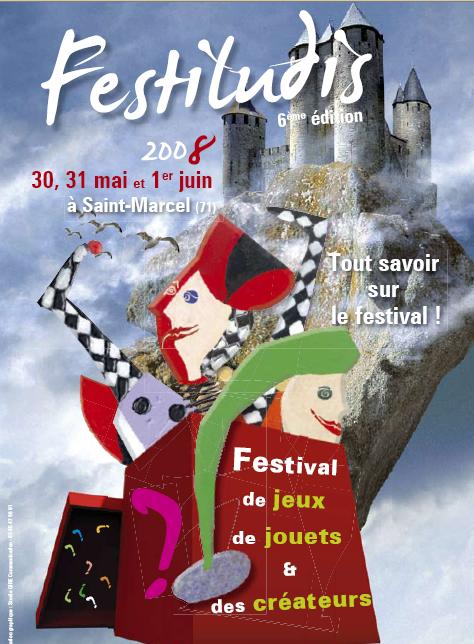

Première exposition de FreeLUG dans un nouveau département : la Saône et Loire (71).

Nous avons été invités à participer à ce grand  
Festival du jeu qui a lieu tous les 2 ans.

Dans chacun des espaces, différentes initiations et animations auront lieu (Jeux de société, de construction, de manipulation, CD-ROM, Roller, etc.). Celles-ci seront mises en place par les membres des associations partenaires, les créateurs, et les animateurs du Centre Socio-Culturel de Saint-Marcel avec l’aide des services techniques de la ville de Saint Marcel.

Les visiteurs pourront découvrir et acheter dans les différents stands des jeux et des jouets. Un espace réservé aux Créateurs sera mis plus particulièrement en valeur afin de faire connaître largement leurs créations.  
c’est donc ici que les exposants de FreeLUG seront mis en valeur.

Un partenariat sera mis en place avec les acteurs éducatifs du territoire de Saint-Marcel et de ses proches environs (écoles, collèges) ainsi que des établissements spécialisés (RPA, CAT, CFA) afin de faire découvrir l’univers du jeu.

Unique en Bourgogne, FESTILUDIS est une manifestation à destination du grand public (5000 visiteurs) qui a pour vocation de mettre en avant l’univers du jeu et du jouet dans ses multiples aspects. Le travail mené tout au long de l’année par l’équipe du Centre Socio-Culturel de Saint-Marcel, en partenariat avec la ville et les partenaires locaux, positionne le festival en véritable expert dans le domaine du jeu.

L’objectif est de favoriser les découvertes de nouveaux jeux éducatifs, d’animer les rencontres avec les créateurs de jeux ,les professionnels, les partenaires et le grand public pour développer des projets innovants.

FreeLUG a donc toute sa place dans ce festival du jeu et espère montrer au public toutes les richesses et potentiels que les jouets LEGO possède.  
**–** Lieu : Saint-Marcel(71380), (pour FreeLUG) dans la salle des fêtes.  
**–** Exposition : Samedi 10h-22h et dimanche 10h-18h  
**–** Surface attribuée à FreeLUG : 2m par 10m soit 2 modules par 13 modules (26 modules)  
**–** Thèmes : il s’agit d’un festival sur le jeu, ici le thème est, pour cette année, plus sur le médièval/fantastique, mais les thèmes "création" sont libres. Donc des thèmes multiples LEGO pourront être envisagés.  
**–** Entrée pour le public : gratuite  
**–** Dates :

-   Vendredi 30 mai 10 h 00 à 12 h 30 - 14 h 00 à 20 h 00
-   Samedi 31 mai 10 h 00 à 22 h 00
-   Dimanche 1er juin 10 h 00 à 20 h 00.

Les organisateurs sont très motivés, ce n’est pas leur premier festival et une très bonne ambiance règne.

N’hésitez donc pas à vous faire connaître pour participer avec nous à ce festival ou de venir en simple visiteur cela nous fera très plaisir.

JeanG

## Documents joints

-   **[Présentation du Festiludis 2008](https://www.freelug.org/IMG/pdf/doss_mail_prA_c_sentation.pdf "Télécharger PDF - 1.6 Mio")**
    
    28 mars 2008 \- PDF - 1.6 Mio
