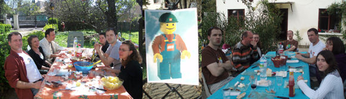
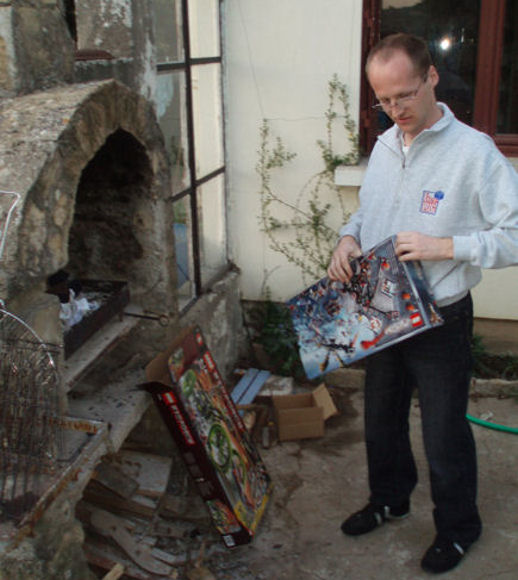
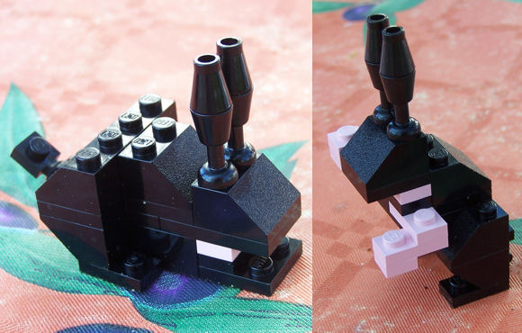
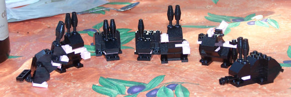
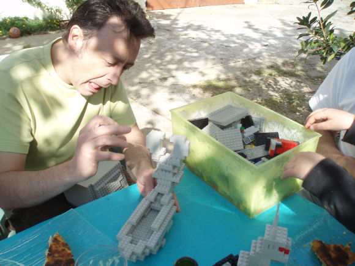
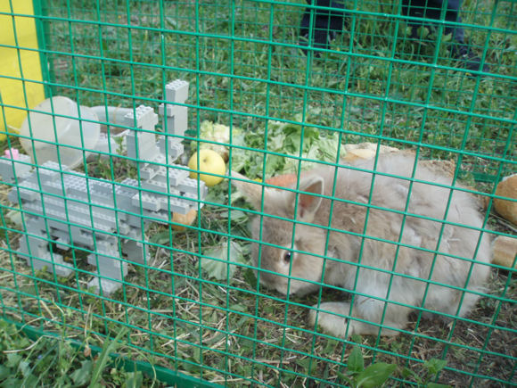

Le 5 et 6 avril quelques AFOLs Freelugiens se sont réunis le temps d’un week-end.

Profitant du passage de JAC dans la région de Bagnols-sur-Cèze, nous nous sommes réunis à Vénéjan autour d’un programme simple.

## Le samedi

Barbecue, petit concours de montage de lapin, visite du village.

L’ambiance était bonne, la météo aussi, tellement que nous avons joué les prolongations le samedi soir par un barbecue nocturne.

## Le dimanche

Jean-Yves (grand BrickFilmer dans l’âme) est venu nous rejoindre en famille et nous avons rallumé le barbecue pour un programme similaire.

Parmi les grands moments du week-end certains ont donné lieu à des création assez surprenantes.

Les premières sont survenues lors du Concours de Vitesse de Reproduction de Lapin :

Un sachet comportant les pièces et les photos nécessaires à la reproduction de l’un des lapins ci-dessus était remis à chacun des participants. Les résultats ont été... assez surprenants :-)

Le dimanche nous avons assisté à la naissance d’un monstre, le BeurkLAPIN :

Créature effrayante comme vous pouvez le voir :

Ce fût un très bon week-end et je suis prêt à réorganiser une rencontre dés que l’occasion se présentera.  
Je souhaite remercier toutes les personnes qui ont participé soit :  
**–** Didier et sa famille,  
**–** Sylvain, Sabine et Mia,  
**–** Jean-Yves et sa famille,  
**–** Jérome et K2000,  
**–** Ma famille.

Pierrick / PZ

[Le lien vers la galerie](http://gallery2.freelug.org/main.php/v/-PZ/rencontre/WE5-6_4_08/)

## Le mot des participants

Oh on a pas fait que ça, en vrac :  
**–** lâché de voiture R/C LEGO (ça fonce ces trucs là, merci Jérôme !)  
**–** trampoline, football, frisbee  
**–** un chouette moment avec le cerf-volant (plus de 50 m de haut), et un bon moment à le récupérer dans l’arbre aussi :-)  
**–** repas, apéro, repas, apéro, repas, apéro... :-))

Pour le BeurkLAPIN, je l’aurais plutôt appelé LapinBlok, c’était pas du LEGO - plus difficile à construire, d’où ma langue tirée et cette photo atroce ;-)

Un paradis pour les gosses qui se sont éclatés, vraiment.

Merci à tous - Sylvain et Sabine.

* * *

Je retiendrais le soleil - il fait toujours beau quand on passe du temps avec quelques amis et quelques briques.

Didier

* * *

Si vous avez bien regardé les premières photos, vous avez remarqué que la nappe est rose dans un sens et bleue dans l’autre. Peut être est-ce pour bien marquer le fait que l’amusement a été de la partie durant tout ce week-end entre amis. Nous en avons tellement fait, que je ne pourrais pas tout énumérer, mais juste dire que c’est dur de courir après un buggy LEGO !!! Et aussi que les boîtes en cartons vide sont de bons allume barboc....

A une prochaine, avec Jan !!

JAC/Jérôme
