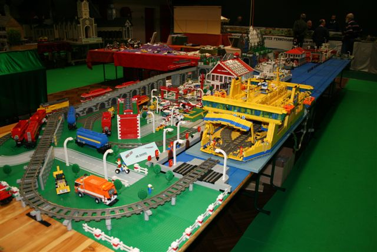
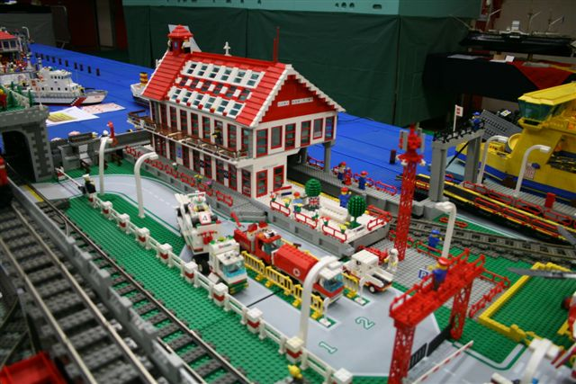

A l’occasion de la troisième édition du salon de Bourgbarré (petite ville de 3000 habitants, à 15 km au sud de Rennes), et suite à une recommandation d’un exposant du Mans, les petites briques ont été à l’honneur et chouchoutées par l’A.P.E (association des parents d’élèves).

Une question a été posée dans un quizz : Quelle est la particularité du réseau de Jean-Marc Barré ? je vous laisse réfléchir.

Pendant les deux jours, le public a répondu présent (3500 visiteurs environ). Comme toujours, et pour ceux qui me connaissent bien, je travaille seul pour le montage et démontage du réseau (18 m2 et évolutif), ma GOLF est toujours là pour le transport, j’essaie de libérer le siège avant pour un Freelugien.

Je n’ai pas de mal avec l’embauche, avec moi, c’est à prendre ou à laisser. Tous les enfants, par tirage au sort hélas nécessaire pour réguler le monde, ont pu jouer malgré les subtilités du réseau, une fille en CE2 a même "travaillé" comme une cheminote pendant 3 heures d’affilée, tous les parents étaient aux anges, certains envisageaient même d’acheter une boite de trains !!!

Pour finir, les petits jeunes, malgré mes problèmes d’audition, sont venus me voir et me féliciter discrètement. Ça m’a fait chaud au coeur. Même si on est dans une époque de jeux vidéos, les enfants n’oublient pas le plaisir simple des LEGO. Saluons au passage la présence de Brigitte et Alain EURY de Saint-Lô qui sont venus me voir, merci à Brigitte pour ses qualités de porte-parole de FreeLUG auprès du public.

Durant le salon, j’ai été approché par un organisateur de Dinan qui "me" veut pour la mi-septembre, le problème, c’est qu’on m’a volé le dossier d’inscription, je recherche depuis...

Prochains passages des petites briques :  
**–** Crozon (19 et 20 avril) trains seulement,  
**–** Carantec, à coté de Morlaix, le week-end suivant (bateaux) uniquement,  
**–** le salon de la maquette de Saint-Martin-des-Champs les 17 et 18 mai,  
**–** D’autres expositions sont prévues à Huelgoat (mi juin) et  
FanaBriques fin juin.

Aux bretons qui me lisent, je reste à votre disposition pour toute information concernant un salon cité ci-dessus proche de chez vous.

[La galerie de photos](http://photos.freelug.org/main.php/v/barr__/expositions/bourgbarre2008/)

Jean-Marc le légoman breton circus
