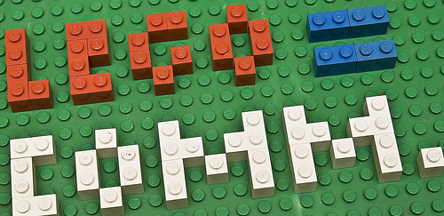
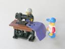

Traduction de l’[article de Linus Bohman](http://www.brothers-brick.com/2008/05/04/lego-is-communication/) paru sur [The Brothers Brick (TBB)](http://www.brothers-brick.com/).

Ce billet fait partie d’une série de six ayant pour but de discuter des modèles LEGO d’un point de vue de la communication. Voici les autres chapitres :

1.  Introduction
2.  Contexte : le message
3.  Contexte : l’audience
4.  Outils : Conception et Construction
5.  Outils : Présentation
6.  Autres facteurs
7.  Conclusion

Je le confesse, comme [Tyler](http://www.brickshelf.com/cgi-bin/gallery.cgi?m=Legohaulic), je suis un Legoolique. Peu de choses me titillent autant qu’un modèle LEGO fait "maison", ou encore MOC (pour My Own Creation - ma création perso) comme nous avons l’habitude de les appeler entre fans de LEGO. Mais en fait, qu’est-ce qui fait qu’un MOC est un bon MOC ? Il y a-t-il un moyen de le savoir ?

Oui, il y en a un. Et je vais vous enseigner comment devenir un dieu de la construction... ou tout du moins d’être un peu moins à la ramasse.

Je sais ce que vous pensez : "Allons Linus ! Le beau est dans l’oeil de l’observateur" et "le beau dépend de ce qui est à la mode". Et sachez que je suis d’accord mais si nous regardons les MOCs au delà de la jolie petite sculpture pour les voir du point de vue de la communication - analysons-les comme un message d’un auteur aux observateurs - nous pouvons en fait y voir des choses intéressantes.

On ne comprend pas en soi pourquoi les [noirs cauchemars iniques de Nannan](http://www.brickshelf.com/cgi-bin/gallery.cgi?f=227000) sont tellement attrayants ou pourquoi les [meubles de Michaël Jasper](http://www.brickshelf.com/cgi-bin/gallery.cgi?f=133999) sont si fascinants. Mais on peut analyser nos réflexions un peu plus loin et, au final, arriver à comprendre pourquoi ces créations ont un impact sur nous.

Ainsi, au long d’une série de 6 billets, commençant avec le suivant, je soulignerai les éléments constitutifs du message de la construction LEGO. Je débuterai sur une vision globale, discutant des relations contextuelles (soyez rassurés, ce n’est pas aussi barbant que cela en a l’air) puis seulement je détaillerai le design et la construction, la présentation ainsi que d’autres facteurs. Je publierai un nouveau chapitre chaque Lundi (NdT, heure suédoise).

Le but cette série d’articles est de vous faire réfléchir. Tout au long de ces six semaines, j’espère que vous exprimerez vos objections, réflexions et exemples dans la partie réservée aux commentaires, et que dans ce cas, le sixième et dernier billet fera part de vos discussions, liens en référence et autres "friandises" sur le sujet. Ça pourrait s’avérer sympa, non ?

Comme nous irons plus loin dans le monde sérieux du LEGO dans ces billets, il est inévitable que j’emploierai des termes du jargon que la communauté LEGO a créé. Au fur et à mesure qu’ils apparaîtront, je les expliquerai, mais n’hésitez pas à demander des éclaircissements ou à pointer mes abus. Si cela devait empirer, tous sont dans ce guide des acronymes LEGO, mais ceci dit, faites le moi savoir. Le [guide des acronymes](http://www.classic-space.com/plugins/content/content.php?content.39) est sur le site Classic-Space.

Tout ces billets sont principalement basés sur mon expérience personnelle et mes propres connaissances, à propos desquelles vous pouvez en apprendre plus sur ma page ["à propos de"](http://www.brothers-brick.com/about/all-about-linus/). Ce type de série est aussi une première pour "the Brothers Brick", alors n’hésitez pas non plus à vous exprimer sur ce point. Et pendant que nous y sommes, n’hésitez pas à me reprendre aussi sur la grammaire et l’orthographe.

Pfiou, je pense que c’est tout.

Maintenant, pouvons-nous y aller ? Demain, nous commencerons avec le point le plus important de tous : le contexte. Ta-ta-taaaaa.
