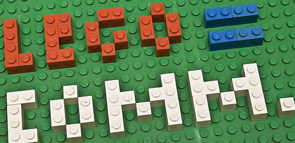
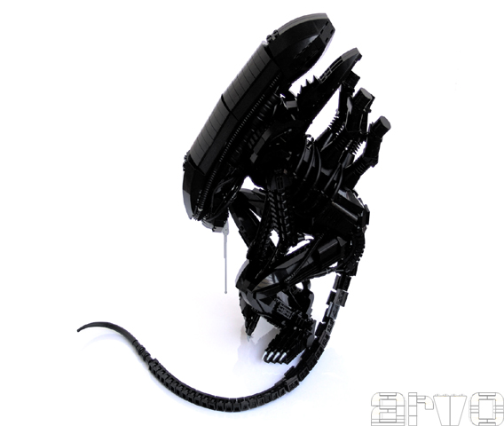

Traduction de l’[article de Linus Bohman](http://www.brothers-brick.com/2008/05/05/lego-is-communication-context/) paru sur [The Brothers Brick (TBB)](http://www.brothers-brick.com/).

Comme je l’ai écrit en [introduction](/articles/752/), nous considérons ici les créations LEGO comme un message. Cela signifie que nous plaçons les MOCs (pour My Own Creation - ma création perso - souvenez-vous) au même niveau qu’un article dans un magazine, qu’une lettre au Père Noël ou qu’une œuvre d’art. Le LEGO est en ce sens simplement un autre média. Mais à quoi nous conduit cette définition ?

En fait, toutes ces activités s’entourent d’un contexte. Elles se développent sur un terrain présentant des obstacles qu’elles doivent surmonter, et la manière avec laquelle elles y parviennent détermine si le message qu’elles véhiculent est correctement transmis ou non. Définir la nature de ces obstacles déterminera le choix des outils (ce que nous discuterons plus tard).

Je diviserai ici les relations contextuelles en deux parties : le message (le MOC lui même) et les récepteurs du message (l’audience). Aujourd’hui, attardons-nous sur le premier des deux : la création.

Un de mes amis m’a dit un jour "Pour dire quelque chose, il faut d’abord que tu aies quelque chose à dire". C’est une phrase que l’on peux citer spontanément mais qui est porteuse de plus de sagesse : Tu ne peux pas exprimer tes pensées si tu ne comprends pas ce que tu penses. Il est hautement probable que [les frères du collectif Arvo](http://www.brickshelf.com/cgi-bin/gallery.cgi?m=arvo) ont fait des recherches approfondies avant de construire cette incroyable [sculpture d’alien](http://www.brickshelf.com/cgi-bin/gallery.cgi?f=284681).

Cette création respecte ici des conventions que nous allons illustrer à l’aide d’un scénario alambiqué. Imaginons que les frères Arvo n’aient pas créé cette sculpture. Imaginez qu’ils aient intitulé [leurs écouteurs](http://www.brickshelf.com/gallery/arvo/Legodreams/Objects/lego_headphones_01.jpg) "l’alien de H.R. Giger" (ce qu’en théorie ils auraient parfaitement pu faire). Cela aurait-il été adéquat ?

Pas vraiment.

Bien que cela aurait provoqué une réaction, la sculpture ne nous aurait pas laissé à nous les spectateurs un inoubliable souvenir. L’écart avec le consensus général est trop important. Si nous avions vu les écouteurs (et en tenant pour acquis que nous connaissons le film), nous n’accepterions tout simplement pas que l’alien ressemble à ça : on ne peux y croire car les frères Arvo se seraient par trop éloigné de la réalité des choses. (et quand on sait combien certains membres de la communauté sont pinailleurs, c’eût été un legocide immédiat - si tant est que les frères Arvo se soucient de ce genre de chose).

C’est une balance délicate à atteindre : vision artistique contre consensus général. Après tout, un MOC en théorie peut ressembler et être nommé librement, mais si quelqu’un  
intitule un modèle comme étant un "vieux bateau pirate", les spectateurs s’attendent à ce qu’il soit fait de bois, qu’il flotte sur les eaux et qu’il soit dirigé par un homme barbu imbibé d’alcool s’esclaffant "aaarrrrrr". Si le vieux bateau pirate est haut et carré, constitué de cubes de verre, pensez plutôt à le nommer "bâtiment". La même chose vaut quand vous explorez le steampunk ou quand vous recherchez la meilleure conception d’une locomotive précise.

Le point est là : sachez que vous communiquez déjà lorsque vous choisissez l’objet que vous allez construire. Les gens aiment les étiquettes, ça leur permet de comprendre ce qui se passe.

La semaine prochaine, nous parlerons des gens avec qui vous voulez communiquer : l’audience.
