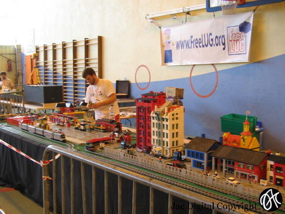
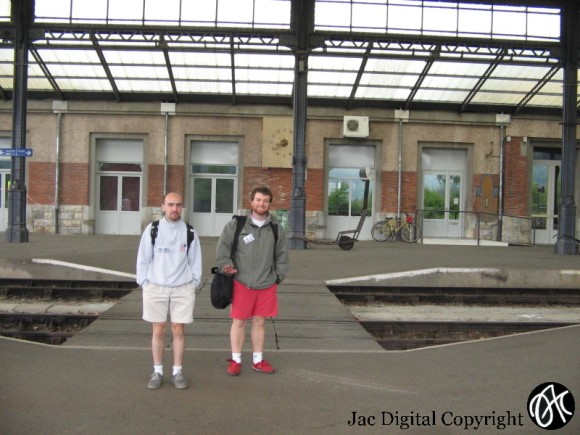
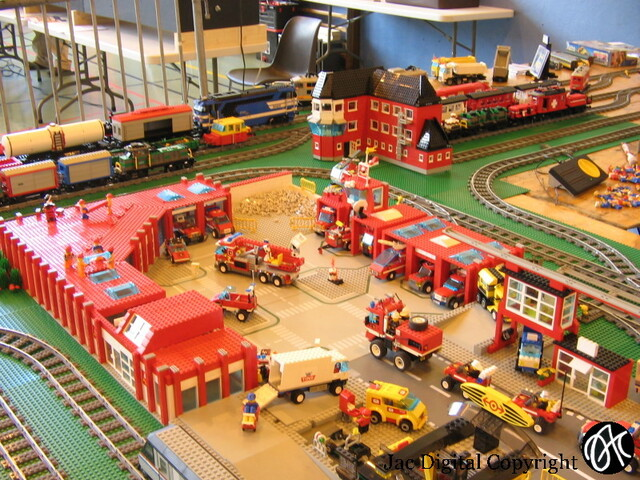
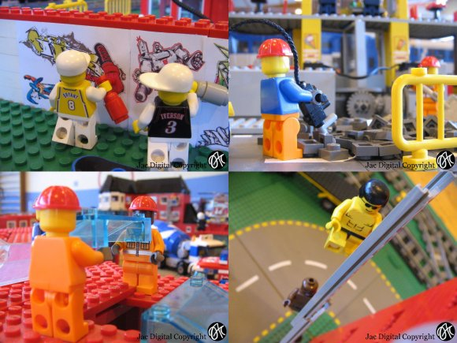
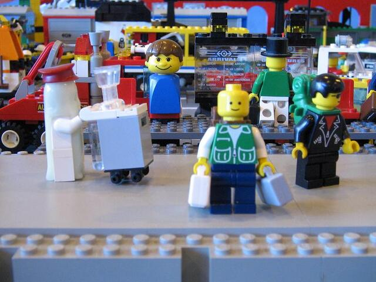
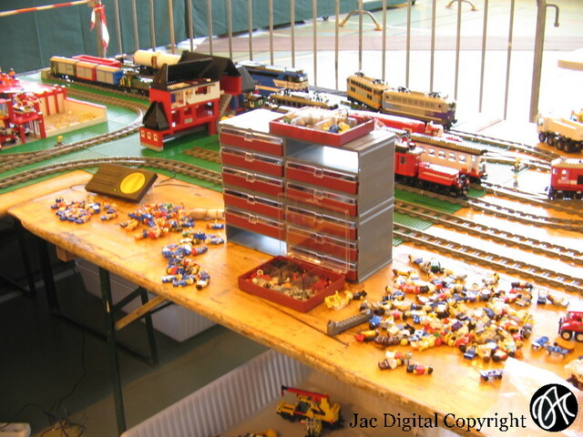
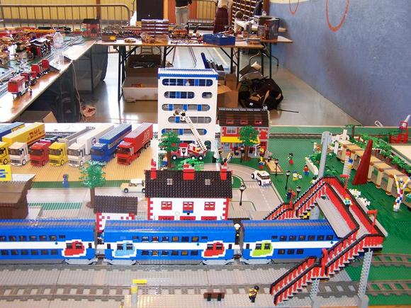
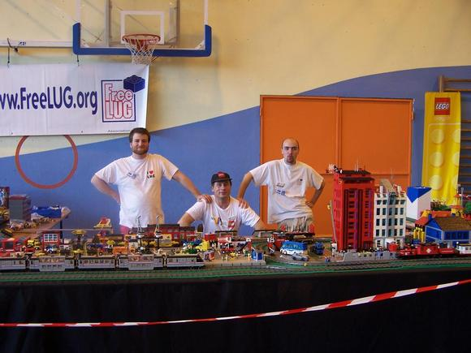
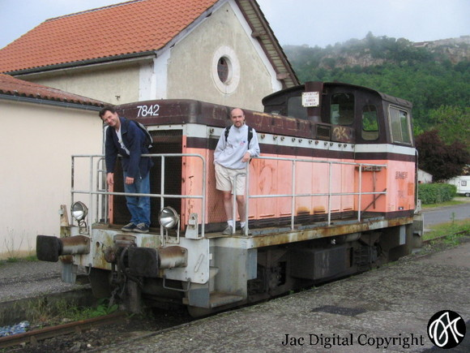

Les 17 et 18 mai, Courants d’Art organisait Festirail en Rouergue à Capedenac-Gare. Particularité de cette exposition, c’est qu’il s’agit d’un festival. Les exposants modélistes sont répartis dans trois salles dans la ville (salle des fêtes, halle de marchandises de la gare SNCF, gymnase), le tout relié par un petit train qui transporte les visiteurs.

En plus de ces 3 salles, un réseau de trains de jardin proposait des tours de circuit sur le parvis de l’église, diverses expositions d’arts accueillaient également les visiteurs, un vide-grenier (mais nous n’y avons pas trouvé de LEGO) était organisé le dimanche matin, et enfin des démonstrations de soudure de rail étaient réalisées. Il faut dire que [Capdenac-Gare est né il y a 150 ans, par le train](http://fr.wikipedia.org/wiki/Capdenac_Gare).

## Jac

Bruno (de l’organisation de Festirail en Rouergue) a connu l’association FreeLUG à [l’exposition de Quissac](/articles/620/) en mai 2007. Il nous a donc contacté pour participer au Festirail en Rouergue. Le fait d’exposer près d’une gare m’a tout de suite emballé. PierreC m’a rejoint sur le projet. Et Erik est arrivé plus tard, mais heureusement, car nous avions vu un réseau un peu grand pour deux constructeurs. Par contre, je n’avais rien de vraiment nouveau à exposer. C’est que construire un immeuble tel le rouge qui fait 5 étages n’est pas chose aisée, il faut mûrir quelques aspects architectural avant de se lancer. Les mises en scène et les emplacements des bâtiments changent, c’est aussi pour s’assembler aux modules voisins.

Nous avons eu la bonne surprise d’accueillir Pierrick qui a fait le trajet pour passer du temps avec nous. Il a aussi participé à l’animation des "minifigues" ! Pas qu’elles s’ennuyaient, car PierreC sait y faire, mais c’était un plus indéniable.

Nous avons pu profiter du Festirail tout entier, dans tout le village. Et aussi visiter la gare comme de vrais touristes. Les bâtiments, le matériel roulant, tous ce qui peut être une inspiration pour de futures constructions. Car le Festirail a lieu tous les deux ans, et nous serons prêts à y retourner...

**Visite de la gare**

Les exposants jouent les touristes sur les quais de la gare

## PierreC

L’exposition de Capdenac fut encore une belle aventure !

Pour cette exposition je décidais de refaire [ma caserne présentée en Novembre à St Rambert](/articles/683/).  
Comme JAC m’avait aussi demandé de mettre une gare, j’ai donc décidé de faire un quartier avec une gare voyageur et un dépôt ferroviaire.  
La construction de la caserne me prenant assez de temps, j’ai essayé de composer le reste de mon module avec des sets officiels.

**Caserne des Pompiers**

Oui, elle va encore grandir, PierreC a encore plein d’idées, et y’a des travailleurs sur le toit !!

Après l’installation du réseau, il ne nous restait plus qu’à animer notre petite ville. J’en ai donc profité pour placer des scènes amusantes avec mes minifigs.

**Mr benoit.....**

J’ai de drôles d’impression sur ce quai de gare !!!!

**Ma "boite-à-minifigs"**

Cette exposition m’a permis aussi de tester une caméra enregistreuse de modélisme prêtée par un copain.

## Erik

Fin avril, le plan du réseau m’était proposé. Me voilà avec une surface de 10x6 (en plaques de 32) à remplir. Oups, mais je n’ai jamais fait aussi grand ! J’ai ressorti de mes cartons ma gare voyageurs et son café, la gare postale... Hum, ça ne couvre que le quart de la surface... Heureusement que les week-ends prolongés de mai sont là, pour me permettre de construire.

J’ai voulu me lancer dans la construction d’[immeubles, dans le style Corner Café](https://www.freelug.org/spip.php?article599). Mouais, je n’aurais jamais le temps si je veux en faire plusieurs... Je me lance à la place dans un immeuble moderne.

Puis essayant de mettre un peu de côté le train, j’ai donc réalisé 8 remorques pour mes tracteurs Magnum, voilà qui occupera mine de rien une belle surface. Par contre, pas le temps de construire le resto-route...

Reste encore une grosse surface à couvrir... voyons... Festirail en Rouergue est organisé par Courants d’Art... si je construisais un grand bâtiment architectural... ça a fini en une sorte de musée d’arts modernes et abstraits.

Bref, tout cela a été achevé en catastrophe la veille au soir du départ pour l’exposition, mais quel plaisir de montrer de nouvelles choses ! Allez, le musée sera présent à Fana’briques :o)

* * *

**L’équipe exposante**

PierreC, Jac, Erik

Dimanche matin, nous avons profité d’un peu de temps libre avant l’ouverture pour aller voir les trains, les vrais cette fois-ci...

**Je suis le roi du monde !**

Nous lançons tous les trois un grand bravo à l’organisation _Courants d’Art_ et en particulier Bruno pour l’accueil chaleureux et la prise en charge totale : les bons repas tout le long du week-end, hébergement (en chambrée de 4 pour continuer à discuter tard le soir), et transport (au prix de l’essence, c’est agréable). Une bonne ambiance générale régnait dans le village.

Un gros merci à Pierrick pour avoir fait 10 heures de route pour nous rendre visite pendant cinq heures le samedi, sa visite nous a fait plaisir, surtout qu’il a pu garder le stand pendant que nous mangions ;) Enfin, il a essayé de justifier son déplacement car il avait un wagon à 3 bogies à tester.

Un coucou également à Justin, 7 ans et demi, qui a rejoint FreeLUG lorsqu’il nous a découvert à [l’exposition de Saint Rambert d’Albon](/articles/683/) et qui est venu nous rendre visite avec son papa.

Et aussi à tous les autres exposants avec qui nous avons pu partager notre passion et que nous retrouvons d’expositions en expositions.

## Galeries de photos

Heureusement que Jac n’avait pas oublié son appareil, au contraire de ses deux acolytes :)  
**–** [Photos de Jac](http://photos.freelug.org/main.php/v/JAC/Exposition/Expositions2008/FestirailEnRouergue-2008/)  
**–** [Photos de Pierrick](http://photos.freelug.org/main.php/v/-PZ/Exposition/Festirail/)
