Il y a quelques semaines, en conclusion de [l’article dédié au set 7621](/articles/733/), j’évoquais l’incertitude d’acquérir d’autres références de la gamme Indiana Jones, notamment celles issues du nouveau long métrage. Bon, ben euh... c’était prévisible, j’ai craqué :-)

Gros plan sur le set 7624, une petite boîte idéale pour revivre à peu de frais les péripéties d’Indiana Jones au Royaume du Crâne de Cristal.

## Alors, ce nouvel Indiana Jones ?

Techniquement, c’est nickel chrome. Belle lumière, beaux cadrages, cascades étourdissantes, pas d’effets numériques tapageurs... Monsieur Spielberg est un bon artisan.

[Site officiel Indiana Jones](http://www.indianajones.com/site/index.html)

Le pari de projeter l’action sur la fin des années 50 pour composer avec les 65 ans de l’acteur Harrison Ford était audacieux ! On ne s’ennuie pas un instant, mais la mécanique scénaristique se révèle moins fluide qu’à l’accoutumée et les rebondissements souvent téléphonés. Quant aux méchants Made in USSR, ils peinent à succéder aux SS du 3ème Reich.  
L’aventure fait surtout trop la part belle au fantastique, et le souffle épique propre à cette saga archéologique nourrie de mythes historiques et religieux s’en ressent un peu.

Avouons-le, ce n’est pas le chef d’oeuvre tant espéré par les fans du monde entier. Néanmoins, cet ultime (?) volet des aventures d’Indy est un formidable divertissement, comme seul Hollywood sait nous en offrir. Ne boudons pas notre plaisir de retrouver un héros mythique après 20 ans d’absence !

## Fiche signalétique

-   **Gamme :** [Indiana Jones](http://shop.lego.com/ByTheme/Department.aspx?d=519)
-   **Collection :** Le Royaume du Crâne de Cristal (Kingdom of The Crystal Skull)
-   **Référence :** 7624
-   **Désignation :** Duel dans la jungle (Jungle Duel)
-   **Année :** 2008
-   **Nombre de pièces :** 90 ([inventaire Peeron](http://www.peeron.com/inv/sets/7624-1))
-   **Nombre de minifigs :** 3
-   **Prix moyen constaté :** 14,99 € (au 01/05/2008)

## Le contexte

Cette scène du « Duel dans la jungle » est tirée de la deuxième moitié du film. Nos héros sont retenus prisonniers par un corps expéditionnaire soviétique dans un campement en pleine jungle péruvienne. S’en suit une évasion, armes blanches aux poings...

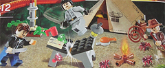

La reproduction d’une - bonne ! - scène de film est un exercice périlleux. Si d’autres sets comme [le temple maya](http://shop.lego.com/ByTheme/Product.aspx?p=7627&cn=536&d=519) ou [le débroussailleur militaire](http://shop.lego.com/ByTheme/Product.aspx?p=7626&cn=536&d=519) jouissent d’une légitimité incontestable, ce « Duel dans la jungle » n’était pas le choix plus pertinent. Il y avait à mon humble avis des scènes plus significatives et plus propices à la création d’une boîte à petit prix...

Ce qui ne m’a pas empêché, au sortir de la projection, de foncer l’acheter ! Je souhaitais « marquer le coup » et rendre au travers de cet article un hommage aux nouvelles aventures cinématographiques d’un héros qui m’est cher. Et puis, je bouillais d’impatience d’examiner la tente de plus près :-)

## Indy + LEGO = $$$

C’est le gros bémol de la gamme LEGO Indiana Jones ! Le coût de la licence et l’exploitation éhontée du juteux filon font grimper l’addition. Les gros sets que j’aurais préféré m’offrir sont tout bonnement hors de prix ! J’attendrai les liquidations de stocks une fois que le soufflé hollywoodien sera retombé... Je me contente aujourd’hui de ce petit set symbolique.

## La boîte

Elle reprend le graphisme propre aux collections de la gamme. Seule la mention « Kingdom of The Crystal Skull » fait référence au film. C’est un travail artistique de haute volée, harmonieux et subtil, qui finira bien par déteindre sur d’autres packagings fadasses de la marque ;-)

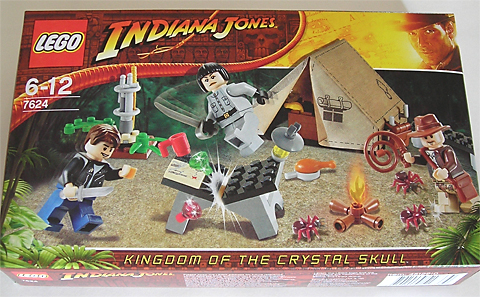

**Le recto de la boîte...**

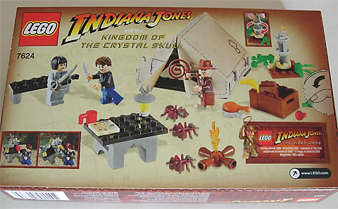

**et son verso**

## Le contenu

C’est bien maigre... Seulement 2 sachets non numérotés, une toile de tente et la notice.  
Le rapport quantité/prix/plaisir est convenable. Toutefois, à budget équivalent, d’autres gammes offrent des sets bien plus généreux en pièces...

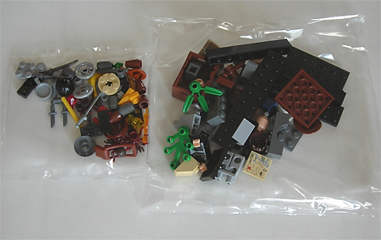

**2 sachets...**

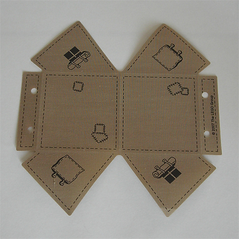

**la toile de tente imprimée...**

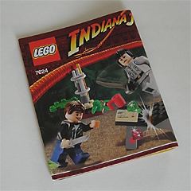

**et une notice sans grande utilité ;-)**

## Le montage

Il est réduit, au vu du nombre de pièces, à sa plus simple expression !

**Les minifigs**

Nous assemblons tour à tour Indiana Jones (minifig en tout point identique à celle du [set 7621](/articles/733/)), Mutt Williams, son fils caché (ah ! comme dans les Feux de l’Amour !), et la vénéneuse Irina Spalko, un agent soviétique férue de parapsychologie.

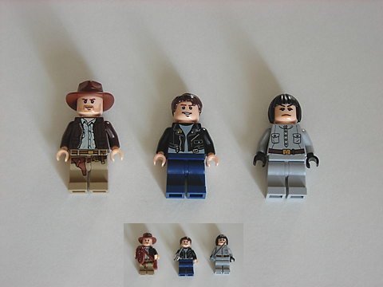

**3 jolies minifigs**

Leurs visages sont d’une fidélité relative, et comme de coutume, ce sont leurs vêtements qui les incarnent définitivement. La tampographie du perfecto de Mutt est riche de détails.

Au rayon des accessoires, Indy retrouve sa besace et son fouet fétiche. Mutt joue lui de son cran d’arrêt (hélas dans une livrée non chromée de très mauvais augure...), tandis que l’agent Spalko brandit sa rapière.

**La tente**

Elle se compose d’un socle fait de briques et de plaques fondamentales recouvert d’un textile imprimé prédécoupé. C’est « la pièce » du set ! L’ensemble est original et joliment réalisé, même si l’armature (invisible de l’extérieur toutefois) gagnerait à de plus finesse et de réalisme.

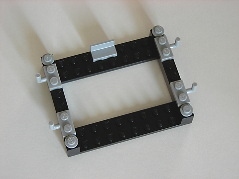

**La structure est un poil grossière**

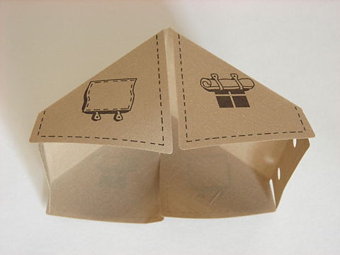

**La toile est à plier avec précaution**

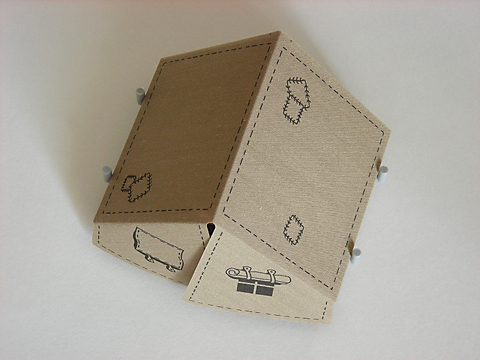

**La structure se fait tout de même oublier**

**Le mobilier et divers accessoires**

De petites choses typiques du minimalisme synthétique des sets officiels viennent étoffer le campement soviétique. Tout d’abord une table sécable (tranchée en deux lors du duel à l’épée avec l’agent Spalko).

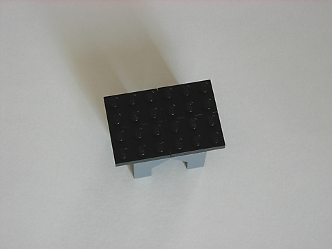

**La table...**

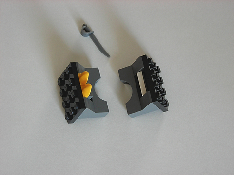

**est à découper dans la largeur ;-)**

A celle-ci s’ajoute un banc sommaire,

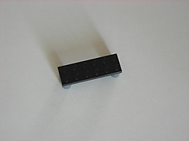

**Bof, bof, bof...**

un râtelier d’armes rotatif,

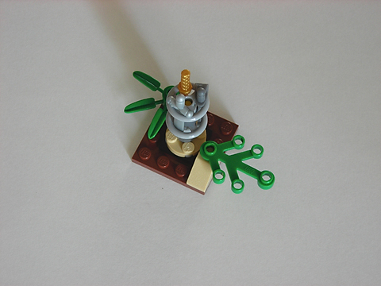

**L’inspiration revient, le sourire également :-)**

et quelques babioles que je vous laisse découvrir.

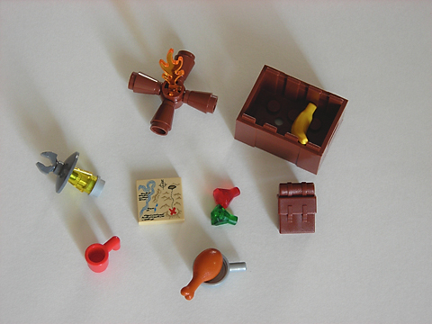

**L’équipement du parfait petit campeur**

**Les fourmis**

« Des fourmis ? Euh... Ben en fait, pas de suite ! »

Une belle incongruité du set (d’autres n’y échappent pas non plus...). LEGO a pris quelques libertés avec la chronologie des évènements, quand ce n’est pas avec les évènements tout court ! Bien après cette scène du campement, un véhicule se plantera dans une fourmilière géante. Une scène forte aux trucages sidérants que la firme danoise a visiblement préféré fondre avec la nôtre et celle du [set 7626](http://shop.lego.com/ByTheme/Product.aspx?p=7626&cn=536&d=519). Mouais... Il eut été plus logique d’inclure ces fourmis belliqueuses dans le [set 7625](http://shop.lego.com/product/?p=7625&LangId=1036&ShipTo=FR) qui contient le véhicule amphibie par exemple !

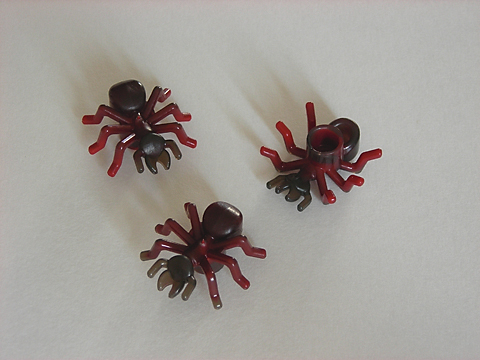

**Brrr !**

Les trois bestioles sont impressionnantes ! La finition bigarrée est magnifique, et, associée à une légère translucidité, leur confère un réalisme stupéfiant. Cerise sur le gâteau : elle dispose d’un tenon concave sous l’abdomen. Les araignées et les scorpions monocolores du passé prennent un sacré coup de vieux.

## Indiana Jones and the Secret of the Cheutemi’s Gazoline

Peut-être parce que je ne recevais de gros sets qu’une fois dans l’année, j’ai toujours été sensible à ces petites boîtes, qui réussissent le tour de force de faire beaucoup avec presque rien. Elles sont une étincelle à l’imagination des enfants.

Au delà du nombre de briques et de la complexité de montage qui ne rassasieront jamais l’appétit d’un AFOL, prenons ce « Duel dans la jungle » pour ce qu’il est : un formidable instant de magie.

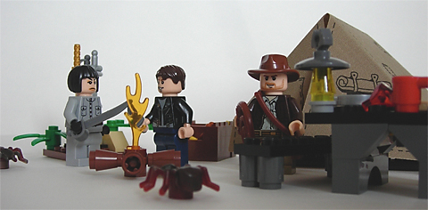

_Les Tables de la Loi, Le Saint Graal, Roswell... Quel mystère Indy n’a-t-il donc pas encore percé ? Quel fabuleux trésor peut-il encore exhumer ?... Mmmm, je crains que le chômage technique ne guette notre valeureux archéologue..._

_En ces temps de misère hydrocarbure, ce qui bouleverserait vraiment le destin de l’humanité serait la découverte d’un incroyable gisement pétrolier, pourquoi pas sous le Nord Pas-de-Calais ! Au moins 30 millions d’entrées au Box Office national ;-)_
