La mine des nains est un set apparu fin 2007 dans la nouvelle gamme Castle de LEGO. On y trouve de nouvelles minifigs. Un superbe set qui trouvera sa place dans votre collection moyen-âge.

Mon fils Maxime, fan de LEGO comme tous les garçons de la famille ; a eu pour sa fête le set 7036, la mine des nains. Voici donc une revue de ce set vraiment très sympa qui fera plaisir aux petits comme aux grands.

## La boîte

La boîte est très visuelle, montre l’essentiel de ce que l’on trouve dans la boîte avec au dos des photos de détails (bon, évidemment, pas facile d’approcher la boîte d’un fan pour prendre des photos).

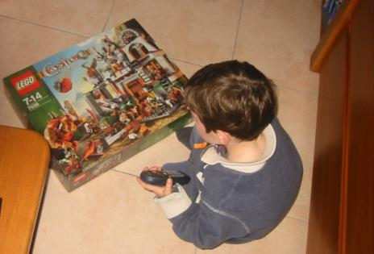

Ce set fait parti de la nouvelle gamme Castel de LEGO. On y trouve notamment de nouveaux personnages : des nains, des petits trolls verts et un troll géant !

## Fiche signalétique

**–** **Gamme** : Castle  
**–** **Désignation** : La mine des nains (Dwarves’ Mine)  
**–** **Référence** : 7036  
**–** **Année** : 2007  
**–** **Nombre de pièces** : 575 (inventaire Peeron)  
**–** **Nombre de minifigs** : 6 + 1 troll géant  
**–** **Prix moyen constaté** : 49,99 € (mai 2008)

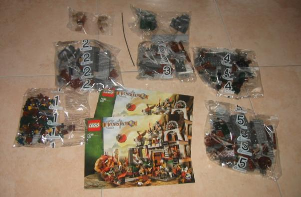

La boîte continent 5 sachets numérotés, 2 sachets non numérotés dans les quels on trouve le troll géant et des rochers. Traine en vrac dans la boîte un flexible technique. Nous aurions évidemment préféré que cette pièce soit mise avec d’autres pièces dans un sac pour éviter qu’elle ne se perde.

On y trouve également 2 notices contenant les instructions de montage détaillées.

## Les personnages

La première bonne surprise, ce sont les personnages. Les nains sont juste hilarants avec leur grosse barbe, leurs armes et leur casque. A noter qu’ils sont tous différents. Ils sont nains car ils reprennent les jambes courtes que l’on a pu trouver pour la première fois en 2002 dans de nombreux set notamment de Star Wars. Elles sont statiques et ne permettent donc pas d’articuler les personnages. De toute façon, les barbes sont tellement longues qu’elles leur arrivent presque au pied.

Le troll géant est apparu avec ce set. Il a les bras articulés et il arrive avec une grosse massue. Les pics sur son dos sont des cornes de vikings que l’on retrouve également pour faire des dents de requins, des défenses de catapultes, etc. Elles sont donc amovibles et se perdent assez facilement au bout d’un certain temps de jeu. Heureusement, comme souvent pour ce type de pièce, LEGO nous en a mis quelques unes en plus.

L’autre nouveauté côté personnage, ce sont les têtes de trolls verts. Elles sont vraiment réussies et font presque peur. Le corps avec les bras verts a également été créé à l’occasion.

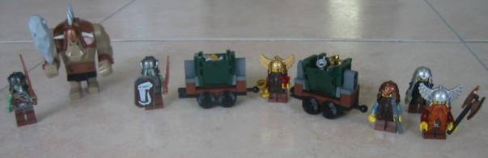

Le montage commence logiquement par les personnages mais aussi par les chariots. Et il faut bien avouer que j’ai craqué pour eux ! Leur montage n’est pas des plus simples. Mon fils de 4 ans a eu des difficultés à les monter. Les plus grands ou les habitués n’auront pas beaucoup de problème.

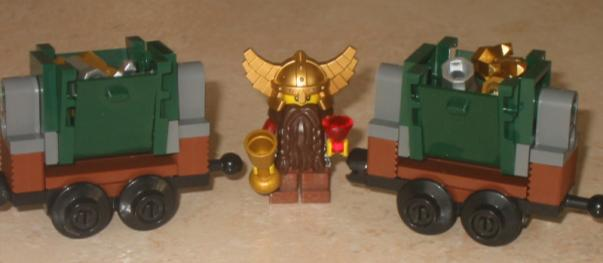

Ils rendent très bien et sont très jouables. Quand au montage, il est astucieux car constitué de portes 1 x 3 x 2 prises en tenaille entre des ailes en V, le tout monté entre deux pins (2460 et 2476) de chaque côté. Le basculement des portes assure la forme en V du wagonnet mais aussi l’ouverture et le vidage du contenu. De quoi donner des idées pour des wagons un peu plus grands !

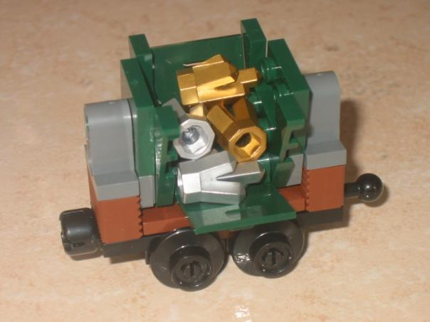

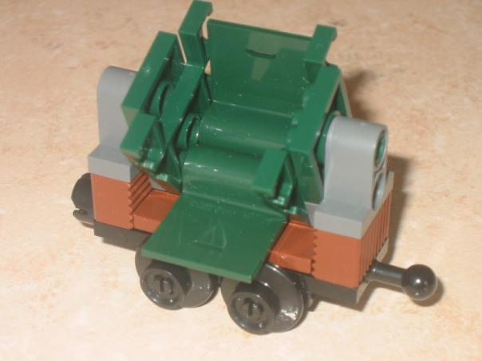

Le montage s’effectue en 4 grandes étapes : le montage de l’entrée de la mine, de la tour de droite avec une grande roue, de la tour de gauche avec sa catapulte puis l’assemblage de ces trois composants avec l’ajout des rails.

## L’entrée principale

[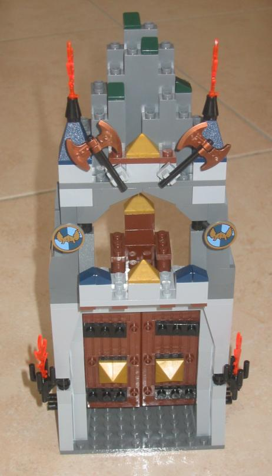](https://www.freelug.org/IMG/jpg/image007.jpg)

L’entrée de la mine est forte élégante, 2 grandes portes, renforcées par des barres noires et des pics métalliques. Le roi trône juste au dessus de cette porte lui offrant une magnifique vue. Ici, aucune difficulté, si ce n’est le positionnement des portes pour les plus jeunes.

## La tour à la grande roue

La tour à la grande roue permet de faire monter et descendre un bac que l’on peut remplir de minerai. Elle est censée illustrer le puits de la mine qui remonte le minerai après extraction.

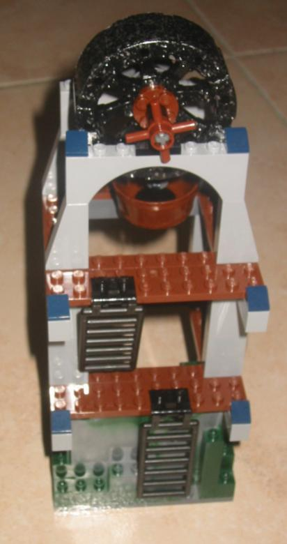

La aussi montage simple, la seule difficulté réside dans le nouage de la ficelle.

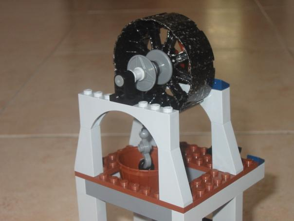

Le rendu final est simple mais efficace.

## La tour de défense

Voici la tour de défense avec sa catapulte. L’avant est simple mais il sera complété a posteriori lors du montage final.

[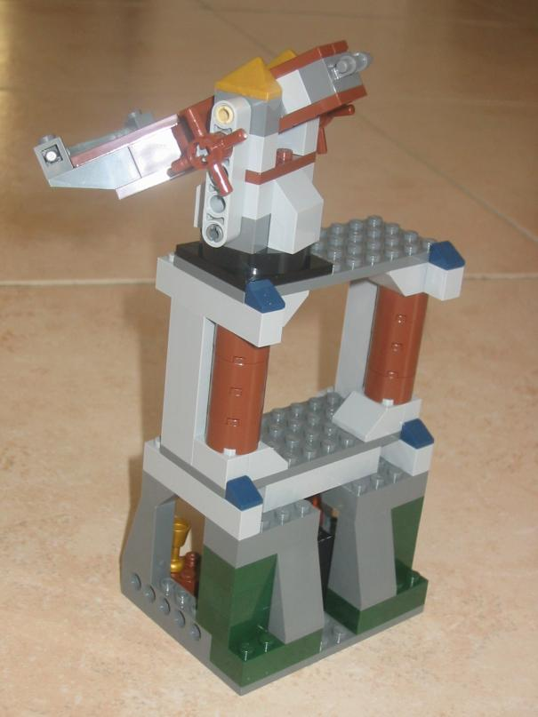](https://www.freelug.org/IMG/jpg/image010.jpg)

Le plus intéressant ici est vraiment la catapulte. La conception est très soignée et elle propulse ses projectiles à très bonne distance. Ses renforts sur les côtés l’ancre vraiment solidement à la base pivotante et il est donc possible de jouer avec sans la casser. Rares sont les sets à catapulte aussi solide et aussi designs.

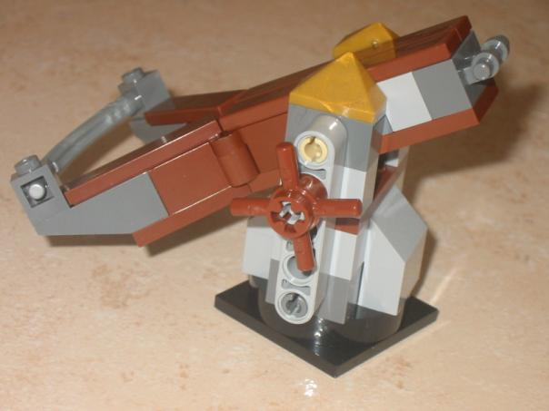

A noter que la quadruple poignée ne sert qu’à décorer.

## Montage final

Le montage final permet d’assembler les 3 précédents blocs et d’y ajouter les rails, le vide minerai, le bac à remplir les wagonnets et quelques décorations.

A l’arrière il y a la possibilité de charger les wagonnets. Un bac peut se déplacer entre l’avant et l’arrière et transporter le minerai. Le seul hic, c’est que les deux côtés permettent de vider le bac mais aucun de les remplir ! Cette fonction doit être réservée à la partie se trouvant sous la grande roue, celle de la mine. L’assemblage final ne le permet pas mais en modifiant le set ou en ajoutant d’autres annexes, cela doit devenir possible.

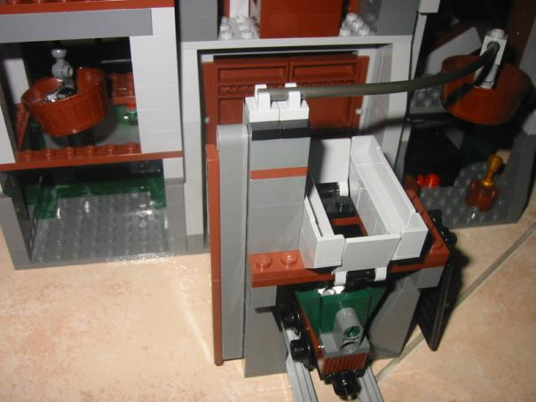

Le chargement peut être manuel à condition que les nains montent à l’échelle !

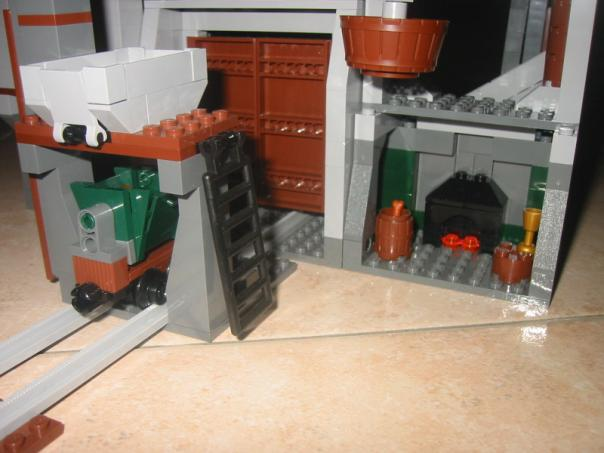

L’arrière comprend aussi une petite cheminée toute simple. C’est le coin salle à manger avec un banc, un verre doré et une cuisse de poulet.  
A l’avant, on notera une mini forge avec des haches, une armure, un casque et quelques autres accessoires.

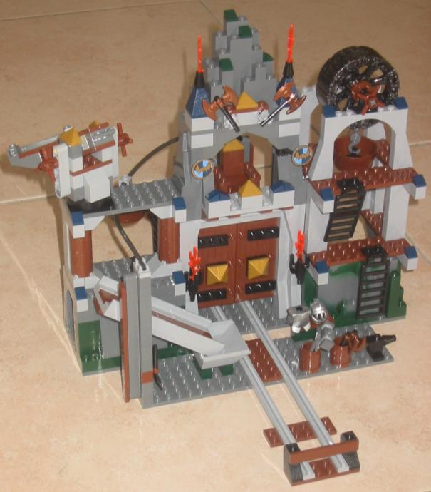

**7036 - La mine des nains**

## Conclusion

Un superbe set, avec des minifigs vraiment drôles et originales. Une mine que l’on a envie de prolonger en ajoutant d’autres bâtiments comme une forge avec haut fourneau, une zone de couchage, une salle à manger. Cela donne aussi envie de modifier le parcours du minerai de façon à pouvoir le charger et le décharger sur un cycle complet. Et aussi de modifier le circuit de rail pour en faire un circuit de train avec moteur.

En tout cas, Maxime a été ravi. Il a monté ce set en quelques jours à raison de quelques heures par jours. Il n’a eu besoin de mon aide que ponctuellement. Et son frère et lui ne se lassent toujours pas de jouer avec. Le bâtiment s’accommode d’ailleurs très bien des autres sets de type château issus de tous les âges.
