C’est avec les nouveautés Star Wars de la gamme Clone Wars que cette nouvelle édition de la Republic Gunship est sortie.

C’était en 2002, avec le set 7163 que le Republic Gunship avait fait son apparition.  
Je vais donc faire un descriptif de la nouvelle Republic Gunship et une rapide comparaison des 2 modèles.

## La petite histoire...

Ces [canonnières volantes TIO/BA](http://www.swg1.net/encyclo/voir_fiche_in.php?fiche=125) (Transport d’Infanterie Offensif/Basse Altitude) de la République firent leurs apparitions lors de la célèbre bataille de Géonosis (à la fin de l’épisode II). C’est le début de la guerre des clones...

Ces engins de transport tactique sont capables de survoler tous les types de terrains pour y déployer soldats clones et véhicules blindés. La canonnière, qui évolue au ras du sol, est puissamment armée.

_Fiche technique :_  
**–** Constructeur : Ingénierie Lourde de Rothana (filiale locale des chantiers de Kuat)  
**–** Modèle : Canonnière à répulseurs TIO/BA  
**–** Dimensions : L. 17,4m ; enverg. 17m ; h. 6,1m  
**–** Vitesse max. : 620 km/h environ  
**–** Capacité d’emport : 4 speeder bikes militaires, environ 17m³ dans la soute principale (si vide de soldats)  
**–** Autonomie : 8 heures de carburant environ  
**–** Equipage : 1 pilote, 1 copilote/canonnier, 2 canonniers de tourelles auxiliaires  
**–** Passagers : environ 30 soldats clones, 1 droïde médical IM-6 (dans un casier)  
**–** Armement : 3 tourelles antipersonnel (2 à l’avant, 1 à l’arrière) ; 2 lance-missiles à transfert de masse ; 4 tourelles laser à rayon composite haute précision ; 8 roquettes air-air

## Description et montage du set...

Disponible sur le [shop](http://shop.lego.com/ByTheme/Product.aspx?p=7676&cn=520&d=322).  
**–** Numéro du set : 7676  
**–** Nom de la boîte : Republic Attack Gunship  
**–** Gamme : Star Wars  
**–** Nombre de pièces : 1034  
**–** Nombre de Minifigs : 5  
**–** Prix moyen constaté : 130 €uros

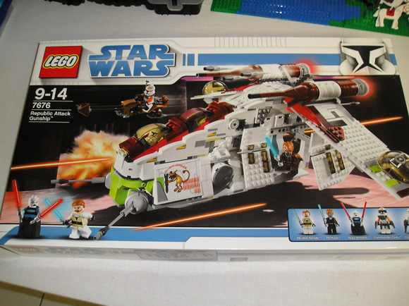

**la boîte**

Le design de la boîte est dans le même style que ceux de la gamme Clone Wars.

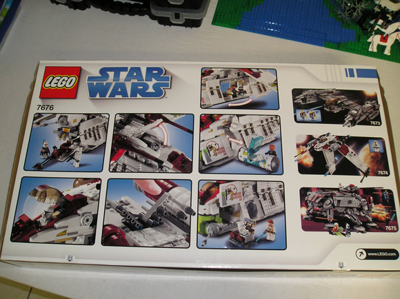

**l’arrière de la boîte**

L’arrière de la boîte nous montre les différentes fonctions possibles avec cette canonnière.

On ouvre alors la boîte pour y découvrir 2 notices, une planche d’autocollants et 18 sachets de pièces.

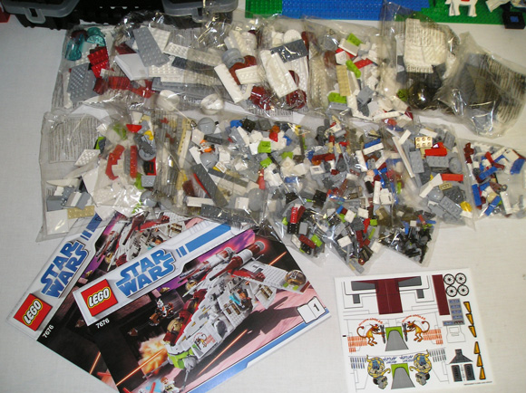

**le contenu...**

On fait un tri rapide...

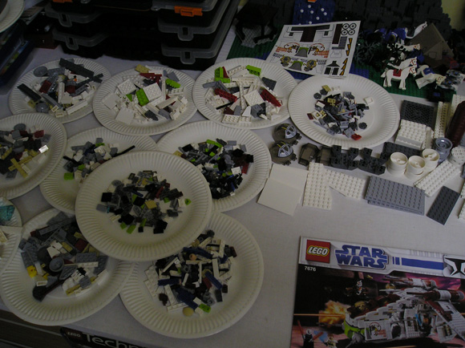

**un petit tri rapide...**

Et on commence comme toujours par monter les minifigs

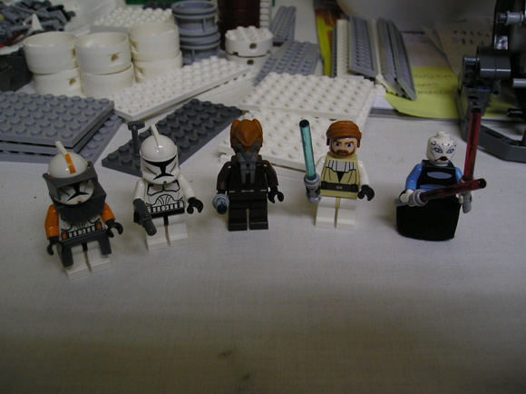

**les personnages**

Nous avons donc le droit à 5 minifigs tout droit sorties de l’univers Star Wars.  
Un simple soldat clone, le commandant Cody, le jedi Obi-Wan Kenobi, le jedi Plo Koon et Asajj Ventress, l’apprenti du maître Dooku.

La tête de Plo Koon est dans le même composite que la tête de Kit Fisto, sorti dans le set [7661](http://www.peeron.com/inv/sets/7661-1).

J’aime bien aussi les possibilités de rajouter une visière ou bien une petite antenne sur les casques des clones.  
Asajj Ventress porte une robe ! LEGO commence à proposer des habits à nos Minifigs...

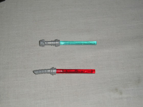

**les sabres lasers**

Un nouveau sabre laser fait son apparition, c’est celui de Asajj Ventress, celui du bas, quant à celui du haut, c’est le même pour les 2 jedis.

Après tous ces petits aperçus, on commence à monter la canonnière.

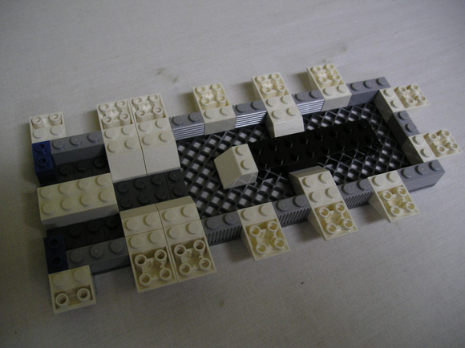

**la base**

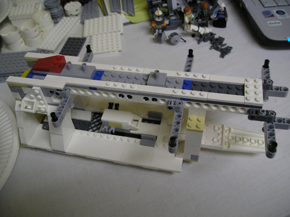

**ça monte...**

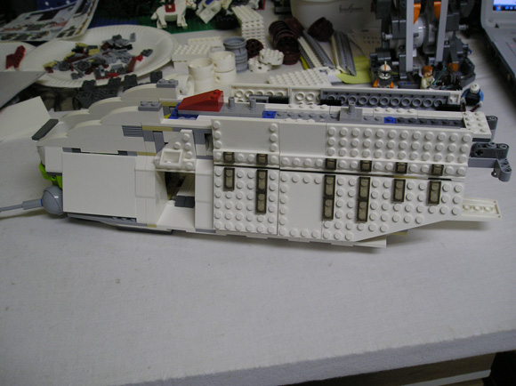

**ça monte encore...**

Rien de bien particulier lors du montage, tout se passe bien !

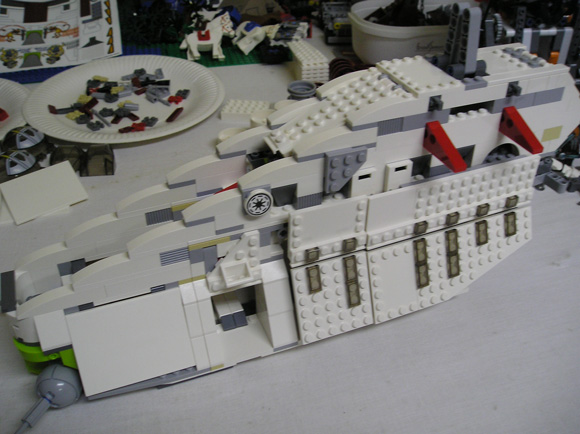

**ça monte toujours...**

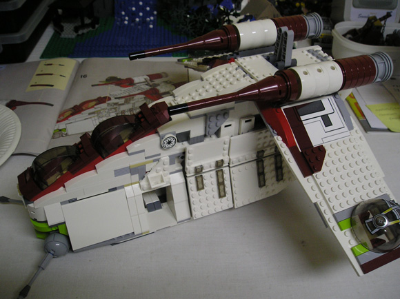

**ça y est... presque fini...**

Avec la canonnière, on a droit à un speeder Bike.

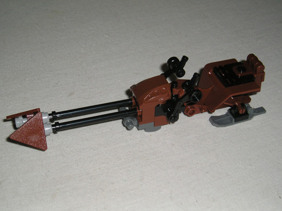

**speeder bike**

Ainsi que d’une chambre de guérison pour les clones blessés.

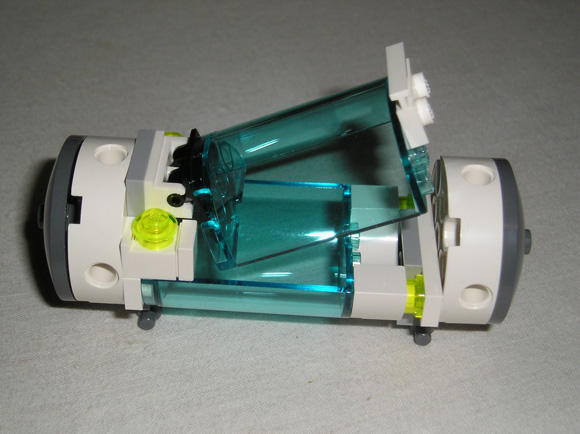

**un caisson médical**

Il y a aussi un petit poste de commandement avancé que l’on peut ranger sur l’avant de la canonnière.

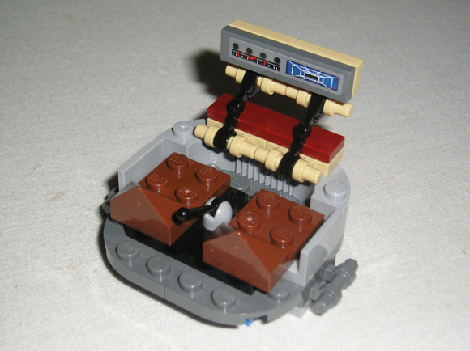

**un p’tit poste de commandement**

On vient donc de finir le Republic Gunship...  
C’est un bel engin d’attaque pour nos clones que LEGO nous propose là.

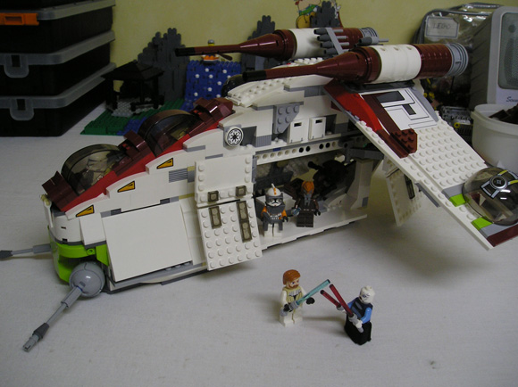

**c’est beau quand c’est fini...!**

Dans la partie centrale de la canonnière, on y retrouve le speeder bike, il peut sortir par l’arrière. Même avec cette moto rangée, il reste de la place pour mettre l’armée de clones...!

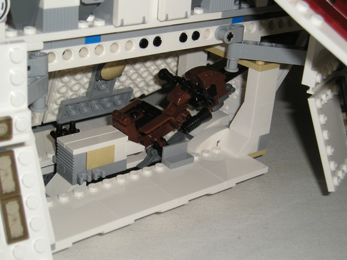

**l’intérieur**

Le bloc médical se range entre l’avant de l’appareil et la plate-forme arrière...

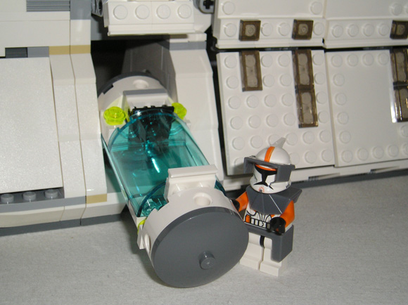

**rangement du bloc médical**

On retrouve donc la place du petit poste de commandement...

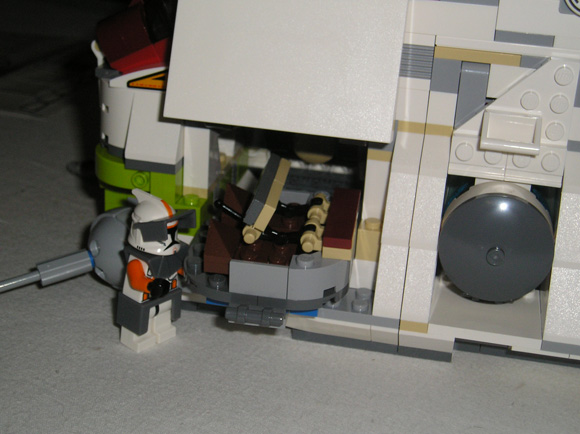

**rangement du p’tit poste de commandement**

Deux robots espions sont rangés sur le dessus de la canonnière...

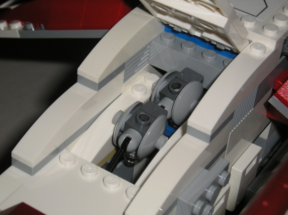

**les robots rangés**

Après tout ceci... vient le moment où on doit choisir entre les deux autocollants proposés à mettre sur l’avant.

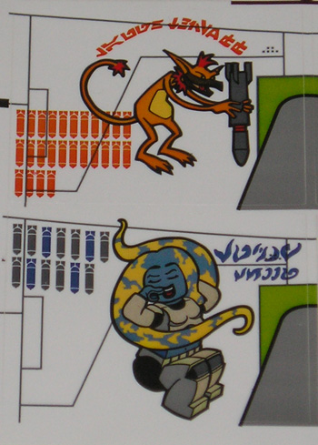

**le choix de l’autocollant...??**

On a le choix entre une minifig à la peau bleue (appelée aussi une Twi’Lek...) avec un petit air aguicheur et une belle coiffure... et une sorte de lézard avec un missile dans les mains...!

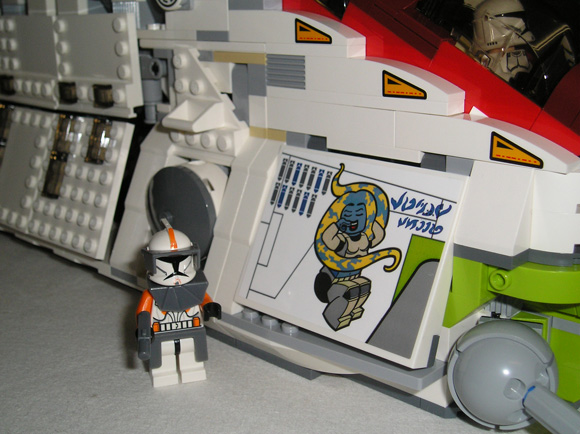

**choisi !**

Et oui... j’ai été séduit par la minifig...  
ça rend vraiment bien sur la canonnière, ce choix pour l’autocollant permet de personnaliser sa canonnière.

## Conclusion

Que dire...

Encore un magnifique set proposé par LEGO pour continuer à compléter sa gamme Star Wars. Cette nouvelle édition de la canonnière est une réussite pour moi.

Même du côté des minifigs, on a droit à 3 jedis et 2 clones.

## Rapide comparatif...

C’était en 2002 que le set [7163](http://www.peeron.com/inv/sets/7163-1) a fait son apparition.

On y trouvait donc une Republic Gunship, avec 4 soldats clones, un jedi et 3 droïdes séparatistes.

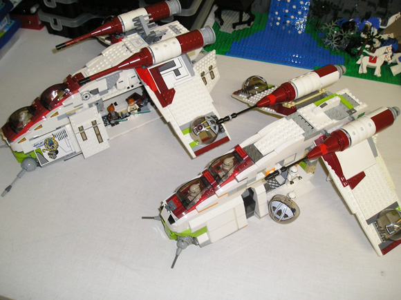

**avec sa jumelle !**

D’un point de vue général, elles se ressemblent beaucoup... Mais à y regarder de plus prés, il y a quelques différences...

Tout d’abord les portes qui sont complètes sur la nouvelle édition, et qui n’étaient que sommaire sur l’ancienne. Ensuite je regrette l’abandon des 2 tourelles sur les côtés... Sur les canonnières originales de la trilogie, elles ont ces tourelles pour se défendre. Cela dit, rien m’empêche d’en mettre en place.

Il y a aussi les nouvelles options : le speeder bike, le caisson de survie et le petit poste de commandement, tout compris à l’intérieur même de la canonnière.

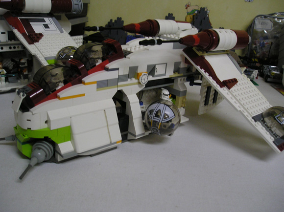

**la 7163...**

C’est vrai que je préfère la dernière sortie. Mais avec les deux ensembles, il y a de bonnes perspectives de champ de bataille...
