Après la [ferme](/articles/lego-city-ferme-7634-7636-et-7637-partie-1-2/), la [moissonneuse](/articles/lego-city-ferme-7634-7636-et-7637-partie-2-2/), le [tracteur](/articles/lego-city-ferme-7634-7636-et-7637-partie-2-2/), le [van](/articles/revue-du-set-7635-le-transport-de-chevaux/), LEGO poursuit son exploration du monde rural en nous proposant ce set qui complète à merveille la ferme.

**–** Référence : 7684  
**–** Nom : La porcherie et le tracteur  
**–** Nombre de pièces : 256  
**–** Prix : [29,90€ sur le S@H](http://shop.lego.com/ByTheme/Product.aspx?p=7684&cn=553&d=9)

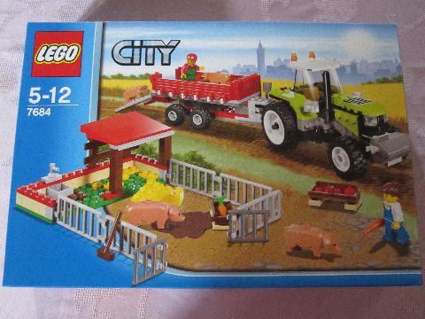

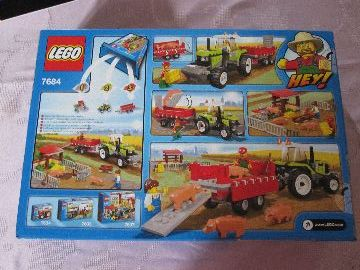

Si la face avant est des plus classiques, la face arrière nous donne plus d’indications sur le montage en trois étapes ainsi que sur les différents éléments mobiles de la benne.

N’attendons pas plus longtemps, ouvrons la boîte

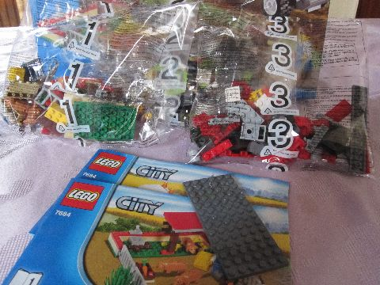

A l’intérieur, trois sachets comme le montre le dos de la boîte, la notice de montage en deux livrets, un pour la porcherie, l’autre pour le tracteur et sa remorque ; ainsi qu’une plaque 14x6.

Attaquons le montage de la porcherie puisque je vous sens impatient de découvrir cette nouvelle pièce : le cochon.

5 tenons de long, plus d’un tenon de large et 1 brique et 2 plates de haut, voilà les dimensions du cochon.

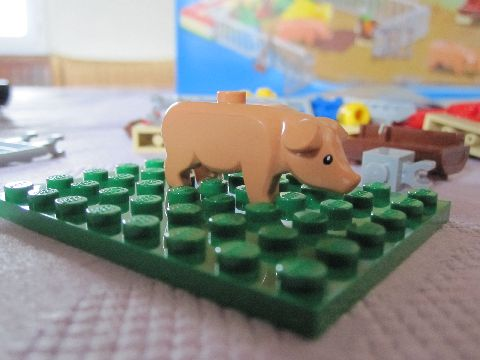

Je vous laisse découvrir le reste sur les photos.

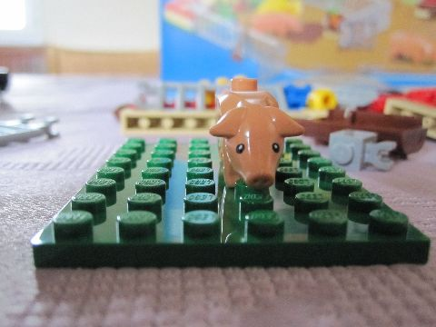

**De face**

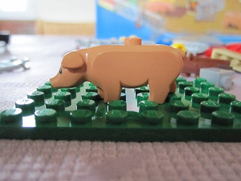

**De côté**

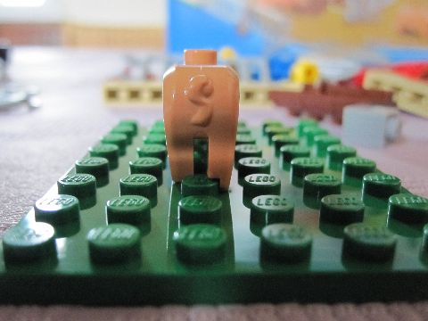

**De dos**

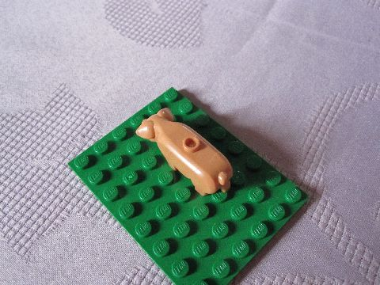

**De dessus**

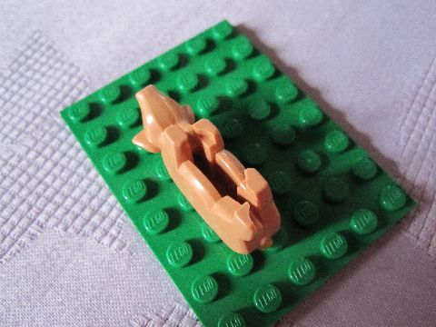

**De dessous**

Le montage commence comme à l’habitude par la fermière, puis par la porcherie.

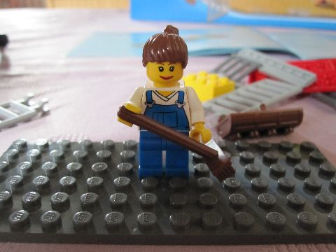

Montage en 21 étapes.

L’étape 5, le mur de la porcherie prend forme.

L’étape 10, L’abreuvoir est prêt, quelques restes de paille dans un coin

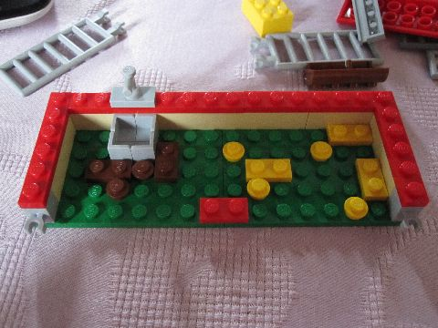

L’étape 15, Le toit est en place

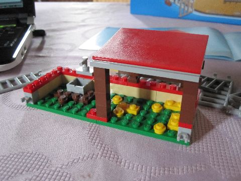

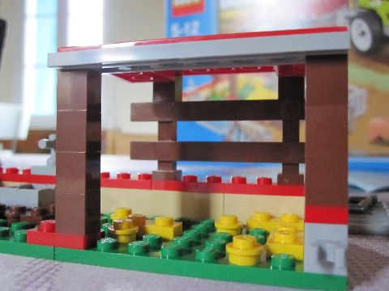

L’étape 19, l’enclos est terminé.

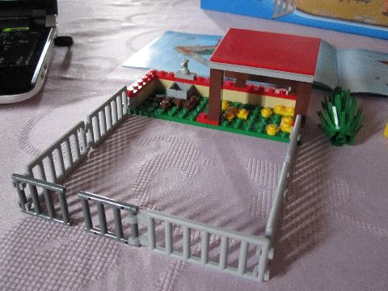

L’étape 20 et 21 clôturent le montage par la fabrication d’auges.

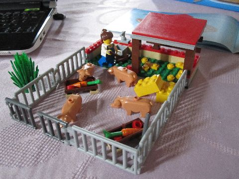

Le sachet N°2 correspond au tracteur.

Après la construction du fermier, on attaque le tracteur en 43 étapes.

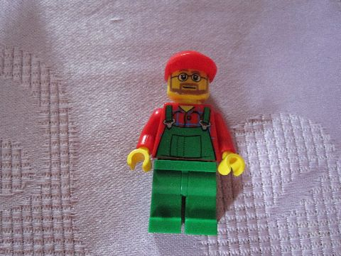

Etape 5 le châssis prend forme

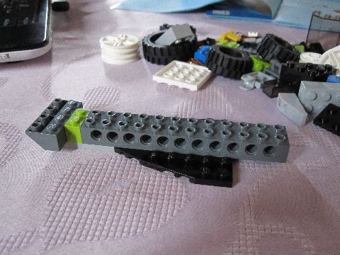

Etape 10 le système d’accroche des outils est en place

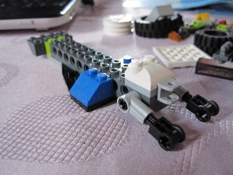

Etape 15 une ébauche du poste de pilotage

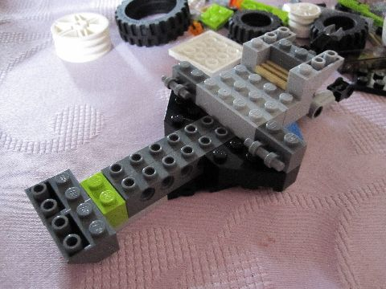

Etape 20 Serait-ce un bloc moteur ? Et ces briques 1x4 transparentes, posées à l’étape 18, c’est nouveau ça.

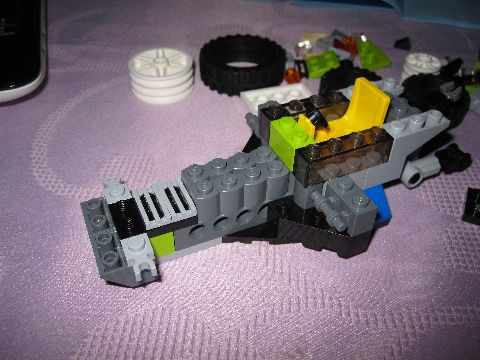

Etape 25 La cabine est bien engagée maintenant

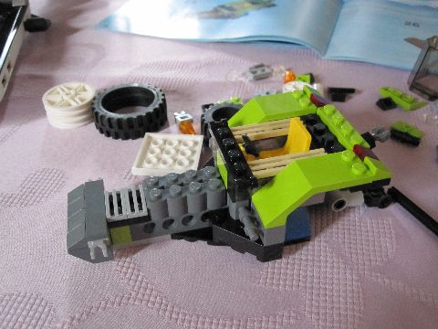

Etape 30 La calandre est posée

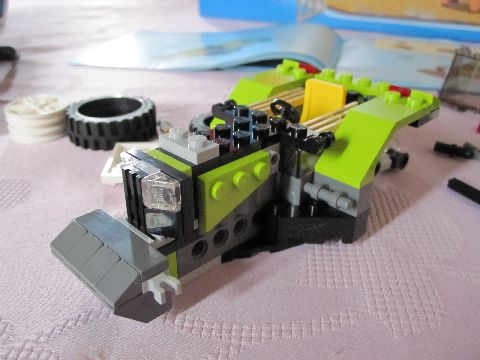

Etape 40 la cabine est terminée et le pot d’échappement en place, encore une nouveauté 2010 présente aussi sur le set [7213](http://shop.lego.com/ByTheme/Product.aspx?p=7213&cn=381&d=9) le camion tout-terrain et le bateau.

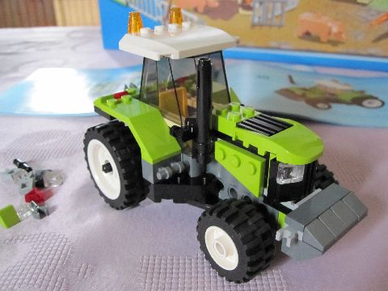

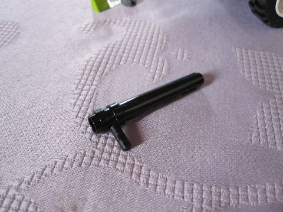

Etape 42 Le modèle est fini, cette étape montre comment installer le fermier au volant.

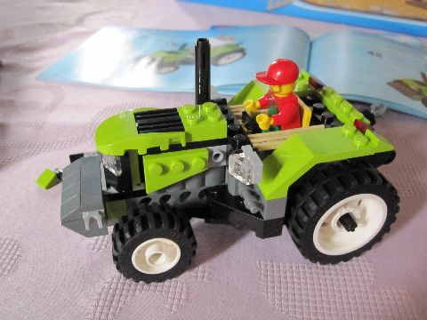

Etape 43 Le fermier est au volant.

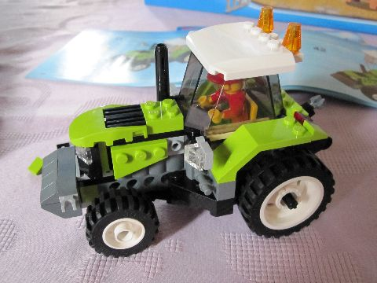

Passons maintenant au sachet n°3

Etape 5 On commence par le châssis quoi de plus logique

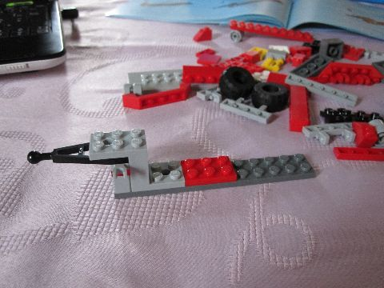

Etape 10 De nouveau une nouvelle pièce, une tile 2x4 ici en rouge. On passe maintenant à la benne.

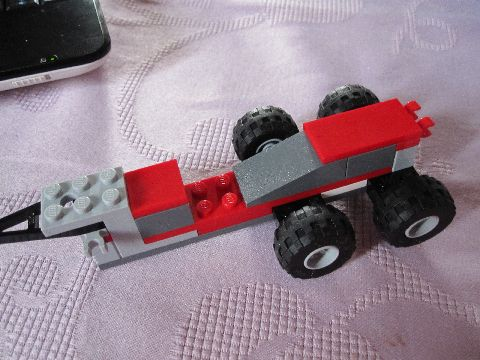

Etape 5 Le plateau de la benne est prêt à accueillir les ridelles

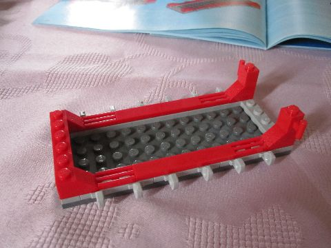

Etapes 10 La benne est assemblée sur le châssis

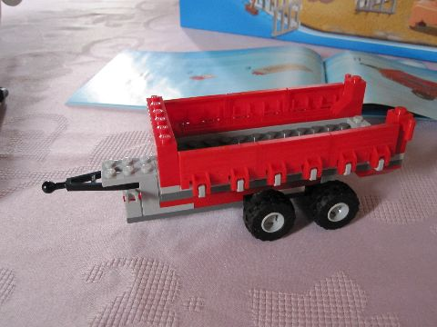

Etape 11 La rampe est assemblée à son tour à la benne.

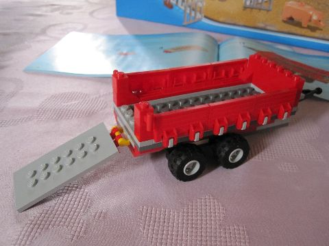

Etape 12 Le tracteur et sa benne.

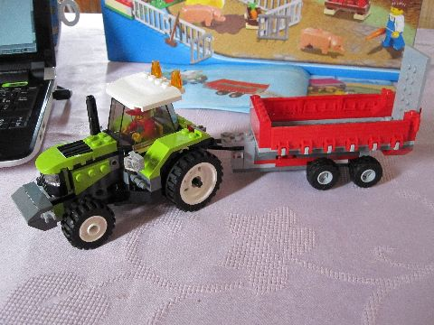

Voilà le montage du set est achevé encore une petite photo d’ensemble avec les extras parts

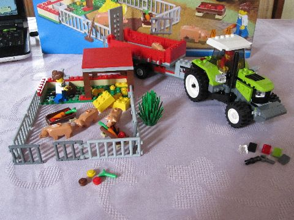

En conclusion, un excellent set qui vient compléter à merveille la ferme, de nouvelles pièces à foison, vivement le poulailler, la bergerie et autres bâtiments agricoles.  
Un petit bémol pour finir, la barrière ne ferme pas bien si on la fixe bien perpendiculaire au bâtiment, alors surveillez bien vos cochons pour éviter toute fuite.
