Je n’ai pas la prétention dans cet article de dire comment faire, car il y a mille et une façons pour réaliser une structure.

Je vais essayer d’expliquer certains principes de base, pour assurer une certaine solidité à l’ensemble et pour pouvoir réaliser la construction monstrueuse de vos rêves !

Quel constructeur LEGO n’a pas désiré un jour construire un modèle énorme  
comme [cette montagne](http://www.brickshelf.com/gallery/Kenn/Trains/NILTC/NMRA05/Others/mountain.jpg) par exemple ?  
Si il est vrai que les parcs LEGOLAND regorgent de ces réalisations, nous avons tous à l’esprit qu’ils ont toutes les briques voulues à disposition !

La réalisation d’une construction de grande taille nécessite d’être suffisamment solide pour résister à la pesanteur terrestre et aussi aux déplacements nécessaires pour les expositions.

La construction dite massive offre une contrainte de taille : un quantité énorme de briques !  
Donc l’astuce va consister à faire un compromis entre solidité et quantité de briques à mettre en jeu.

Et si certains se demandent pourquoi réaliser une structure de soutien ?  
Et bien, plutôt que de faire un discours, quand il n’y en a pas, ça donne ça :

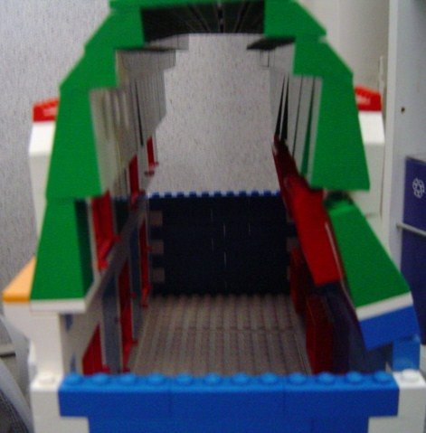

**Toit de maison**

## Etape 1/ la surface de départ :

La surface de base où va reposer votre structure est essentielle. Car si les proportions sont importantes, il faut que cela soit solide, sinon la catastrophe guêtte le jour où elle va se déplacer du lieu de construction !

Les plaques de base 32x32 ou 48x48 sont souvent le départ de toute construction, mais voilà elles sont très souples ! Quand elles sont à plats aucun souci c’est stable ! Il n’en sera plus de même quand elle devra être soulevée !  
Donc commençons d’abord par la renforcer :

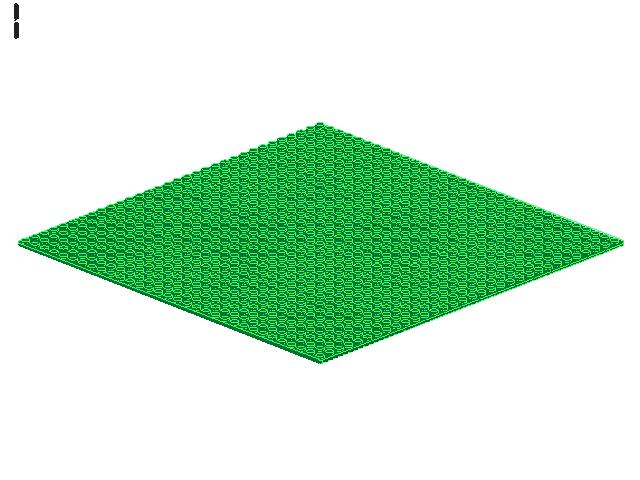

**Base module structure**

Exemple de plaque de base pour la construction de structures

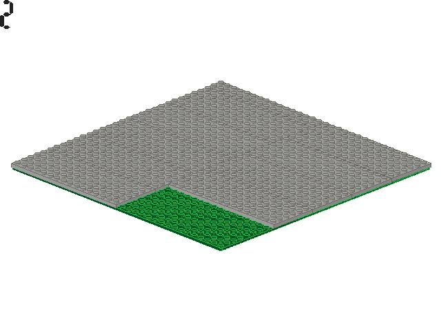

**Base module structure renforcée**

Renforcement de la plaque de base pour construire une structure

## Etape 2/ les piliers :

Les piliers seront les supports cachés de votre structure. Ils seront invisibles aux yeux du public mais sans eux, la construction en hauteur sera très vite limitée !

Exemple de piliers :

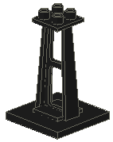

**Pilier 2680**

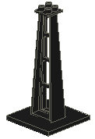

**Pilier 2681**

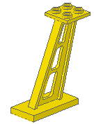

**Pilier 4476**

Ces pièces sont à déconseiller surtout si la structure prend de la hauteur ! Trop fragile, et la déformation latérale peut être problématique.

**Colonne 6168c01**

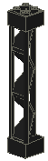

**Pylône 30517**

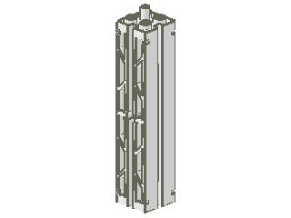

**Pilier 30646a**

Ces pièces sont plus adaptées mais assez hautes pour les 2 premières.

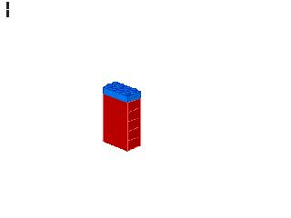

**Pilier en briques**

Pilier en briques 2x4 et plates 2x4

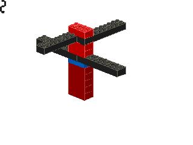

**pilier + poutres**

assemblage du pilier et des poutres. Les poutres sont montés successivement dans le sens gauche droite et avant arrière

## Etape 3/ les poutres horizontales :

Les poutres horizontales vont permettre de relier les piliers entre eux. S’il existe des briques pour cela, leur longueur est limitée : 1x16 ou bien 2x10 pour les plus grandes !  
Et déjà sur le 1x16 la résistance est assez limitée. L’autre point important, c’est que ces briques sont de longueur paire et que parfois on est amené à réaliser une poutre de longueur impaire.

Quelques exemples de poutres renforcées et à longueurs voulues :

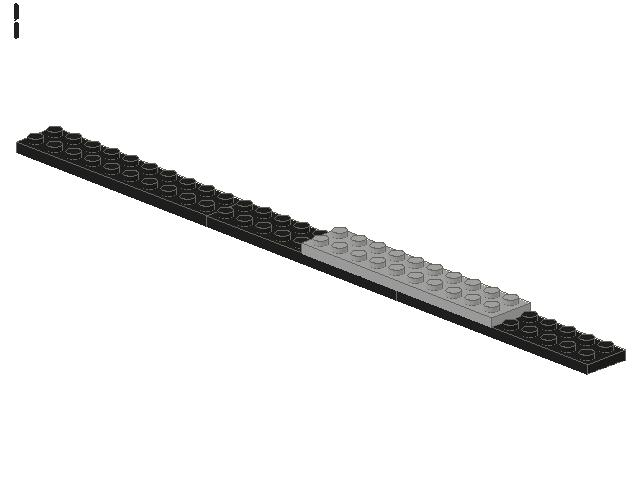

**Poutre extra longue**

réalisation d’une poutre extra longue à partir de pièces plates

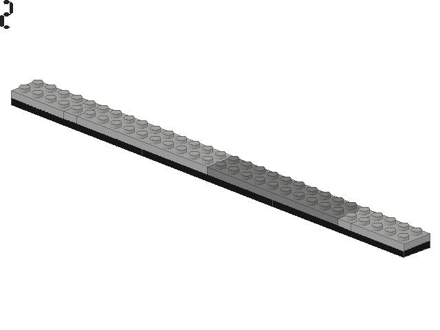

**Poutre extra longue étape 2**

décalage des pièces plates pour assurer la solidité

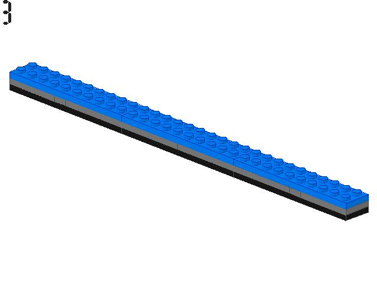

**Poutre extra longue étape 3**

Poutre terminée !

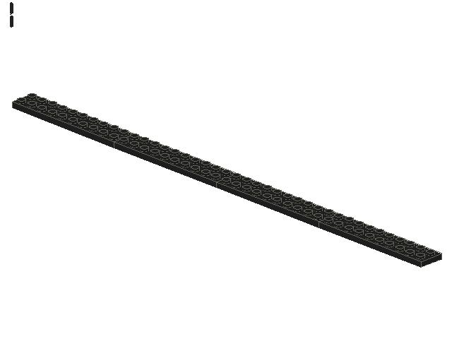

**Poutre extra longue Technic**

Réalisation d’une poutre extra longue Technic super renforcée

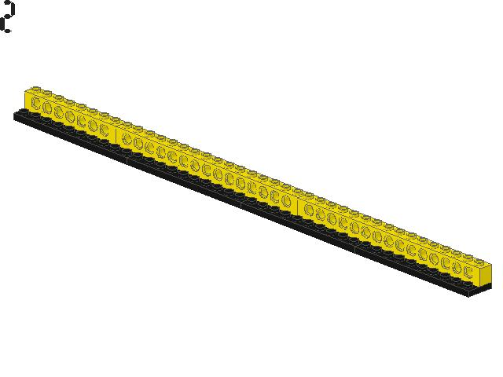

**Poutre extra longue Technic étape 2**

Décalage entre les plates et les poutres Technic

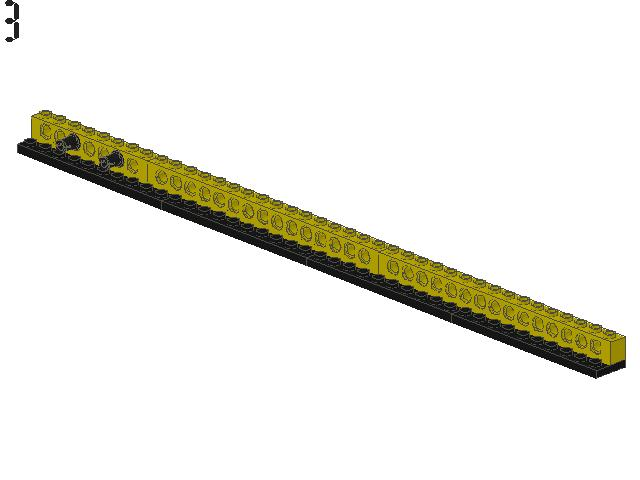

**Poutre extra longue Technic étape 3**

Connecteur Technic pour assemblage des briques

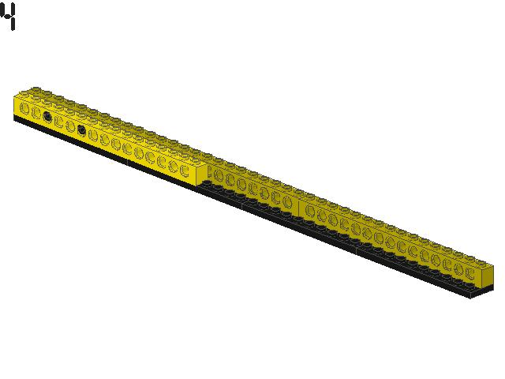

**Poutre extra longue Technic étape 4**

Décalage des briques Technic

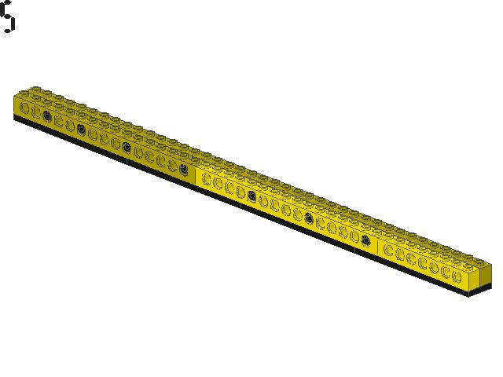

**Poutre extra longue Technic étape 5**

Double fixation sur les pièces plates et avec les connecteurs Technic

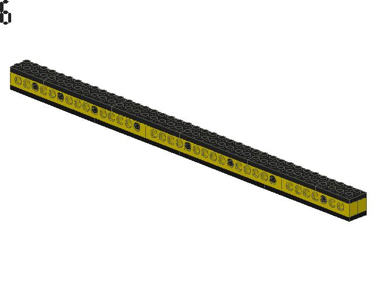

**Poutre extra longue Technic étape 6**

Etape finale

## Etape 4/ le recouvrement :

Je pense qu’il est préférable de procéder à une construction par étage. Comme cela vous pourrez réaliser plus facilement votre structure en modules, ce qui facilitera le transport.

Quelques exemples de pièces pour recouvrement :

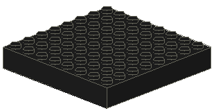

**Brique 4201 8x8**

Brique de base 8x8 servant de toit à la structure

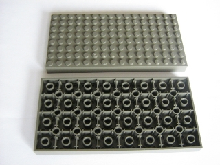

**Brique 4041 8x16**

Brique de base 8x16 servant de toit à la structure

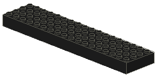

**Brique 4042 4x16**

Brique de base 4x16 servant de toit à la structure

Et maintenant un exemple de montage :

[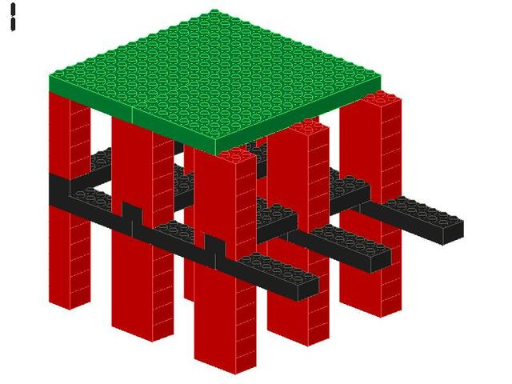](https://www.freelug.org/IMG/jpg/recouvrement_module.jpg)

**Toit**

Réalisation d’étages intermédiaires avec les grandes briques

## Etape 5/ l’habillage :

C’est la construction qui sera vue du public, la façade !  
Elle va devoir s’appuyer à chaque étape sur votre structure :

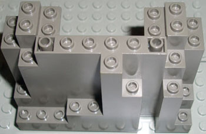

**Rocher 6082 ( BURP )**

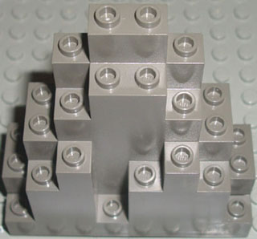

**Rocher 6083 ( LURP)**

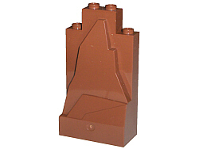

**Rocher 54782**

Exemple de pièces de façade pour les montagnes.

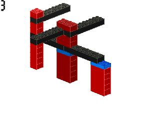

**Piliers mulitiples et poutres**

Assemblage de poutres et de piliers

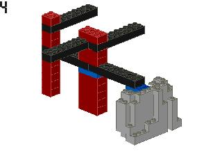

**Façade**

Mise en place de la façade

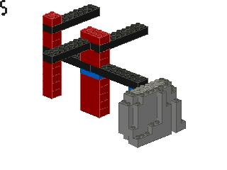

**Façade assemblage**

Assemblage de la façade à la structure avec une plate 2x6 dans ce cas

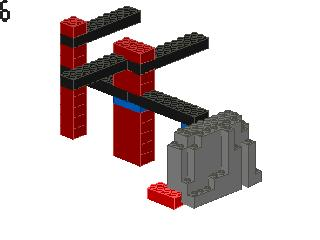

**Façade assemblage étape 6**

brique 2x4 cachée servant à assembler 2 élements de façade

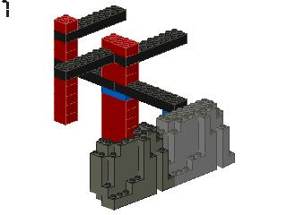

**Façade assemblage étape 7**

étape finale

## 6/ Conclusion :

Ce qu’il faut avoir à l’esprit c’est que toute structure imposante sera fortement gourmande en pièces, briques, plates de toutes formes.  
Toute la difficulté est de faire le meilleur compromis entre solidité et nombres de briques utilisées.

Quelques exemples de structures :

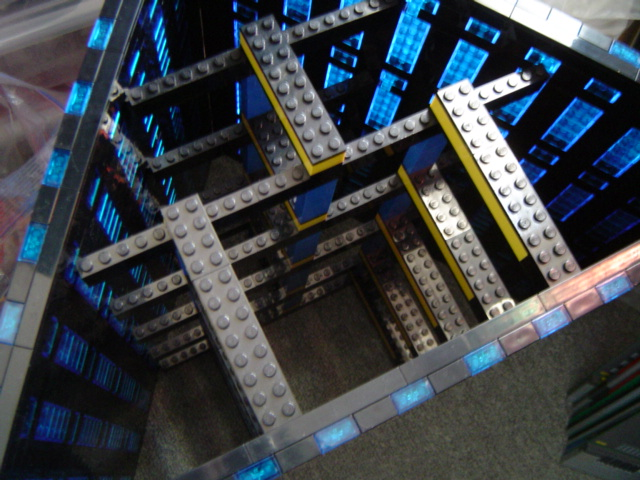

**structure interne pour un immeuble**

Vue sur la structure faite en plates et briques pour cet immeuble. La construction des façade en brique double permet de faire des consolidations cachées sur les parties intérieures des murs.

Il y a des milliers de façon de réaliser une structure et la nécessité de faire du cas par cas pour arriver à l’objectif que vous vous serez fixé !  
Un exemple de [réalisation](http://www.brickshelf.com/gallery/Jamesb/Supertrain2001/mountain/mountain07.jpg)  
Et parfois il faudra refaire et refaire plusieurs fois pour arriver au résultat tant espéré !

**A vos briques !**
