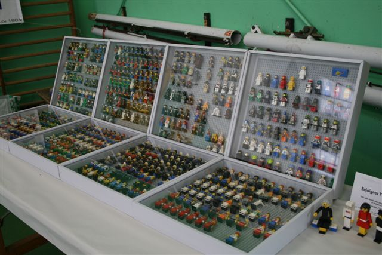
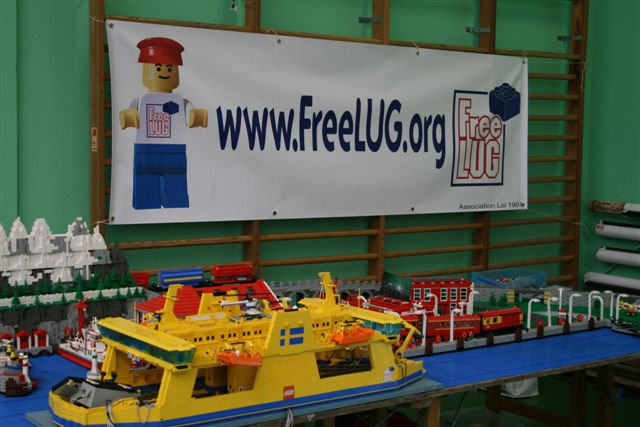

L’édition 2008 de notre club (de la maquette) sera marquée par la présence importante de LEGO représenté par son commercial régional et Jouéclub (sponsor exclusif du salon).  
Ce fait mérite d’être signalé car c’est plutôt rare par chez nous.

Ronan de Concarneau dont c’est sa première sortie officielle en salon, m’a fait l’amitié de venir et présenter sa collection de 600 minifigs et un diorama.

Pour ma part, j’ai présenté la suite et fin de mon réseau trains et ferries.

Le réseau ne sera plus représenté chez moi sauf décision de mon club vis à vis des enfants, en revanche, il sera visible dans les villes qui m’accueilleront comme Dinan à la rentrée.

Je travaille sur un autre thème et surtout je veux privilégier des dioramas animés comme la barge qui prennent moins de place pour les futurs salons.

Ce fut un franc succès pour les adhérents finistériens de FreeLUG.

Petit bémol, les salons dans le Finistère connaissent une baisse inquiétante de la fréquentation.

J’ai pensé à Médérick pour les maquettes de bateaux très particuliers, à Jac pour un truck

[Galerie de photos](http://photos.freelug.org/main.php/v/barr__/expositions/saintmartin2008/)

JEAN MARC et RONAN très contents du salon

_  
En effet, ce fut une première en salon (mis à part à [la gare de Quimper avec Jean-Marc et Didier Malon en septembre](/articles/674/)dernier), c’était très sympa de pouvoir montrer ma collection qui n’est qu’un échantillon de toutes les minifigs sorties par TLC depuis 1978._

_

Et, deux jours à jouer au train-ferrys, c’est excellent pour le moral !!!

merci jean-marc,

_

_ronan.  
[http://yopunk.free.fr](http://yopunk.free.fr/)_
