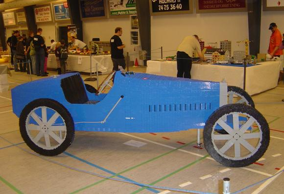
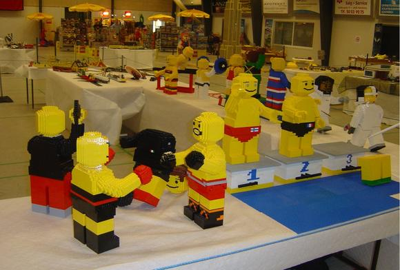
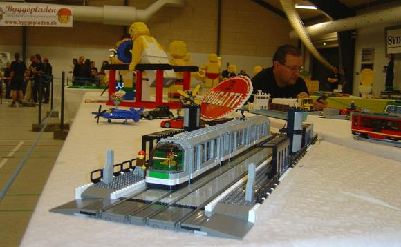

Résumé de l’exposition LEGO à Skaerbaek, Danemark, les 28 et 29 septembre 2008.

A faire une fois dans sa vie d’Afol !

Skaerbaek est une petite bourgade danoise située à 80km de Billund (capitale du LEGO).

Nous partons vendredi matin (Manu et Thierry) au volant d’un 23m3 chargé de la Bugatti et des Maxifigs Olymiques réalisées pour Fana’briques. Nous rejoignons Marc et Daniel (de Karlsruhe).

A noter que la prise en charge des frais de location de la camionnette est assurée par l’office de tourisme. La Bugatti rejoindra pour leur compte Berlin après Skaerbaek.

Arrivée vers 20h00.

Nous prenons possession de notre chalet prévu pour 6 personnes. Malheureusement ce chalet est prévu pour 4 adultes et 2 enfants.

Deux hollandais étant arrivés plutôt occupent une chambre.  
N’ayant pas de vrai chambre, je m’installe dans le salon. Mauvaise idée. Je passerai la nuit suivante dans la camionnette...

Le Fritidscenter est un centre de vacances avec salles de sport, piscine, stade, une cinquantaine de chalets et des salles de réception. L’endroit est chouette, et pratique pour ce type d’évènement. Nous avons réservé nos repas sur place. Les repas sont bons.

Nous mettons en place notre lay-out et notre Bugatti samedi matin dans une des deux salles réservées à l’exposition. Rencontre avec les afols. Inauguration samedi à 11 heures en présence de la directrice adjointe de LEGO. Le public arrive. Bonne fréquentation le samedi.

Samedi soir : repas obligatoire pour tous les afols, jeux, enchères et bons moments. 12 Nationalités différentes dont 5 Brésiliens.

Dimanche : Le public moins nombreux que samedi déambule dans les allées bordées de briques... Les quatre accompagnés de Serge (BeLUG) allons visiter l’ile de Römo. Le plus original étant que les voitures circulent et se garent sur la plage. L’après-midi verra la visite du boss de LEGO et quelques autres personnalités legotiques.  
Dimanche soir, nous rangeons notre matériel.

Lundi, départ pour Billund.  
Au programme, découverte du magasin d’usine, visite du musée privé et visite de l’usine. Fantastique journée !

Mardi matin, fin de la belle histoire.  
Au niveau des frais pour 4 jours, hormis le déplacement, comptez 100 euros pour les repas et 90 euros pour l’hébergement.

Merci au club danois Byggepladen et à Jan Beyer pour l’organisation.

**Photos sur le net :**  
**–** _J.Bartosch_ [http://www.brickshelf.com/cgi-bin/g...](http://www.brickshelf.com/cgi-bin/gallery.cgi?f=344989)  
**–** _Luca Junventino_ [http://www.brickshelf.com/cgi-bin/g...](http://www.brickshelf.com/cgi-bin/gallery.cgi?f=344403)

Thierry
