Kultiverse regroupe en fait quatre évènements en un, dont la célèbre [Japan Expo](http://www.japan-expo.com/) et Kultima, évènement auquel nous avions été invités à participer en novembre dernier.

130 000 visiteurs en 4 jours, autant dire que nos briques ont vu du monde, mais également toute sorte d’individus étrangement vêtus.

Nous étions cinq à participer à cet évènement pour lequel nous avons présenté du Médiéval, du StarWars et un peu de Technic.

## La partie Star Wars

L’objectif était de présenter toute la gamme UCS, chose faite dès le deuxième jour, le Faucon Millenium étant absent le premier (faute à une voiture trop petite parait-il).

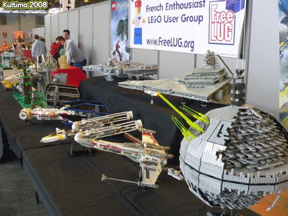

Jean-Louis avait également amené son diorama de la plate-forme d’Endor ainsi qu’une petite scène de la bataille d’Hoth.

Durant les quatre jours, nous avons également eu l’occasion de construire quelques boîtes de la gamme StarWars que nous avons ajoutées au fil du temps.

Autant dire que les StarWars ont toujours du succès, surtout que nous avions [à proximité un grand AT-AT](http://photos.freelug.org/main.php/v/JLB/Kultima2008/JLB-P1040581.JPG.html) et une [501ème](http://www.501frenchgarrison.com/) jamais très loin et toujours disponible pour une photo avec leur version Minifig.

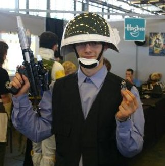

**Un rebelle avec sa version humaine**

ou plutôt un rebelle avec sa version minifig...

## La partie médiévale

Bien que Didier avait déjà présenté un diorama Castle l’année passée, nous avons voulu itérer puisque la gamme s’est étoffée en 2008 de nouvelles bestioles. C’est donc à quatre que nous nous sommes répartis les différentes zones du diorama. L’objectif était de présenter la gamme Castle au public, le tout mis en scène dans des décors.

**Le volcan des squelettes**

C’est Erik qui a fait tout feu tout flamme avec ce très beau volcan crachant flammes et squelettes venus du fond de l’enfer. Les bateaux se relayaient pour permettre aux os de traverser les eaux et de venir déverser sur le pauvre village les hordes de soldats des forces du mal. Evidemment toute cette chaleur et cette lave en fusion a donné quelques idées à deux pauvres créatures qui souhaitaient mettre en peu de peau sur leurs os.

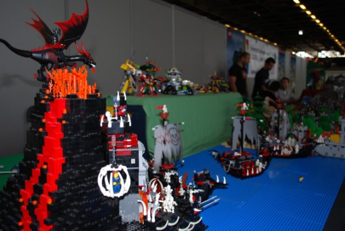

**Le village**

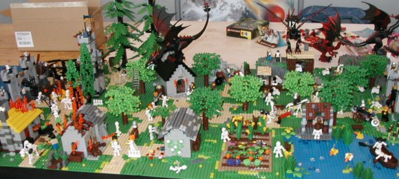

Le village de Manu recélait de scènes savoureuses où l’humour [côtoyait le gore](http://photos.freelug.org/main.php/v/brickerik/expositions/kultiverse2008/P7040103.JPG.html), voir le second degré parfois situé au-dessous de la ceinture.

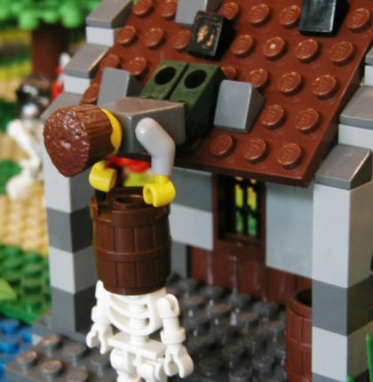

**Coup du sceau d’os**

Mais bon, tout ça faisait quand même bien rire notre public de tout âge.

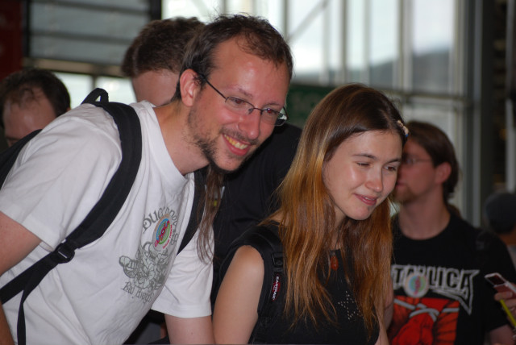

**Avec des yeux couleurs d’enfant...**

**Le champ de bataille**

Que serait un diorama médiéval sans son champs de bataille ?

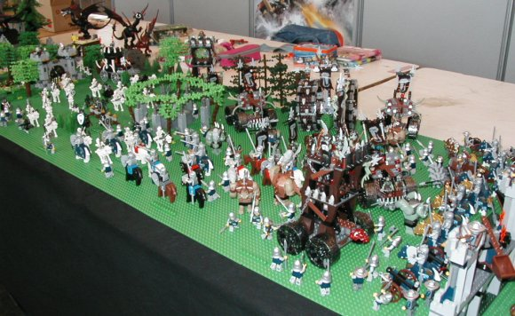

**La montagne et la mine**

L’idée était de présenter le set de la mine des nains, pour le montage, Jérémy a utilisé deux de ces sets. Inséré dans une colline, ce montage a permis également de surélever le château de Didier. A coté de la colline on trouve également deux rangées de remparts qui sont les premières lignes de défense du château. Sous la colline, caché du public se trouvent les temples de la gamme Indiana Jones. Serez-vous retrouver l’entrée sur les photos ?

**Le château**

Le château de cette édition était à la fois plus simple et plus complexe que celui de l’année dernière. Plus simple, car moins détaillé avec moins d’aménagement intérieur mais plus complexe avec quelques jeux sur les ruptures de structure pour présenter autre chose qu’un cube ou un rectangle.

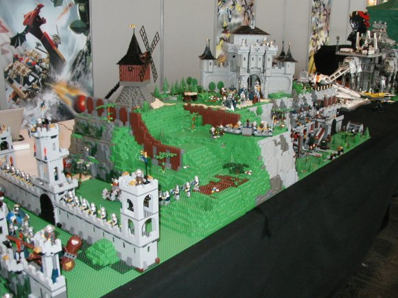

Bien mis en valeur sur la mine réalisée par Jérémy il était côtoyé par un moulin médiéval donnant un peu de mouvement (à défaut d’un peu d’air) à notre stand.

## Et à la Japan Expo, il y avait quoi de beau ?

La Japan Expo, c’est surtout très commercial, beaucoup de boutiques qui ne vendent pas de LEGO, donc d’aucun intérêt pour l’AFOL qui ne baigne pas dans la culture manga ;)

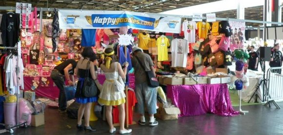

Mais il y a aussi tous les à-côtés : village de jeunes créateurs/auteurs, des dédicaces d’auteurs/dessinateurs/animateurs japonais, des stands jeux vidéos, des gundams et autres maquettes (coucou à [l’association Anigetter](http://anigetter.forums-actifs.com/) - merci pour l’apéro le samedi soir que nous avons du hélas écourter), toute sorte d’activités ludiques (jeux de plateau...) ou sportive avec présentation d’arts martiaux.

Mais la Japan Expo, c’est surtout son ambiance essentiellement offerte par les cosplayers, ces personnes costumées jouant le rôle d’un personnage généralement issu d’un univers manga, mais pas uniquement.

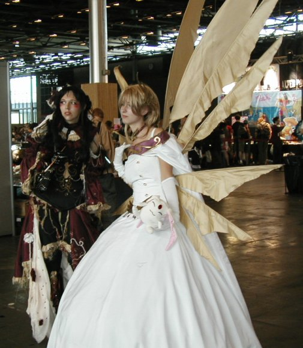

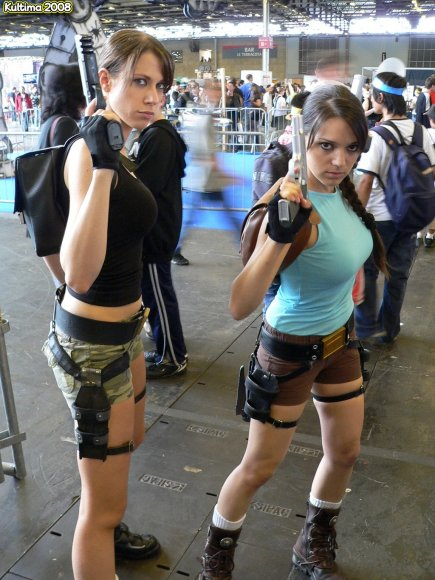

**On ne va pas se plaindre de voir double**

## Galeries de photos

Les galerie photos :  
**–** [Erik](http://photos.freelug.org/main.php/v/brickerik/expositions/2008/kultiverse2008/)  
**–** [Didier](http://photos.freelug.org/main.php/v/La-Gallerie-de-qdm/Expositions/2008-Kultiverse/)  
**–** [Manu](http://photos.freelug.org/main.php/v/Gyclore/Expositions/Kultima/Expo/)  
**–** [JLB](http://photos.freelug.org/main.php/v/JLB/Kultima2008/)

La vidéo tournée par [Amalgamez](http://www.amalgamez.com/), vidéastes amateurs et indépendants : [http://www.dailymotion.com/mrkey/vi...](http://www.dailymotion.com/mrkey/video/x68f23_japan-expo-2008-episode4hobbies_webcam)
