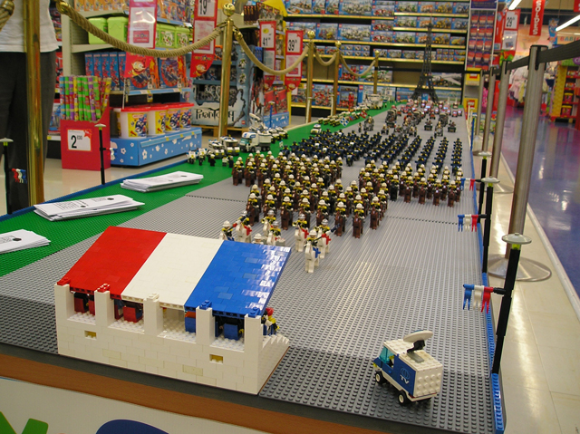
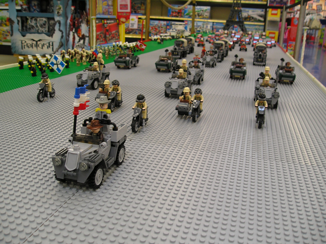
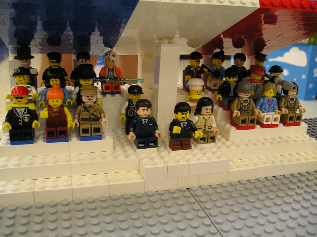
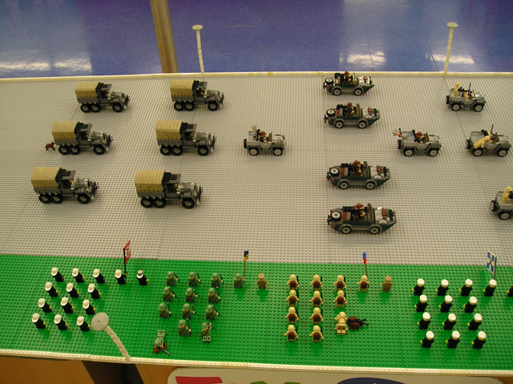
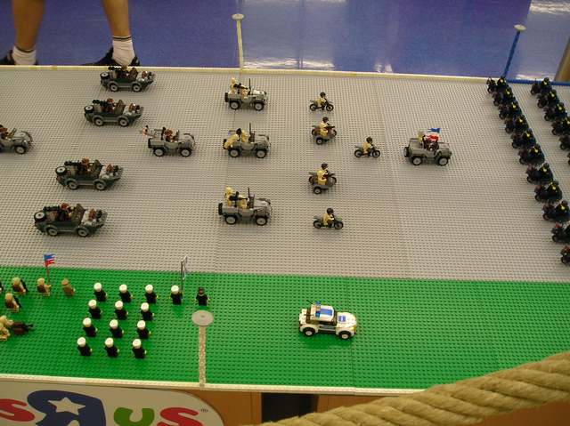
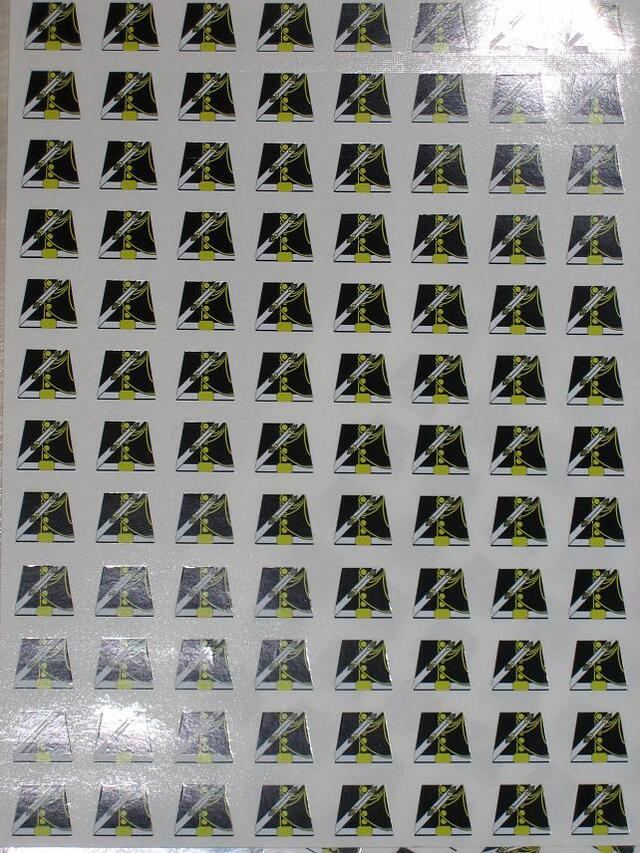
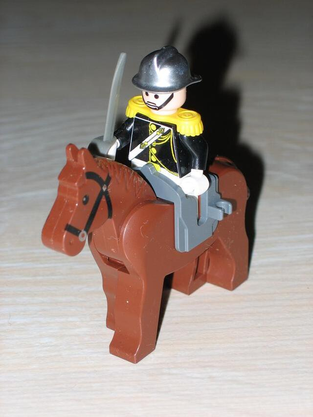
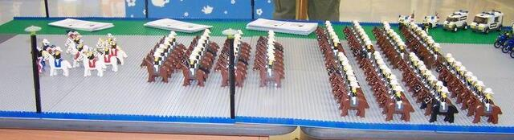
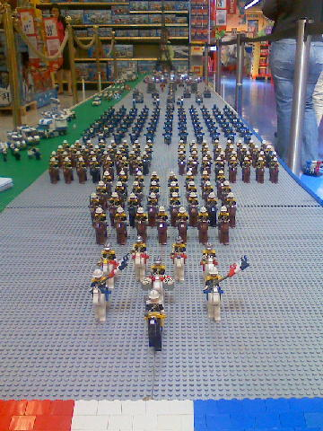
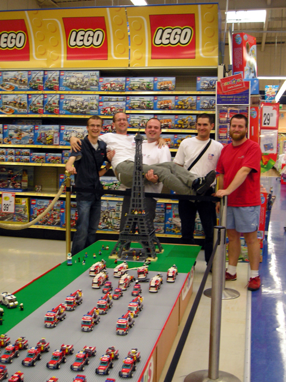

Après une exposition en solo en 2007, me voici entouré de PierreL, PierreC , DavidC et de Pierrick... ça sent la bonne ambiance à plein nez et une exposition qui s’agrandit.

Un 14 juillet, à Dijon...

**L’ensemble**

## Une exposition pas comme les autres...

Pour une fois je n’inonderai pas de photos car je n’avais pas d’appareil :) Mon idée folle de 2007 de vouloir refaire le défilé du 14 juillet a visiblement plu. Croyant être encore tout seul cette année, je ne pensais pas recommencer l’expérience tout de suite. Mais cette édition 2008 a été le signe de l’amitié au delà du LEGO. D’un seul exposant, cette exposition est passé à cinq exposants. Même si elle n’a qu’une durée éphémère, une journée, cette exposition restera pour moi une bonne détente entre potes et une bonne tranche de rigolade...

Je vous remercie les amis d’avoir fait le déplacement et pour cette agréable journée.

JeanG

* * *

**ma partie**

C’est ma première participation à une exposition en magasin, qui plus est sur une seule journée.  
Mais ce fut une bonne expérience.

J’ai été bien inspiré par la gamme Indiana Jones, en particulier les boîtes [7622](http://www.peeron.com/inv/sets/7622-1) et [7625](http://www.peeron.com/inv/sets/7625-1), qui reprennent des véhicules militaires. J’ai donc "investi" dans cette gamme.

J’en ai ressorti 7 boîtes 7622 et 4 boîtes 7625, plus quelques boîtes [7620](http://www.peeron.com/inv/sets/7620-1) et [7624](http://www.peeron.com/inv/sets/7624-1), et quelques autres...  
J’avoue que je n’ai fait aucune modification des véhicules.  
J’ai juste complété les uniformes des soldats, et échangé quelques têtes.

J’ai donc présenté 6 camions, 4 véhicules amphibies, 6 jeeps et 5 motos ainsi que des véhicules des pompiers. J’avais ramené ma Tour Eiffel, montée la veille par moi-même et un peu JeanG...

Pour qu’il y ait comme même des minifigs à pieds, j’ai mis en place mes deux régiments, ainsi que des policiers et des pompiers. Il n’y avait pas suffisamment de minifigs pour les mettre dans le défilé.

Un défilé n’est rien sans sa tribune officielle, j’ai donc pris 5 min pour en faire une petite et ainsi y mettre notre président...

**La tribune officielle**

Quelques vues de ma participation.

**vue d’ensemble 1**

**vue d’ensemble 2**

Il y a eu une superbe ambiance entre nous cinq... Les minifigs en ont encore vu de toutes les couleurs... Les sabotages chez les créations voisines étaient réguliers...  
Allez voir les photos pour plus de détails...

Je tiens à remercier JeanG pour m’avoir permis de découvrir cette nouvelle façon d’exposer.

Voilà pour ma participation à ce défilé. J’espère réitérer l’expérience l’année prochaine, avec j’espère plus de véhicules militaires, et avec, pourquoi pas, plus de participants...

Pierre L. (appelé aussi Pierrolego)

* * *

Dès que JeanG m’a appris qu’il renouvelait l’exposition du défilé du 14 juillet j’ai tout dessuite voulu m’associer à lui.

Pour l’occasion j’ai décidé de réaliser des gardes républicains. J’ai donc réalisé 101 cavaliers (100 gardes et un capitaine). Le modèle de la tête vient d’un set Star Wars (sauf pour le capitaine qui a la tête d’Alfred, le maître d’hôtel de Batman), le torse est un Castle et le casque est un casque de pompier métallisé.

J’ai aussi fait réaliser des autocollants pour les torses de minifigs, mais ceci sera le sujet d’un autre article.

**Planche de stickers**

Voici donc mon modèle de garde :

**Un garde et son cheval**

Voila, mes gardes sont prêts pour circuler sur les Champs-Elysées !

**La garde républicaine défille**

En tête de cortège, on peut trouver la fanfare de la garde qui a l’habitude de précéder le défilé des troupes montées.

**En tête de notre cortège : la fanfare !**

Voila maintenant que la garde républicaine est passée, c’est au tour des unités motorisées !

J’ai pris un grand plaisir à préparer et à participer à cette exposition. Je remercie tout mes camarades du jour pour le bon moment passé en leur compagnie !

Pierre C. - Tribolego

* * *

En fait c’était ma première exposition en tant que participant. Alors j’avais sorti la grosse artillerie : 4 camions de pompiers tous neufs. En plus comme je suis arrivé en retard on les a mis à la fin.

Ça a été une bonne journée avec une exposition évolutive, le décor a changé toute la journée et les minifigs ont suivi nos humeurs. Une mention particulière à notre président que tous les visiteurs ont reconnu et à son ministre du transport.

Pierrick

**Des AFOLs.....!**

Galeries photos :  
**–** [Pierrolego](http://photos.freelug.org/main.php/v/pierrel/exposition/14+juillet+2008/)  
**–** [PZ](http://photos.freelug.org/main.php/v/-PZ/Toys+14-07-08/)
