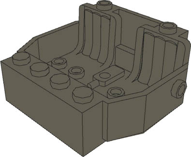
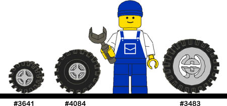
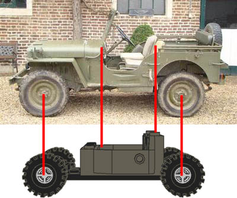
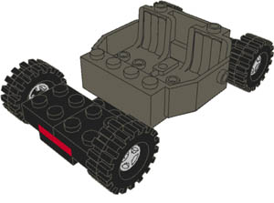

Récemment j’ai acheté le [set Indiana Jones #7622](http://www.peeron.com/inv/sets/7622-1) car j’ai trouvé l’esthétique des véhicules plutôt sympa. Après un montage rapide avec un pote n’étant pas encore sorti de son dark age (mais sur le point de l’être), comme toujours j’ai été un peu déçu du coté mal proportionné des sets officiels...

C’est bien connu, un MOCeur n’est jamais si bien servi que par lui-même, me voila donc parti pour faire ma propre version.

En montant le set je me suis dit que le [SPUD](http://www.brickwiki.org/index.php?title=POOP) "[Car Base 4 x 5 with 2 seats #30149](http://www.peeron.com/inv/parts/30149)" n’était finalement pas si moche que cela et mériterait peut-être l’attention d’un MOCeur de mon genre. Observons la pièce en question :

**Le SPUD 30149**

Mouais... ça va pas être si simple, la pièce présente peu de possibilités d’accroches. On sent qu’elle a été conçue pour se clipper sur une base. Il y a bien quelques tenons sur le dessus, mais si on s’accroche par là, la voiture va se plier en deux dès qu’on va vouloir assoir une minifig au volant...

Rien sur les cotés ou presque car les poignées de portes ne vont pas être d’un grand secours. Bref autant se faire à l’idée, il va falloir passer par en dessous.

Au fait que va-t-on faire avec cette pièce ? Bien évidemment une jeep, et qui dit jeep, dit jeep Willys, la jeep la plus célèbre de l’armée américaine. Une petite [recherche sur Google Image](http://images.google.fr/images?hl=fr&q=Jeep+Willys&btnG=Recherche+d%27images&gbv=2) me procure plus de photos de référence qu’il n’en faut !

Bon ! Prochain problème le choix des roues et la longueur du châssis. Pour ce qui est de la largeur, il n’y a pas à hésiter une seconde, pour moi les voitures à l’échelle minifig se doivent d’être en 6 tenons de large, et ça tombe bien, notre SPUD s’y prête admirablement. En revanche, pour ce qui est des roues, d’habitude je prends les roues classiques [#3641](http://www.peeron.com/inv/parts/3641) que TLC utilise couramment sur les petits véhicules pour minifig. J’aime bien ces roues car elles ne sont pas trop hautes, elles me semblent donc mieux proportionnées par rapport à la hauteur d’une minifig. Sur les sets récents (comme sur le set Indiana Jones à l’origine de cet article), TLC tends à utiliser des roues du diamètre de la roue [#3483](http://www.peeron.com/inv/parts/3483), mais franchement je trouve cela exagéré, est-ce que les roues de votre voiture vous arrivent à la hauteur de la poitrine ? Pour des roues de camion ou de bus je ne dis pas...

**Hauteurs de roues par rapport à une minifig**

Mais un rapide test avec mes roues préférées donne tout de même l’impression qu’elles sont trop petites, j’opte alors pour les roues [#4084](http://www.peeron.com/inv/parts/4084) que je trouve en farfouillant dans mon stock et qui sont d’un diamètre intermédiaire.

Un rapide montage du châssis sur une plaque 2x10 nous permet de comparer les proportion entre notre MOC et le modèle d’origine.

**Comparaison des proportions**

On remarque au passage que les roues arrières doivent être plus proches du SPUD que les roues avant. Ce détails a l’air insignifiant, cependant j’ai remarqué qu’une bonne proportion entre les éléments significatifs du modèle est plus important que l’ajout des détails et décorations pour faire ressembler le MOC au modèle d’origine.

Il y a un autre détail qui pour moi a de l’importance lorsque je fais un véhicule en LEGO, il s’agit de la hauteur du véhicule. Si on n’y prend pas garde, on a vite fait de faire des voitures trop hautes qui dépassent de plusieurs têtes une minifig debout à ses cotés. Le choix de roues un peu plus grandes que d’habitude risque d’aggraver la situation. Il est clair qu’il va falloir baisser le châssis d’au moins une plaque.

**Le gabarit de base**

Ne vous jetez pas sur vos pièces pour autant, il ne s’agit que d’un gabarit, rien ne dit que la base sera faite d’une plaque 2x10 ! Maintenant que le gabarit est prêt, dans les prochains articles on va pouvoir s’attaquer à la réalisation proprement dite, que j’ai découpé en 3 parties : l’habitacle, l’arrière et l’avant.

**La suite au [prochain numéro](/articles/792/) !**
