Ma collection Castle ne pouvant être complète sans [la tirelire appartenant à cette gamme](http://shop.lego.com/ByTheme/Product.aspx?p=852231&cn=473&d=70), j’ai donc fait l’acquisition de cette boîte. Les surprises offertes à l’ouverture de la boîte m’ont invité à vous les partager.

Sous son film plastique, le premier carton d’emballage ne laisse pas encore présager la suite.

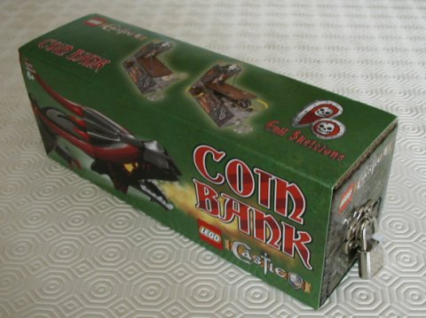

En le retirant, la tirelire laisse découvrir un beau carton glacé ainsi qu’une seconde petite boîte, le tout sous un bout de carton percé de deux trous par lesquels surgissent deux tenons, la notice étant délicatement glissée (comprendre pliée en trois) entre.

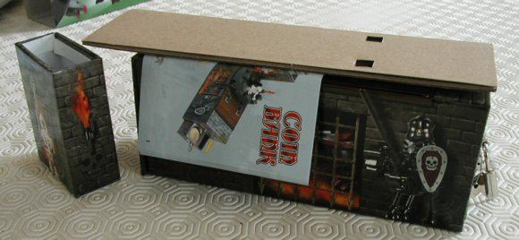

Déjà, il y a une notice, de 24 pages, cela induit qu’il y a de la construction. La présence des deux plates sur le dessus intrigue, c’est sans doute la première fois que nous allons devoir construire sur du carton...

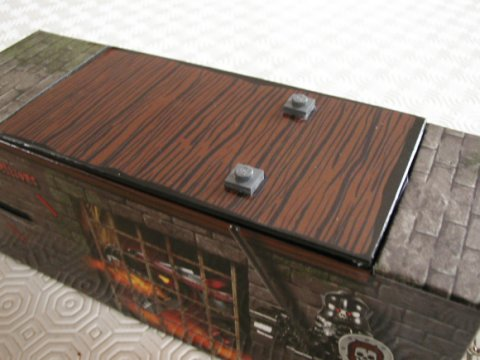

Construire... oui effectivement, nous oublions qu’il doit y avoir des briques dans cette boîte.

Soulevons donc le couvercle et découvrons des sachets bien tassés.

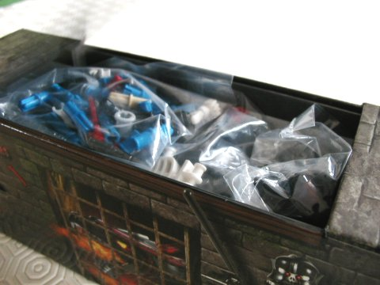

Quatre sachets, plus précisément. Le sachet des grandes pièces semble si bien compacté que cela nous fait penser à ensachage manuel. Il faut dire qu’il faut caser les 102 pièces annoncées sur la boîte dans un si petit espace !

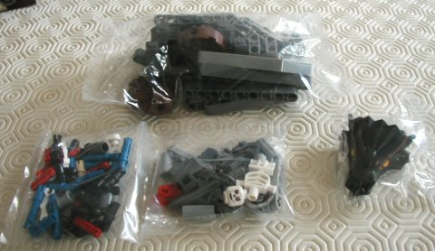

La première étape de montage ravira davantage les fans de Technic que de Castle. Notons que les étapes sont rapides, les chevilles étant parfois placées en même temps que les barres (chose que nous ne voyons plus de nos jours) et parfois même sur l’arrière de la construction, laissant au constructeur le droit de déduire ou deviner leur position, la symétrie n’étant pas de mise...

La tête du dragon est montée sur bras, celui-ci pivotant par l’action des manivelles. Un système à cran d’arrêt empêche la tête de retomber.

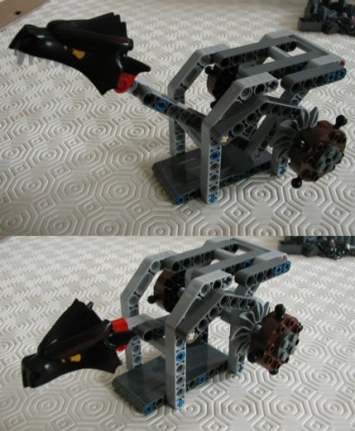

La seconde étape est l’assemblage d’un petit bout de rempart. Sous la plaque, deux briques 2x3 viennent se fixer en configuration "stud to tube" (tenon vers tube), montage peu courant dans un modèle officiel.

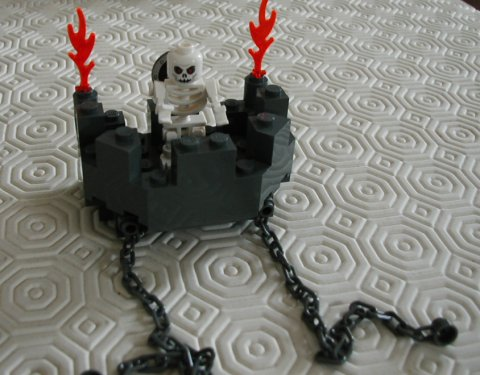

Côté carton, on extrait un grand tiroir par l’arrière, un volet le retenant à l’aide d’une bande auto-agrippante.

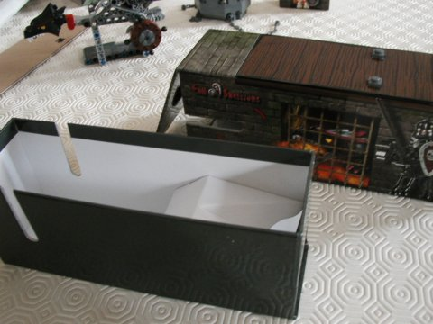

Le montage Technic y prend place, des fentes laissant passer les axes des manivelles.

Le rempart vient se glisser dans la petite boîte et celle-ci est collée à la grande grâce à un adhésif double-face. Les chaînes sont reliées aux deux tenons de la trappe.

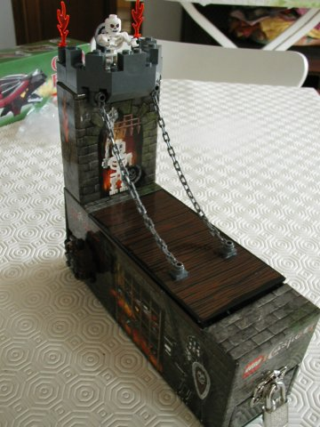

L’action de rotation des manivelles fait surgir le dragon de la trappe.

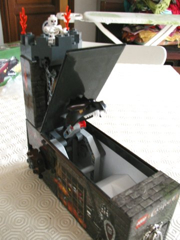

Le dragon vient ensuite se rabattre sur la pièce présentée au bord de la tirelire pour la faire tomber de ses dents dans un petit tiroir accessible qui s’ouvre sur le devant et protégé par un petit cadenas (qui n’inspire pas confiance).

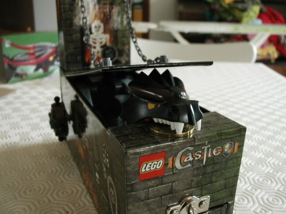

[Le plus simple pour illustrer étant évidement une vidéo](http://photos.freelug.org/main.php/v/brickerik/boites/P8110007.MOV.html) (la petite boîte n’a pas été collée, c’est pour cela qu’elle est tenue à la main).

Voila donc une tirelire bien sympathique avec une présentation de belle qualité qui relance le mythe du dragon gardien de trésors. Construction originale mêlant briques et boîte en carton, on regrette quand même la nécessité d’un collage.
