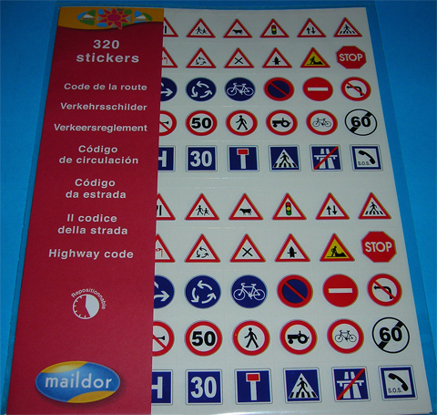

Une petite brève pour vous faire partager ma découverte du jour.

Flânant dans un magasin [Cultura](http://www.cultura.com/) (distributeur de produits ludo culturels), j’ai mis la main sur ce petit sachet contenant pas moins de 320 gommettes repositionnables reprenant des panneaux du code la route.

Il s’agit d’un produit de la marque Maildor, au prix modique de 3,34 €.

Les gommettes se présentent sous la forme de carré de 19 millimètres de côté.  
Il faut surtout retenir que les pictogrammes routiers présentent eux des arêtes ou un diamètre de 16 millimètres, soit les dimensions exactes d’une tile 2 x 2 carrée ou ronde !!! Un petit coup de ciseaux et hop, le tour sera joué !

De beaux panneaux pour étoffer nos villes en perspective.
