Cela faisait plus de 10 ans qu’il n’y avait pas eu de port dans la ville LEGO. Ce retour est une bonne nouvelle, on diversifie sa ville en ajoutant un port au milieu des trains, aéroports, et autres casernes ou bâtiments.

J’ai choisi de vous d’écrire la boite 7994 pour la rédaction de mon premier article.

Je suis allé l’acheter chez Toys’R’us à 69,99€, au lieu de 79,99€ sur le shop. Une bonne petite affaire.

## Descriptif et montage

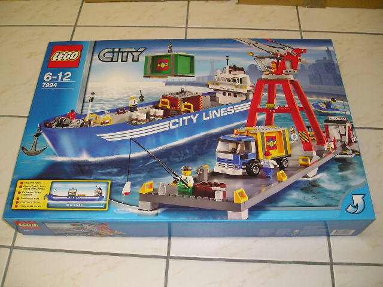

Une grande belle boîte qui contient 659 pièces.  
A noter qu’elle s’ouvre sur le côté et non sur le dessus.

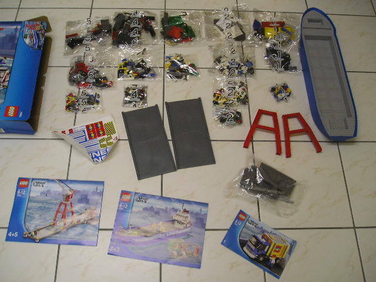

Une boîte bien remplie avec la présence de 16 sachets avec leurs numéros. Il y a donc 5 étapes pour le montage.  
On constate tout de suite la grosse coque du bateau.

A noter une mauvaise surprise, la plaquette d’autocollants est bien abimée, ils auraient pu la glisser dans une notice pour éviter de la froisser au milieu des grosses pièces.

**Première étape :** la construction du camion de transport de conteneurs.

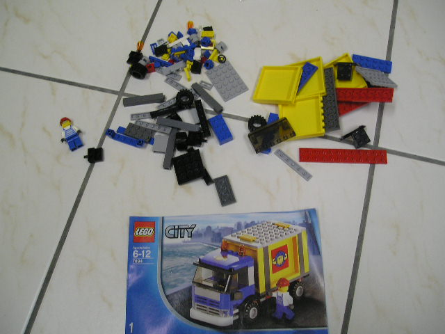

Cela reste un classique maintenant.

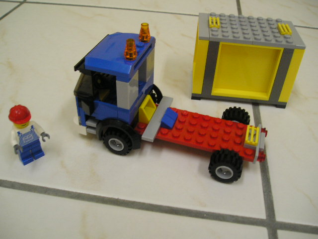

A noter que sans son conteneur, le camion n’est pas bien beau.

**Deuxième et troisième étapes :** construction des conteneurs et du bateau.

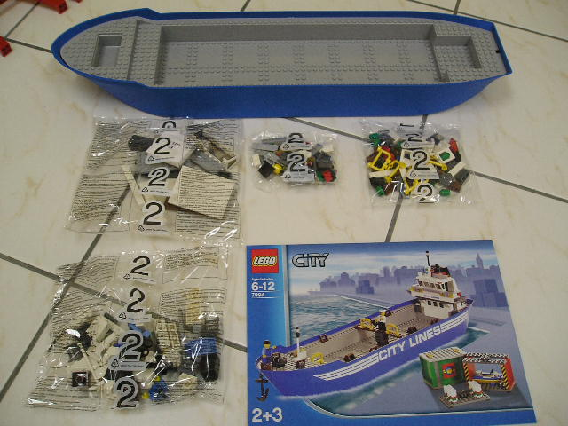

Et oui, il n’y a pas de petites économies.  
Comme le bateau de police 7899 et celui des pompiers 7906, les coques ne sont que 2 pièces non réutilisables pour autres choses hormis pour des bateaux.  
Dommage.

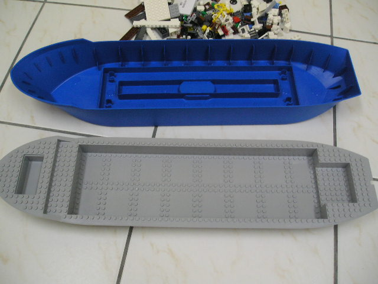

Le bateau est vite fini.  
Il est bien vide malgré sa marchandise.

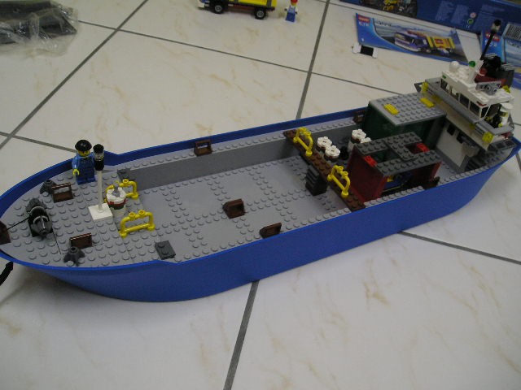

**Quatrième et cinquième étapes :** construction du ponton et de la grue.

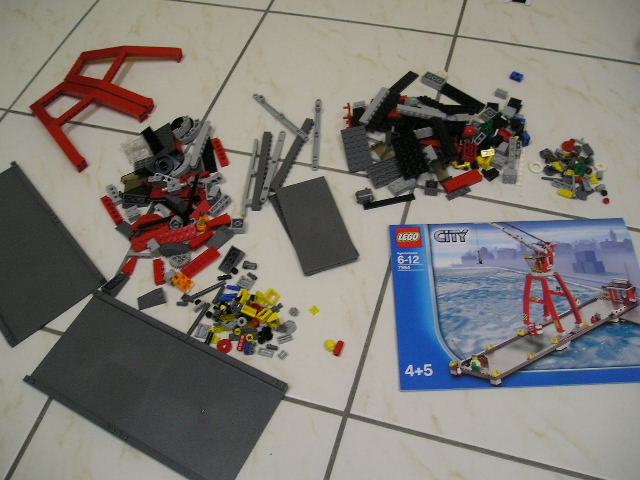

Un bel ensemble, prêt à accueillir le cargo et sa cargaison.

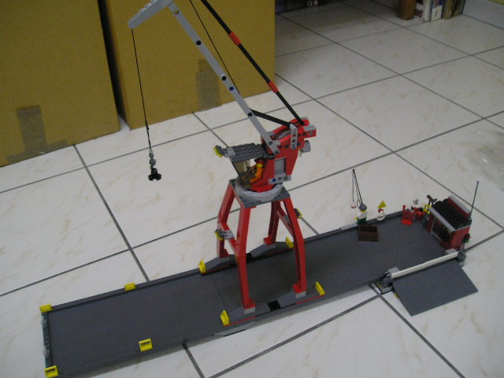

Il ne reste plus qu’à tout réunir.

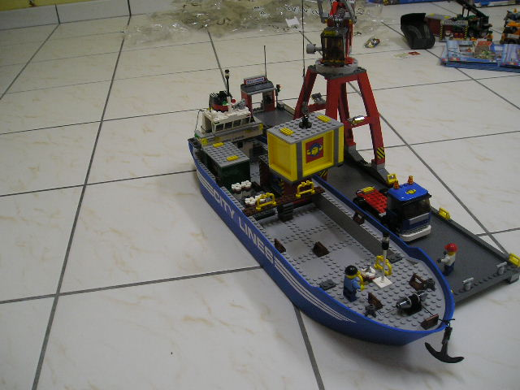

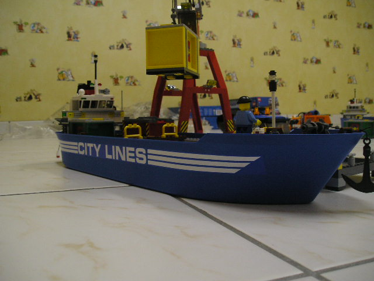

Un beau port qui charge et décharge les marchandises à destination de la ville...

Et quand on rajoute un deuxième port et deux fois la boîte 7992, le transporteur de conteneurs, cela donne ça :

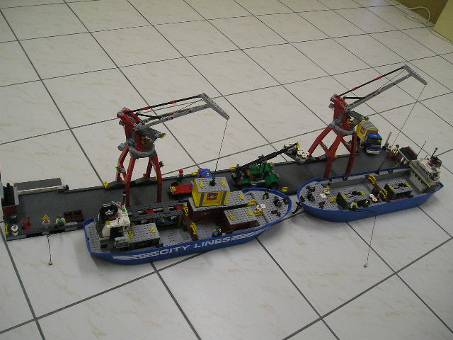

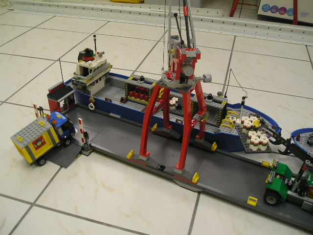

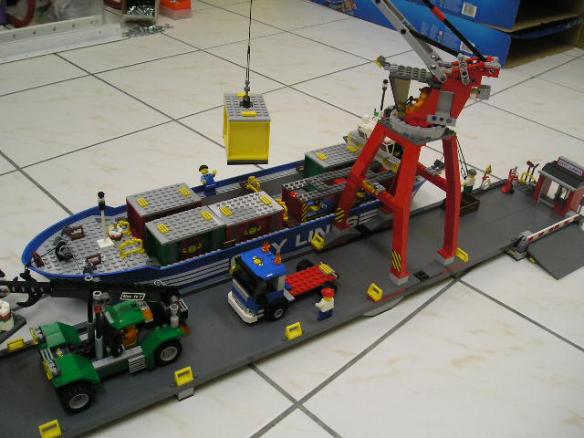

Et oui, c’est tout de suite plus impressionnant.

## Conclusion

Pour ma part, je trouve cette boîte plutôt bien réussie.  
Depuis le temps que j’attendais le retour d’un port dans la gamme City.

Il est vrai que juste la boite 7994, le port est vide. Seulement 4 conteneurs dans la boite, il faut rajouter la 7992 pour que l’on commence à remplir le bateau.

Sinon une belle grue de déchargement, ainsi qu’un petit camion sympa avec son conteneur.

Son plus gros défaut est à mon avis la coque qui n’est qu’une seule pièce et non réutilisable. Tant pis.

Voilà pour ce qui est de la présentation du nouveau port de commerce de LEGO City.

A quand un port de plaisance ?...
