Aujourd’hui c’est du sérieux. [Après l’arrière](/articles/799/), on s’attaque maintenant à l’avant de la Snotmobile et le fanatisme d’un MOCeur de mon genre nous conduira à "SNOTER en rond".

Les éléments caractéristiques de l’avant de la jeep Willys sont à mon sens son capot arrondi, les garde-boues et les phares encastrés. Pour ces derniers, j’ai redécouvert [la solution employée par Nico](http://lego.nico.free.fr/lego-jeep.htm) à savoir l’emploi d’une [plate Technic 1x4 #4263](http://www.peeron.com/inv/parts/4263). Je dis redécouvert car comme je l’avais précisé dans un précédent article je ne suis pas allé regarder son design lorsque j’ai conçu ma version. Mais il faut bien avouer que cette pièce tient admirablement ce rôle. On regrettera simplement son manque d’existence dans différentes couleurs (et tout particulièrement le gris foncé pour ce qui nous concerne).

Pour ce qui est du capot arrondi, on lorgne naturellement sur les briques du style [2x1x1/3 with curved top #6091](http://www.peeron.com/inv/parts/6091). Le problème c’est que si on les empile de façon standard, tenon vers le haut, ça parait difficile de rajouter un garde-boue.

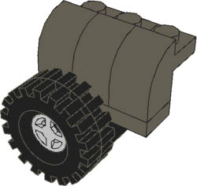

**Montage naïf du capot avant**

Puisqu’on parle du garde-boue justement, je souhaiterais le garder assez mince, une plate d’épaisseur maximum. Mais ça s’annonce difficile vu qu’en plus il est censé rejoindre le marche pied de façon oblique. Bon la solution qui nous vient à l’esprit est d’essayer d’utiliser des hinge-plates et de les accrocher au marche pied...

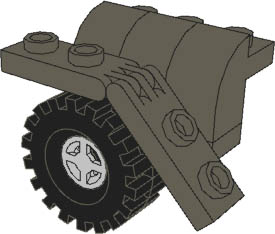

**Garde boue avec des hinge plate ?**

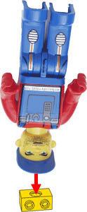

**Casse-tête chinois à essayer en cas de dépression**

Mouais... encombrant et pas [studless](http://www.brickwiki.org/index.php?title=Studless) pour deux sous. Oui oh je sais, si en plus je rajoute cette contrainte, autant essayer de faire rentrer un Jack Stone dans un trou d’axe Technic.

Bon cela dit, la difficulté ne devrait pas nous empêcher d’essayer. Je ne dirais pas non plus que le SNOT est le remède à tous les maux du MOCeur, néanmoins j’ai eu la faiblesse d’essayer de tourner les briques arrondies de 90° afin de réserver les tenons pour l’accrochage des garde-boues.

Et là très rapidement le [Panel 1x2 #4865](http://www.peeron.com/inv/parts/4865) s’est imposé comme un bon candidat au garde-boue. De plus on obtient un garde-boue sans tenon et on ne peut plus fin (mais peut-être un peu court, je vous l’accorde). De plus, en ajoutant deux plates 1x3 au milieu on obtient un capot de l’exact largeur grâce à la magie de l’arithmétique de la brique LEGO.

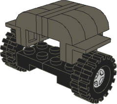

**Capot avec briques incurvées en SNOT 90°**

Dans la foulée on enchaine avec les mêmes panels pour le lien oblique avec le marche pied. Certes, cette fois-ci la brique ressort un peu du reste de la carrosserie, mais c’est là à mon avis qu’il faut lâcher prise parce qu’on fait un modèle en LEGO et non du vrai modélisme.

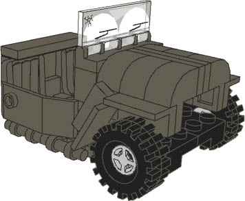

**Avant avec garde-boue qui rejoint le marche-pied**

Bon vu comme ça, ça a l’air pas mal mais comment attacher tout ça ? Les briques incurvées ne peuvent pas s’attacher à des briques machine à laver par exemple, car le tenon du dessus gêne. Il faudrait plutôt utiliser des briques Technic à plat, mais l’alignement n’est pas correct pour les clipser sur les supports de roue.

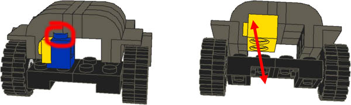

**L’accroche s’annonce difficile**

A tout hasard, j’essaye une [bracket 1x4 #2436](http://www.peeron.com/inv/parts/2436), même si j’ai le sentiment que ça ne fait qu’empirer les choses. Avant j’avais juste besoin de SNOTer à 90° pour accrocher le capot, maintenant on se retrouve à 180°. Il y a quand même un avantage, c’est qu’on peut maintenant accrocher les deux cotés ensemble avec une simple plate 2x3.

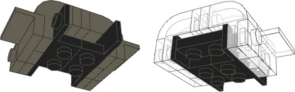

**Capot attaché avec des brackets 1x4**

Si vous avez des briques en main, vous vous dites peut-être que je suis bien gentil avec mes briques virtuelles, mais en vrai comment ça se monte ? Pas de panique, commencez par monter les pièces noires ensembles, c’est à dire les deux bracket 1x4 sur la plate 2x3 et clipser ensuite les deux montant sur les brackets.

Délaissons un peu l’objectif que nous poursuivons, à savoir comment attacher ce capot sur le châssis, pour voir si on ne pourrait pas tirer parti des bouts de bracket qui ressortent à l’avant. Hormis les phares encastrés et un radiateur dont on s’occupera plus tard, l’avant possède un pare-choc plat assez caractéristique. Une tile 1x6 le représentera à merveille et la solution que je vous propose pour l’attacher est d’utiliser des [plates 1x1 with Clip #4081B](http://www.peeron.com/inv/parts/4081B)

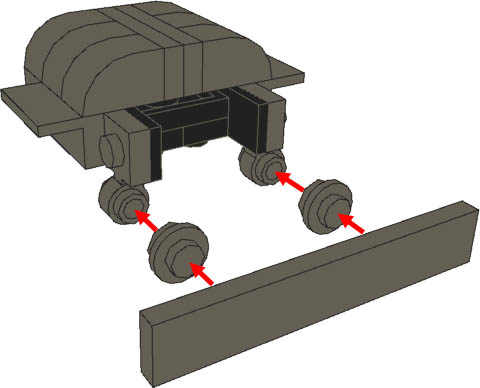

**Ajout du parechoc**

La plate 1x1 with clip est une de mes pièces préférées car elle permet de faire du SNOT 180° dans un espace relativement petit (bien qu’on ne l’utilise pas à cet escient ici). On ajoute des plates 1x1 rondes histoire d’avancer un peu plus le pare-choc vers l’avant mais elles ne sont pas indispensables, faites selon votre goût.

Bon tant qu’on est sur l’avant, finissons le. J’avais parlé de la [plate Technic 1x4 #4263](http://www.peeron.com/inv/parts/4263) pour les phares, et pour ce qui est de la couleur on a le choix entre le gris clair et le noir. A moins de faire appel à [JeanG et à son célèbre atelier de peinture](http://www.brickshelf.com/cgi-bin/gallery.cgi?f=263028) pour briques en mal de teinte... La position est sans surprise, on ajoute des [tiles grille 1x2 #2412B](http://www.peeron.com/inv/parts/2412B) pour le radiateur de devant.

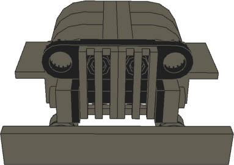

**Le radiateur et les phares**

Je vous laisse chercher en guise d’exercice, un moyen pour accrocher le radiateur au reste de la voiture, car ce point sera abordé dans l’article suivant. Maintenant on peut retourner à notre préoccupation première qui est l’accroche du capot sur le châssis.

Bien sûr je pars de la plate 2x3 noire qui tient les deux brackets ensembles et je dois faire un SNOT 180° mais tenons à l’intérieur, qui est moins commun que le SNOT 180° tenons extérieurs comme on peut le faire avec la [plate 1x1 with Clip #4081B](http://www.peeron.com/inv/parts/4081B). C’est l’heure de sortir son anti-sèche [^1] pour se rappeler du genre de pièces qu’on utilise dans ce cas : j’ai bien sûr nommé les Technic Liftarms !

Si vous êtes un crack de la géométrie LEGO vous devriez savoir que la hauteur du tenon (juste le téton) est un milli-poil plus haut qu’une demi-plate. Donc si on met deux tenons tête-bêche on obtient un espacement plus large qu’une plate [^2]. Mais heureusement, les Technic Liftarms sont plus haut qu’une plate, et à priori c’est fait pour. Pour quoi ? Pour justement pouvoir clipser deux tenons tête-bêche [^3] .

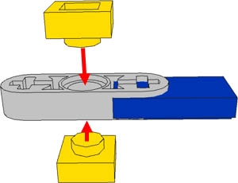

**Comparatif d’épaisseur entre un liftarm et une plate**

On utilise donc un [Technic Liftarms 1x3 #6632](http://www.peeron.com/inv/parts/6632) que l’on clipse sur deux jumpers tête-bèche, le jumper du haut étant prêt à recevoir la plate 2x3 du capot.

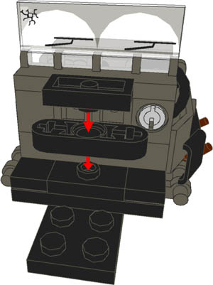

**L’accroche du capot en SNOT 180 tenons intérieurs**

Tout semble prendre sa place, et je vous invite bien sûr à faire le montage en vrai, mais si vous le faite vous vous apercevrez que le capot à tendance à piquer du nez. A la limite on aurait pu ignorer ce défaut, mais ce problème fait bailler la jointure entre l’habitacle et le capot. Immensément disgracieux, on risquerait de nous jeter des pierres pour un truc pareil ! En guise de deuxième exercice, je vous laisse le soin de trouver une solution pour régler ce problème, avant de vous proposer la mienne dans le prochain article.

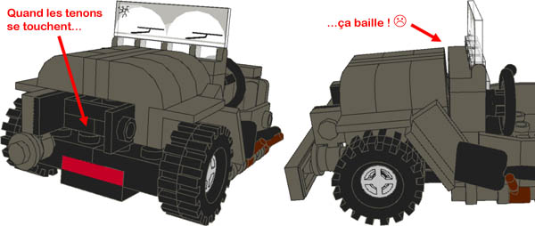

**Baille-Baille !**

[Rendez-vous au prochain numéro !](/articles/807/)

[^1]: je pense bien sûr à [Brickwiki](http://www.brickwiki.org/), un site qui mériterait plus de contributions.

[^2]: Pourquoi ? Les ingénieurs de TLC auraient mal fait leur boulot ? En fait si on enlève l’épaisseur du logo LEGO en relief sur le dessus des tenons, on y arrive presque ! Bref, cette aberration, c’est plutôt un sale coup des marketeux, comme d’habitude... :-)

[^3]: Dans l’image de comparaison, je me suis permis d’interpénétrer les deux briques histoire de mieux faire ressortir la différence de hauteur.
