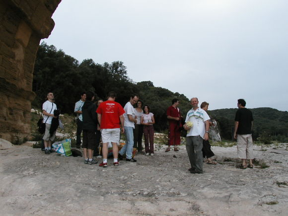
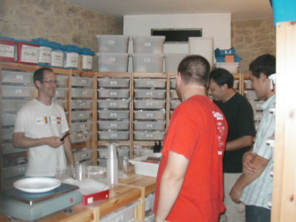
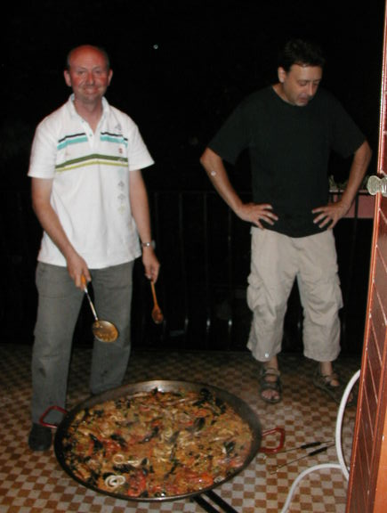
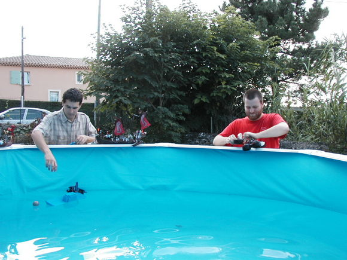
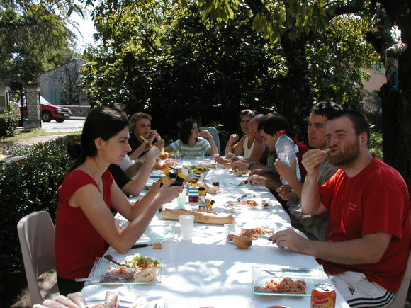
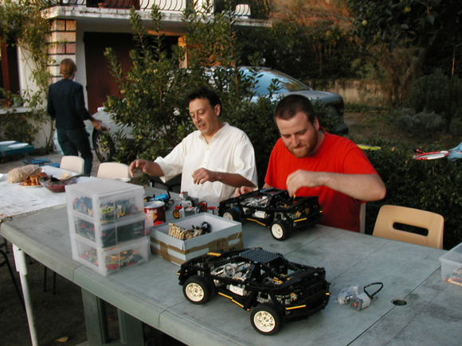
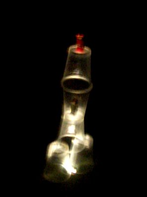

A la suite du [précédent week-end (5 et 6 avril 2008)](/articles/740/), j’envoyais un mail de remerciement en promettant d’en organiser un autre rapidement. Je ne pensais pas que ce serait aussi vite fait.

L’idée est née un soir sur le chat d’une simple remarque : "Tiens je n’ai jamais vu le Pont du Gard". Deux semaines et 10 mails plus tard, une date était arrêtée et les invitations lancées.

## Déroulement

Les festivités ont commencé le vendredi soir lorsque Sylvain a accepté qu’on s’incruste violemment chez lui pour un repas pizza (pizzas offerte par 1001bricks, sponsor non officiel du WE). De suite le ton du week-end a été donné :  
**–** des gens agréables (normal, ce sont des AFOLs)  
**–** des LEGO (pas ceux de Sylvain)  
**–** à boire et à manger.

Le samedi, Laurent, un AFOL Bagnolais (plus connu sous le pseudo ebay 123laulau) s’est joint à nous. La météo n’a pas voulu traumatiser les participants parisiens et leurs a réservé un temps de transition idéale : pluie chaude intermittente agrémentée de vent chaud (après on va dire que les gens du sud ne savent pas recevoir).  
Ceci ne nous a pas empêché de pique-niquer sous le Pont du Gard, malgré une invasion de chien-vaches.

Il s’en est suivi une démonstration de préparation de commande BrickLink sur une petite commande de plus de 120 références qu’un participant a bien voulu passer (et surtout payer).

Le soir (tard après la préparation de la commande et la 3éme vérification du paiement fait en pièces de 5c) nous nous sommes retrouvés autour d’une paella préparée par Jean-Yves pour partager de grands moments de rire et de bonne humeur.

Le dimanche, le beau temps étant de retour nous avons pu profiter de la piscine pour mettre à l’eau les trucs censés flotter et là nous avons eu beaucoup de bonnes surprises. En effet tous les modèles flottaient, sauf le garde républicain motorisé qui préférait faire des tours de piscine au fond (on ne lui avait pas dit que le concours d’apnée était fini).

Nous avons aussi pu tester les pistolets à eau LEGO apportés par Jean-Yves, et ils marchent très bien (logique c’est du LEGO).

Un test de flottaison de brickerik a aussi été fait et là ce fut une catastrophe : le brickerik ne flotte pas et en plus il casse tous les modèles en étant jeté en tombant dans la piscine.

Tout ceci en préambule à un barbecue bien sympathique.

Juste avant le dessert (vers 16h30) a eu lieu la désignation du gagnant du concours de truc qui flotte. Le jury étant composé de nos chères compagnes avec des critères qui leurs sont propres, Pierre Charles a donc gagné ce concours (victoire obtenue parce qu’un membre du jury a fait preuve d’un manque évident d’objectivité).

Il s’en est suivi un deuxième concours surprise : le passage impossible.

Le principe est simple, il faut :  
**–** des équipes de deux personnes (pas forcement AFOLs) ;  
**–** des modèles LEGO (dans notre cas des figurines Alfred)  
**–** un gabarit de passage (ici un trou de la taille d’une brique 2x1 Duplo).

Le déroulement :  
**–** un membre de l’équipe démonte le modèle LEGO et fait passer les pièces au travers du gabarit ;  
**–** le deuxième membre remonte le modèle de l’autre coté.  
**–** la première équipe qui reconstruit le modèle gagne.

Juste après le dessert vint malheureusement l’heure des premiers départs.

Pour noyer notre tristesse, nous nous somme lancés dans un projet fou : construire un igloo en glaçons LEGO. Projet vite abandonné au profit d’un massage de dos surprise aux glaçons pour deux tourtereaux.

Une fois les gens rafraichis nous pûmes enfin nous essayer aux joies du tech-ball (sport méritant de figurer aux jeux olympiques). Un article présentant le tech-ball sera fait ultérieurement.

Suite à ce moment Technic, une soudaine envie de motoriser deux malheureuses 8880 en PFS nous saisit et c’est sans vergogne que nous nous jetâmes sur les 2 pauvres créatures sans défense. Cette aventure repoussa à tard dans la nuit l’heure du repas ce qui causa la mort prématurée de la paella qui n’apprécia pas le 3éme réchauffage.

Ce week-end s’acheva donc sur ce dernier repas agrémenté de quelques apparitions lumineuses et de poissons trop rapides pour être vus.

## Conclusion

Pour moi ce weekend était un test en vue d’organiser des évènements plus importants. J’ai donc beaucoup appris sur la quantité de travail, le budget et les quantités de nourritures à prévoir.  
Je n’ai qu’une envie c’est de recommencer mais on va attendre l’année prochaine maintenant.  
Prévoir pour les prochaines manifestations : louer un hélicoptère pour palier aux pannes de voiture de dernière minute.

Enfin, on a tous déploré l’absence de la tante à Pierre Charles.

## Remerciements (dans le désordre)

**–** au mur (Pierre C et Pierre L) pour ces 3 demi-nuits blanches, ça faisait longtemps que je n’avais pas vu écrit 03:30 sur mon réveil.  
**–** à Christophe pour être venu avec sa bonne humeur (et sa compagne).  
**–** à Jean-Yves pour la paella et les pistolets.  
**–** à Erik pour nous avoir amené la pluie.  
**–** à Sylvain qui s’est retenu de jouer au MB tout le week-end.  
**–** à Laurent pour avoir pris le risque de venir passer un moment avec des fous inconnus.  
**–** à nos compagnes pour nous avoir laissés jouer au LEGO tout un week-end et avoir préparé à manger.  
**–** à nos enfants pour avoir été sages.

## Le mots des participants

**Le mot de TOF92**

Pour moi, c’était ma première sortie hors de Paris, Ile-de-France. Super accueil, notre Pierrick local est venu nous chercher à la gare. Il nous a fait visiter le pays et l’arrière pays (très beau coin). La visite du pont du Gard, ça donne envie de faire une création LEGO.  
Pour le repas du samedi soir, on a mangé une super paella des mains de maître de Jean-Yves et son assistant Sylvain, que du bonheur.

Le dimanche, journée des épreuves de LEGO-olympique  
entre le tech-ball et les trucs qui flottent et qui avancent. Une équipe dans la nuit avait fait un moc en rangeant le stock.

Ce fut pour moi un bon week-end dans le Gard, pas de soucis pour remettre ça !

**Le mot d’Erik**

Que dire de plus ? Je pense que Pierrick a bien résumé tout ce week-end, et je le remercie pour l’organisation (et Sylvain pour son hospitalité). Et puis maintenant, j’ai une autre excuse pour revenir dans le sud (même si c’est trop loin) : voir le pont du Gard, mais cette fois sous le soleil ;o)

**Le mot de Tribolego et de sa chérie**

Week-end inoubliable ! que dire de plus que LEGO + Amis + (presque) beau temps = deux jours merveilleux !

**Le mot de Pierrolego**

Ben ils ont déjà tout dit... Un grand merci à Pierrick et sa famille de nous avoir accueillis pour ce week end extra !  
Grâce à ces deux jours, j’ai même pu suivre le traitement d’une commande LEGO que j’ai passée dans un magasin tout proche, référencé sur Bricklink... Merci encore Sylvain.  
Et sinon le concours des trucs qui flottent était bien sympathique.

Alors c’est quand la date du prochain week end ?

**Le mot de Jean-Yves**

Bravo à Pierrick et merci à toutes et tous pour ce beau week-end. Vivement le prochain, avec des MOCS flottants sur le Gardon... chiche ? Ma petite vidéo :

[Vidéo de la publication d’origine](http://www.youtube.com/v/q1SoIk6BGSE&hl=fr&fs=1)

[Galerie photos de brickerik](http://photos.freelug.org/main.php/v/brickerik/expositions/2008/gard2008/)

[Galerie photos de christophe](http://photos.freelug.org/main.php/v/Tof92/week-end+dans+le+gard//)

[Galerie photos de pierrick](http://photos.freelug.org/main.php/v/-PZ/we6-9-08/)
