Premier véhicule de la série, le scooter des profondeurs est bien utile pour explorer les fonds marins et échapper rapidement à tous les dangers.

**–** Référence : 8057  
**–** Nom : Le scooter des profondeurs  
**–** Nombre de pièces : 64  
**–** Prix : 9,90€ sur le [S@H](http://shop.lego.com/ByTheme/Product.aspx?p=8057&cn=616&d=70)

Commençons par découvrir la boîte et son contenu.

Comme pour celle du [crabe des profondeurs](/articles/8056-le-crabe-des-profondeurs/), elle indique en bas à gauche la présence d’une clé de l’ancienne citée, ici la clé bleue.

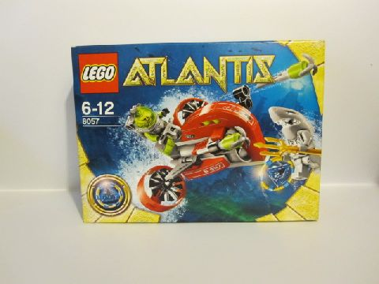

A l’intérieur : deux sachets de pièces, la notice et une planche d’autocollants.

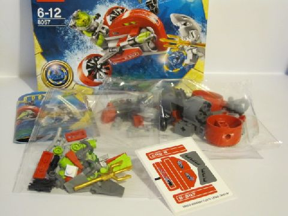

Contrairement à la notice, je préfère commencer par le montage du scooter.

A l’étape 10, le châssis du scooter prend forme

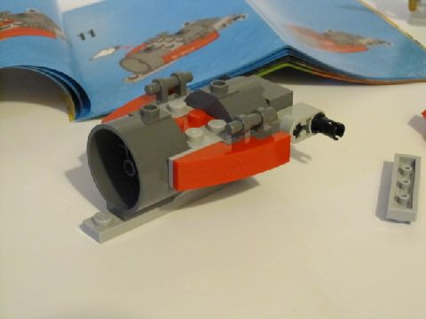

A l’étape 15, le montage du sous-ensemble fait apparaitre une nouvelle pièce.

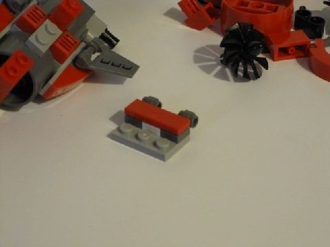

Une tile 1x3, ici de couleur rouge, qui enrichit la gamme des pièces de longueur impaire. Cette pièce est disponible en plusieurs coloris, la [liste est disponible sur bricklink](http://www.bricklink.com/catalogItemIn.asp?P=63864&in=S).

A l’étape 21, le modèle est fini. Au programme, propulseurs rotatifs et orientables et deux torpilles, de quoi sortir vainqueur de bien des combats. Reste deux extra parts pour ce set.

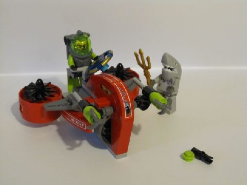

Découvrons maintenant en détail les minifigs de ce set :

En premier le plongeur Ace Speedmen

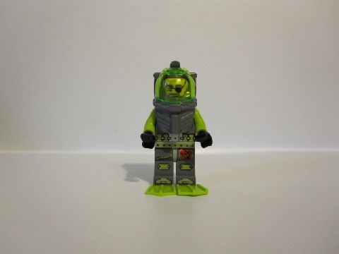

**de face avec son équipement de plongée**

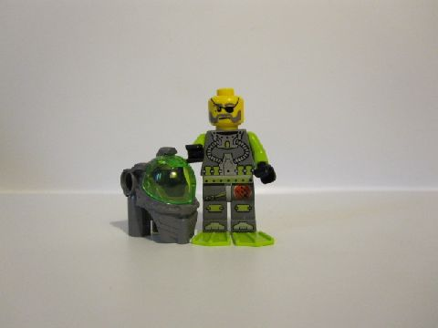

**sans le casque, première face**

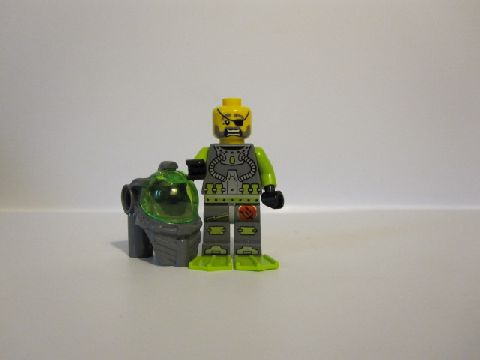

**et la deuxième face**

Le guerrier Requin avec l’arme officielle des guerriers de l’Atlantis, le trident.

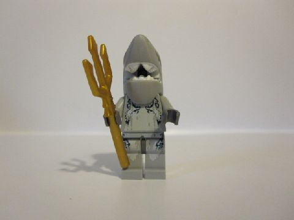

**de face**

La tête de requin en plastique plus ou moins souple est très bien rendue.

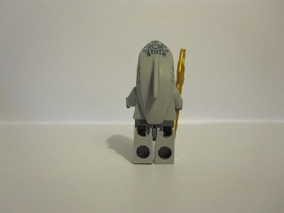

**de dos**

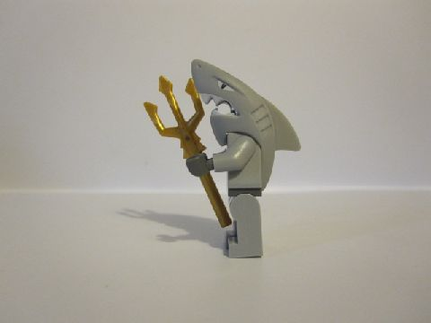

**de coté**

Voilà la revue est terminée, pour un premier véhicule dans la gamme, ce petit scooter est assez sympa à monter.

La prochaine revue : le mini sous marin promotionnel.
