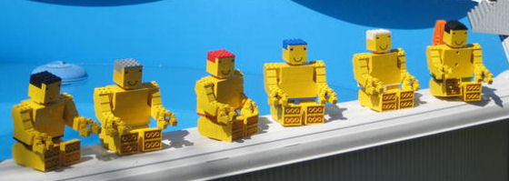
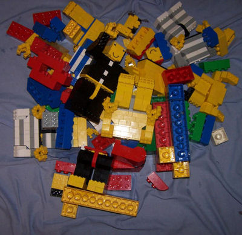
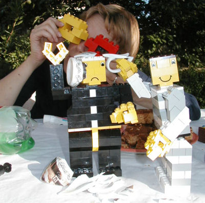
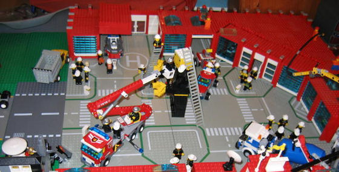
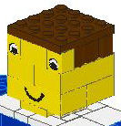

Apparus lors du [second week-end dans le Gard](/articles/804/), ces êtres étranges nous ont suivis pendant deux jours. Mais qui sont-ils ? Comment sont-ils faits ? Comment vivent-ils et surtout que veulent-ils ? Voila les questions auxquelles nous allons essayer de répondre.

**Equipe olympique de natation**

On notera, à droite, un Alfred dopé à la Duracell.

## Classification

L’Afred fait partie de la famille des Tasdebriques de forme humanoïde.

Il occupe une place particulière dans la sous-famille des Fig, à mi-chemin entre la Minifig et la [Maxifig](http://guide.lugnet.com/set/3723).  
Il se différencie de ses cousines Maxifig et Minifig par sa taille et son mode de construction ce qui lui confère les avantages suivants :  
**–** Construction nécessitant beaucoup moins de briques que la Maxifig ;  
**–** Possibilité de transport accru (le premier sac suffit à le transporter) ;  
**–** Diminution de la sensibilité au phénomène "perduquelquepart", phénomène encore inexpliqué qui frappe tant de Minifigs ;  
**–** Plus grande modularité que la Minifig.

Malheureusement il possède quelques défauts parmi lesquels on peut citer :  
**–** Design grossier ;  
**–** Fragilité au niveau du bassin ;  
**–** Fâcheuse tendance à perdre la tête.

## Description

Afred mesure 13 tenons de large, 4 de profondeur (11 bras tendu) et 17 briques 1 plate de haut. Il est composé de 149 pièces et pèse environ 200g.  
On retrouve les mêmes articulations que les Minifigs c’est-à-dire au niveau des hanches, des épaules, des poignées et de la tête. Avec la possibilité, en plus, de faire varier l’ouverture des mains.

Il faut noter que l’on trouve des Alfreds dans de multiples couleurs et formes.

## Habitat

**Tas d’Alfreds**

Quelques Alfreds tentent de se dissimuler dans un (petit) tas de briques

D’une façon générale, les Alfreds sont attirés par les zones riches en briques, ainsi ils vivent habituellement dispersés dans un tas de briques ou une caisse de vrac. Mais on peut trouver quelques spécimens téméraires sur des étagères ou même dans des lits. Il paraîtrait même qu’un individu a élu domicile dans une caisse automatique de parking.

## Caractère

**Deux Alfreds s’amusent**

Notez à l’arrière plan une étrange créature.

De nature discrète, les Alfreds sont sociables et joueurs, ils aiment se baigner, boire ou manger un morceau ensemble. Certains sont même champions de plongeons.  
Parmi leurs activités favorites, on trouve :  
**–** Le passage impossible. Activité qui consiste à se faire démonter pour être passé à travers un gabarit puis être remonté de l’autre coté.  
**–** Le mélange de briques triées.

A noter que les Alfreds sont des êtres très actifs mais aussi très peureux qui restent absolument immobiles dès qu’ils sont observés, tout ceci dans le seul but d’être confondu avec un simple jouet.

## Pratique

_Comment détecter un Alfred ?_

Rien de plus simple : observez vos briques. Si malgré tous vos efforts, vous avez toujours un tas de briques non triées, c’est qu’un Alfred a élu domicile chez vous.

_Comment attraper un Alfred ?_

Chose simple : quand un Alfred se sait observé, il ne bouge plus et mime la poupée, vous n’avez qu’à vous approcher sans le lâcher du regard et le saisir.

_Comment nourrir un Alfred ?_

Chose étrange les Alfred ne se nourrissent pas. En fait, certains spécialistes pensent que les Alfreds se nourrissent de la douce odeur des briques. Chose étrange car les Alfred n’ont pas de nez.

_De quels soins a besoin l’Alfred ?_

Les Alfreds ont besoin de peu de soins ou énormément d’attention en fonction de la situation.  
**–** Première situation : l’Alfred se retrouve seul sans personne pour le voir. Il n’a besoin de rien, dans ce cas là il vaquera à ses occupations (mélanger vos briques).  
**–** Seconde situation : l’Alfred se retrouve longtemps dans une pièce avec beaucoup de personnes. Dans ce cas là, l’Alfred ne bougera pas. Il faudra donc le faire changer de position régulièrement (tous les quarts d’heure) pour éviter qu’il ne se bloque.

Dans tout les cas les Alfreds ont besoin d’un démontage et remontage par semaine.

## Conclusion

**Alfred chez le coiffeur**

Les Alfreds sont des créatures drôles et très attachantes qui aiment particulièrement la compagnie des AFOLs. Je ne peux que vous conseiller d’en adopter un, il remplira votre vie de joie et de bonheur (sans avoir de couches à changer et avoir à se lever la nuit pour lui donner le biberon). En plus si un jour il ne vous convient plus, transformez le en bateau, maison ou même cendrier, ça servira toujours.

Dernière précision : Que veulent les Alfreds ? Et bien tout simplement régner en maîtres absolus sur le monde de la brique MOUAHAHAHAHAHA !

**Notice de montage**

Comment se fabrique l’Alfred

**–** [Résumé du week-end dans le Gard des 6 et 7 septembre 2008](/articles/804/)  
**–** [Galerie de photos d’Alfreds](http://photos.freelug.org/main.php/v/-PZ/moc/alfred/)
