D’époque contemporaine ou légèrement futuriste, l’ApocaLEGO est un thème de science fiction qui est apparu durant l’été 2007. Il se place après l’Apocalypse, où les hommes et femmes tentent de survivre, généralement regroupés en petites factions et en combattant d’autres pour préserver ou gagner des ressources. C’était sans compter la présence de quelques créatures destructives...

Guerre, ruines, désolation, absence de végétation, aliens, zombies... voici les ingrédients de ce thème.

Les constructions favorites sont les dioramas de taille moyenne présentant une scène de désolation (bâtiments en ruine...) et de combat.

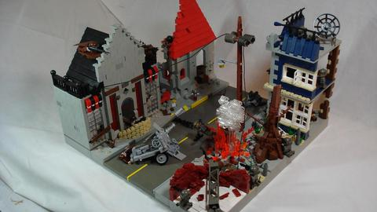

**Clash (remyth)**

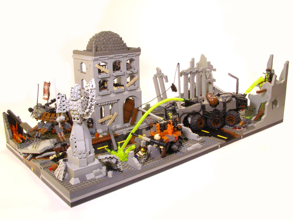

**Downtown Doomsday (Legohaulic)**

Face aux menaces et aux difficultés de s’abriter, la vie s’organise...

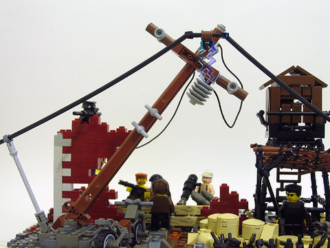

**Checkpoint (Nathan Wells)**

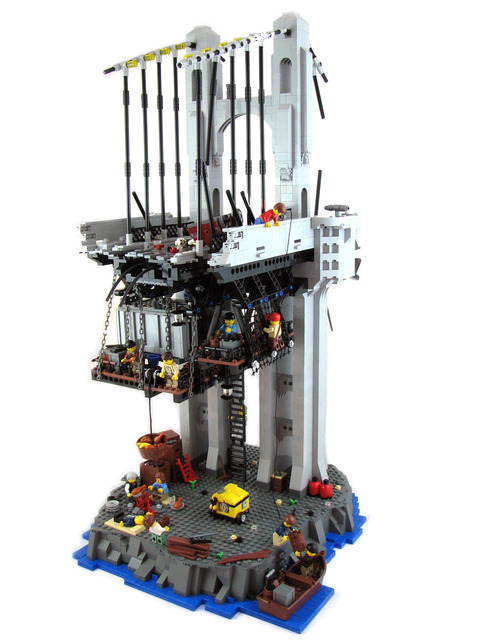

**Lionsgate Bridge (tiberium\_blue)**

... et les factions s’équipent

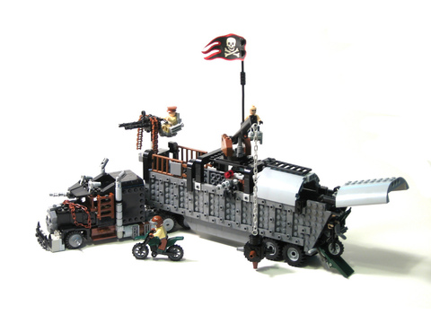

**king of the road (mikepsiaki)**

Le retour de quelques ressources végétales au milieu des ruines apporte l’espoir...

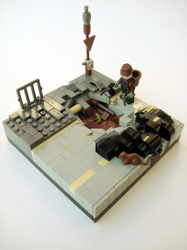

**Sowing the seed of agriculture (nolnet)**

tandis qu’on s’affère à décontaminer des survivants dans un recoin qui semble paisible en apparence...

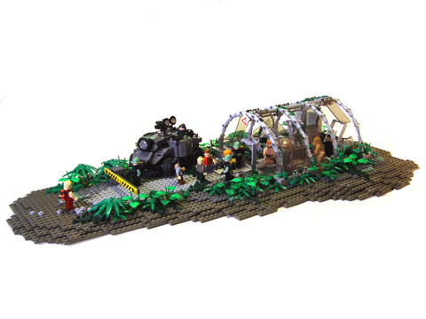

**Decontamination Site Delta 22 (Legohaulic)**

Et si l’apocalypse nous apportaient de nouvelles créatures malveillantes ?

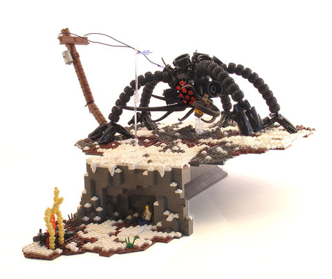

**Howl of Lamentations Unending (Xifux)**

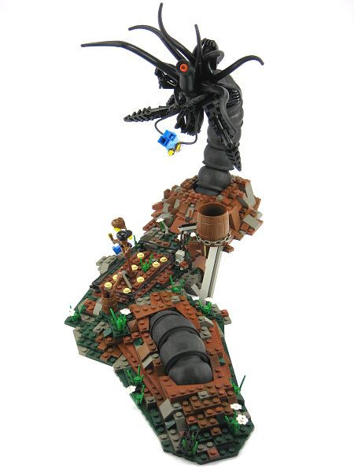

**Ephram’s Garden (Brian Kescenovitz)**

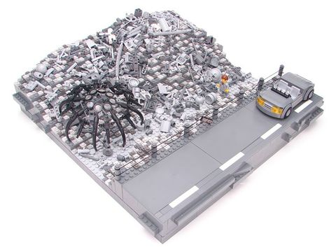

**Cyclopean Horror (Nannan Z)**

ou plus humainement, quelques zombies...

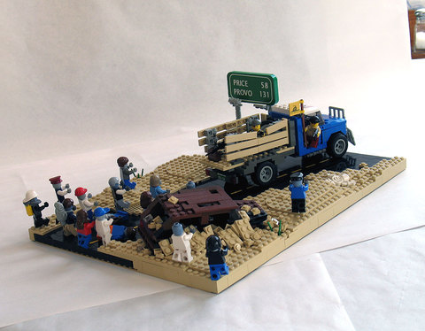

**Zombie Hunt (-Mainman-)**

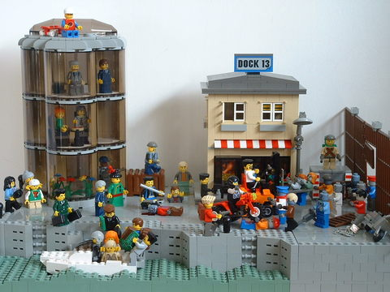

**Land of the Dead (cbolego)**

... qui étaient à l’honneur lors de la Zombies Apocafest de BrickCon 2008.

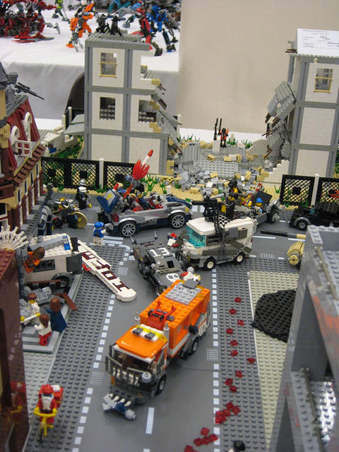

**Zombie Apocafest (Dunechaser)**

## Comment faire de l’ApocaLEGO ?

Tout dépend quelle situation on souhaite représenter : scène de survie, scène de combats, zombies, aliens... les variantes sont nombreuses.

Mais les points généralement communs sont des scènes de désolation, pour cela on préférera le gris et les bâtiments en ruine, l’absence de végétation. Les abris seront souvent faits à partir de matériaux de récupération. Un des leitmotivs les plus courants est un poteau électrique couché.

Les factions combattantes se rapprochent plus des mercenaires, ils seront donc bien armés mais ne disposeront pas d’un uniforme commun. Dans un contexte de science-fiction, on peut aisément introduire de nouvelles armes chimiques.

Les aliens peuvent trouver inspiration dans les illustrations de _La guerre des mondes_. Quant aux zombies, on apprécie particulièrement les [têtes du troll Harry Potter](http://www.peeron.com/inv/parts/3626bpx149), le [visage gris de Dark Vador](http://www.peeron.com/inv/parts/3626bps7) ou encore les [têtes des Mandragores](http://www.peeron.com/inv/parts/3626bpx386).

## Webographie

Retrouvez de nombreuses créations à travers les références suivantes :  
**–** [Brickwiki:ApocaLEGO](http://www.brickwiki.org/index.php?title=ApocaLEGO)  
**–** [ApocaLEGO sur Brothers Brick](http://www.brothers-brick.com/category/lego/apocalego/)  
**–** [Groupe ApocaLEGO sur Flickr](http://www.flickr.com/groups/apocalego/)

Illustrations de l’article :  
**–** [Howl of Lamentations Unending](http://www.brickshelf.com/cgi-bin/gallery.cgi?f=304228)  
**–** [Ephram’s Garden](http://mocpages.com/moc.php/47644)  
**–** [Cyclopean Horror](http://mocpages.com/moc.php/35530)  
**–** [Lionsgate Bridge](http://www.flickr.com/photos/28550645@N05/2720228040/in/set-72157606471910269/)  
**–** [Clash](http://www.flickr.com/photos/tyrondurknight/2678334797/)  
**–** [Checkpoint](http://www.flickr.com/photos/nathanwells/sets/72157601590760380/)  
**–** [Downtown Doomsday](http://www.brickshelf.com/cgi-bin/gallery.cgi?f=259679)  
**–** [Decontamination Site Delta 22](http://www.brickshelf.com/cgi-bin/gallery.cgi?i=3325535)  
**–** [Sowing the seed of agriculture](http://www.flickr.com/photos/28119014@N06/2707984580/)  
**–** [king of the road](http://www.flickr.com/photos/pmiaki/2790488702/)  
**–** [Zombie Hunt](http://www.flickr.com/photos/mainman/sets/72157603329169875/)  
**–** [Land of the Dead](http://www.brickshelf.com/cgi-bin/gallery.cgi?f=171418)  
**–** [Zombies Apocafest, BrickCon 2008](http://www.flickr.com/photos/dunechaser/sets/72157607776271940/)

Logo de l’article :  
**–** [Austin S](http://mocpages.com/home.php/7279)
