C’est une quatrième version du Slave que LEGO nous propose ici. Cette édition nous présente le Slave I avec Boba Fett comme deux des versions antérieures.

## La petite histoire

Ce vaisseau est à la base un véhicule de police pour transporter des prisonniers sur l’astéroïde-prison Oovo IV.

C’est de cette prison que Jango Fett s’empara d’un slave pour fuir. Par la suite, Jango Fett améliora les armements du slave.

Suite à la bataille de Geonosis, où Jango Fett trouva la mort de la main de Mace Windu, Boba Fett (le fils de Jango Fett) récupéra le vaisseau pour suivre le chemin de chasseur de primes laissé par son père.

Boba Fett continua à améliorer ce vaisseau. Suite à des mésaventures, Boba Fett a piloté d’autres modèles, allant du Slave II au Slave IV. Cependant il a toujours fini par récupérer le slave I.

**–** Constructeur : les chantiers navals de Kuat  
**–** Modèle : vaisseau de patrouille et d’attaque, classe firespray  
**–** Dimensions : 21.5 m de longueur, 21.3 m de largeur, 7.8 m de hauteur  
**–** Vitesse max. : 1000 km/h en atmosphère  
**–** Capacité d’emport : 6 prisonniers, 40 tonnes métriques de fret  
**–** Equipage : 1 pilote, 1 co-pilote  
**–** Armement : 2 canons blaster rotatifs, 1 canon à ions, 1 lance-missiles à concussion, 2 lance-torpilles à proton, 1 projecteur de rayon tracteur

## Description du set

**–** Numéro du set : 8097  
**–** Nom de la boîte : Slave I  
**–** Gamme : Star Wars  
**–** Nombre de pièces : 573  
**–** Nombre de Minifigs : 3 + Han dans la carbonite  
**–** Prix moyen constaté : 95 euros

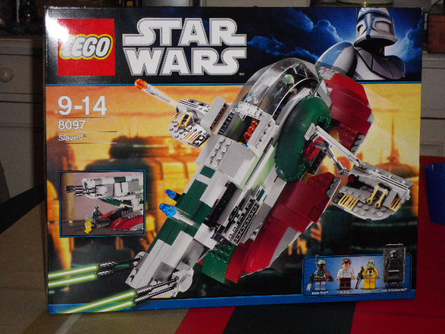

**la boite**

Une boite d’une taille raisonnable mais fine. Relativement sombre, elle met cependant bien en valeur le vaisseau.

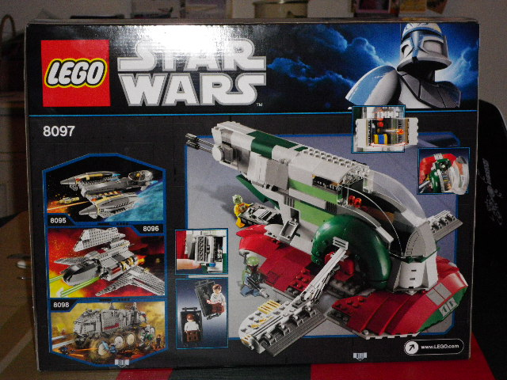

**boite de derrière**

Le dos de la boite nous présente quelques fonctions du vaisseau. Trois sets de la nouvelle gamme Star Wars sont aussi mis en avant.

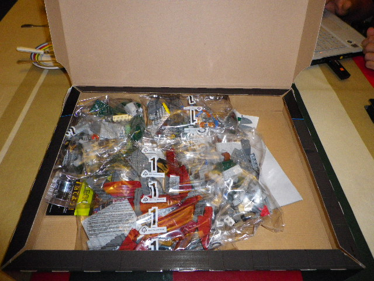

Une boite remplie modérément comme à l’habitude...

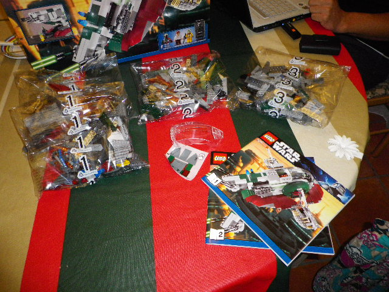

4 sachets numérotés (2 numéros 1 + numéro 2 + numéro 3), le pare brise du cockpit, une petite planche d’autocollants et deux livrets de montage sont présents dans cette boite.

## Montage du set

On commence par ouvrir les deux sachets 1

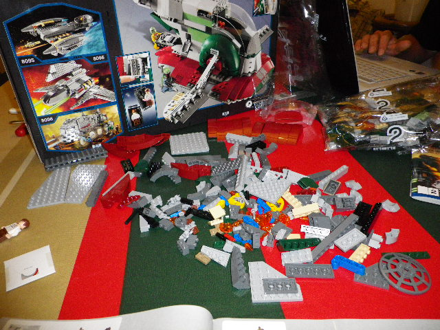

Et on monte avec grand plaisir les Minifigs...

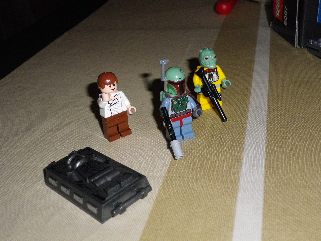

**les nouvelles Minifigs**

Nous avons donc trois nouvelles Minifigs :

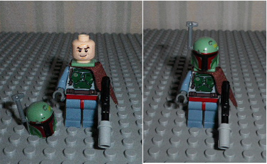

**Boba Fett**

**–** Un Boba Fett tout nouveau ! Et oui, il n’a plus son jet-pack accroché à son casque. Les deux accessoires sont maintenant séparés. Un nouveau visage, un casque plutôt réaliste comme les casques de mandalorien, le jet pack est identique à ceux des clones.

**–** Une nouvelle version d’Han Solo avec sa célèbre chemise blanche !

**–** Un nouveau personnage Star Wars apparait ici...

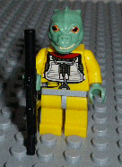

**Bossk**

C’est le trandossan Bossk, très connu dans l’univers étendu Star Wars. Cependant il n’a rien à faire ici logiquement. La mise en scène de présentation de la boite nous montre Bespin lorsque Boba récupère Han Solo dans la carbonite, Bossk n’était pas présent lors de cette scène. De plus, Boba et Bossk sont rivaux. On peut peut être y voir une suite à l’apparition de Dengar dans l’édition précédente du Slave I. Mais cela n’empêche notre enthousiasme d’avoir cette nouvelle Minifig.

**–** Fini la brique 1x2x5 avec une sérigraphie dessus. mais place à un vrai bloc de carbonite... Ce bloc de carbonite représente fidèlement Han Solo, de plus en relief, avec les écrans de contrôle sur les tranches.

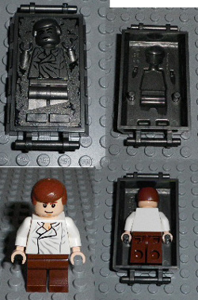

**Han Solo et sa carbonite**

A l’arrière du bloc de carbonite, on peut insérer la Minifig d’Han Solo.

* * *

Nous attaquons maintenant le montage du Slave !

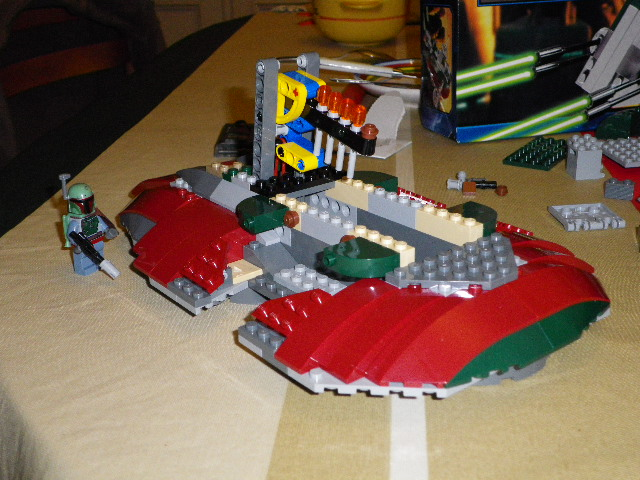

Le montage est des plus classique. De plus, celui-ci est fort similaire au précédent Slave.

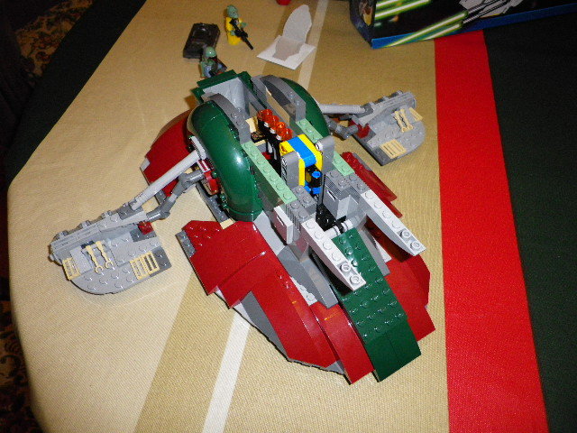

Le montage se fait sans aucun soucis majeur. Donc on arrive vite à la fin.

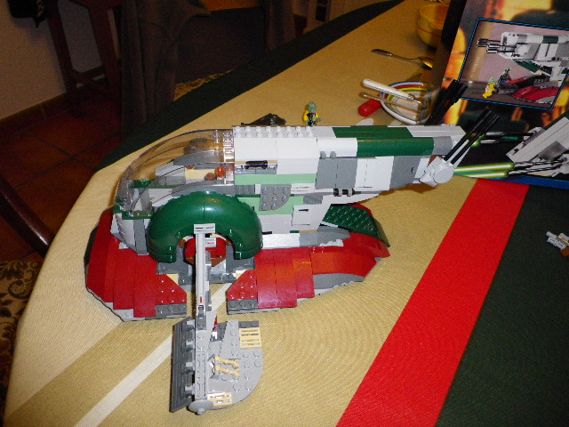

Un slave reste un slave, il ressemble donc beaucoup au précédent comme pour les couleurs.

[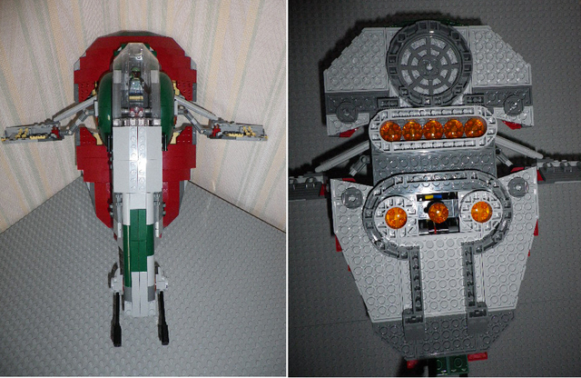](https://www.freelug.org/IMG/jpg/Sans_titre-1_copie.jpg)

On retrouve les traditionnels canons et autres missiles...

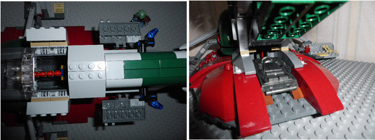

Han dans la carbonite a sa place sur l’arrière du vaisseau.

Voilà pour le montage.

## Conclusion

**–** Et bien tout d’abord encore un beau vaisseau Star Wars  
**–** Forcement comme pour toutes les licences le rapport à la pièce revient cher. 95 / 573= 0,17€ la pièce...  
**–** Cependant, LEGO sait comment attirer les acheteurs. Il ajoute de nouvelles Minifigs... Soit pour cette version, des nouvelles éditions de Boba Fett et d’Han Solo. Nous avons en prime un vrai bloc de carbonite et puis Bossk...  
**–** Une énième version du Slave, mais cela reste tout de même un vaisseau représentatif de la saga Star Wars.  
**–** une belle boite à avoir, déjà pour les Minifigs et puis pour le vaisseau en lui-même. Vous pourrez craquer dessus quand il sera en promo ! ;-)

Détail du slave I repris du site [Star Wars Universe](http://www.starwars-universe.com/vehicule-104-slave-i.html)

[Revue du précédent Slave](/articles/set-6209-slave-1/)
