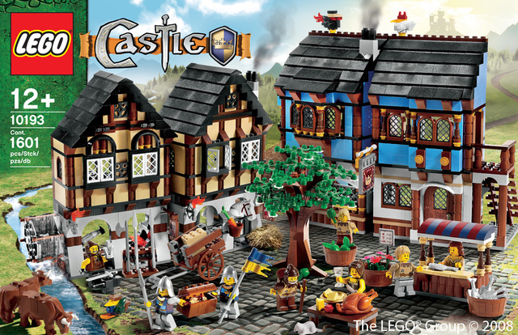
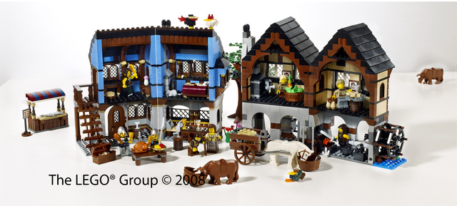
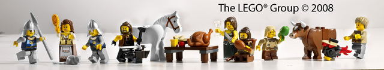
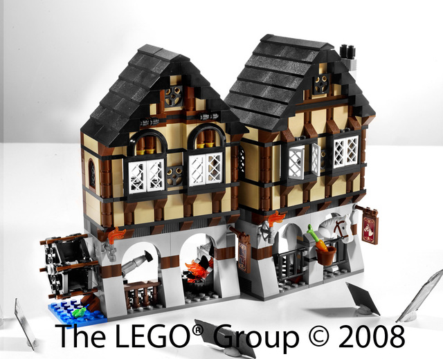
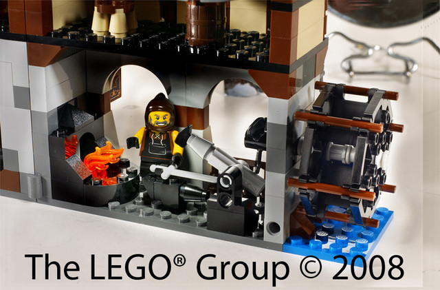
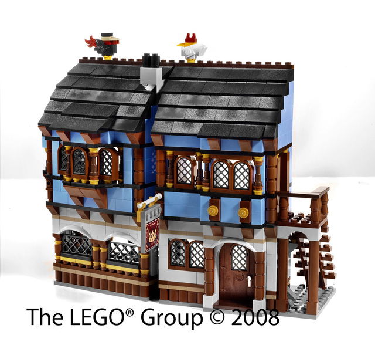
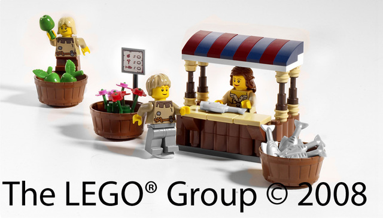
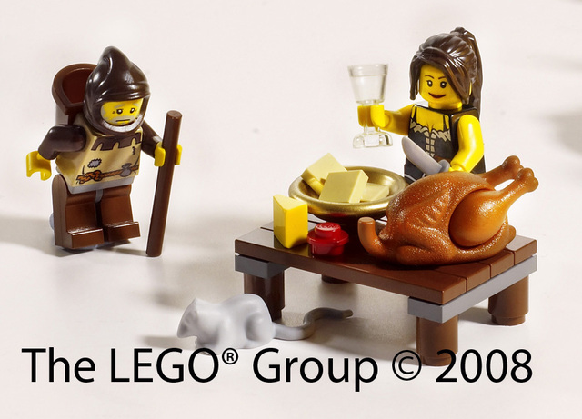

La société LEGO a dévoilé aujourd’hui le futur modèle _"Marché médiéval"_ (10193) à BrickCon (une convention de fans adultes de LEGO qui se déroule aux Etats-Unis).

Description rapide :  
**–** Numéro : 10193  
**–** Nom : Medieval Market Village (Le marché médiéval)  
**–** Pièces : 1601  
**–** Prix annoncé : 99.99 euros

Bonnes gens, agrandissez votre royaume LEGO !

Ce village médiéval avec son marché conviendra parfaitement à tout château LEGO. Plein de détails authentiques, d’accessoires amusants et de nouveaux animaux pour agrandir et améliorer votre royaume.

Il inclut deux bâtiments complets avec des intérieurs détaillés : le magasin du forgeron avec son pilon actionné par la roue à aubes, un étal, un arbre, une table, un charriot, des vaches, un cheval, poule, poulet, canard et paysans, chevaliers, et des éléments et couleurs rares, et plus encore !

Le set inclut 8 minifigurines : un forgeron, deux soldats, 2 paysans, 2 paysannes et un garçon.

Jouez ! Les deux bâtiments de deux étages possèdent une charnière qui permet de les ouvrir et de les refermer à volonté.

Le bâtiment jaune/brun renferme une écurie, l’atelier du forgeron et ses appartement à l’étage.

Aide le forgeron à façonner les épées à l’aide du marteau-pilon actionné par la force de l’eau. N’oublie pas de fermer les portes de l’écurie et de nourrir le cheval avec les carottes.

L’appartement du forgeron est décoré de tableaux aux murs, possèdent des fenêtres qui s’ouvrent, une table et une cheminée.

Le bâtiment bleu, de style classique européen renferme une taverne confortable de plain-pied et une chambre accueillante à l’étage.

Le set comporte de nombreuses touches d’authenticité : des cheminées dans les chambres, des tables de repas, des portes et fenêtres mobiles et d’autres détails intérieurs.

Les soldats et paysans font leur marché et mangent parmi les paniers remplis de poissons, de pommes et fleurs. Asseyez-vous à une table pour un repas autour d’une dinde et de fromage accompagné de bière, mais laissez le passage aux soldats qui transportent le trésor du roi.

L’ensemble des bâtiments mesurent plus de 19cm de haut et près de 23cm de large grand ouvert.
