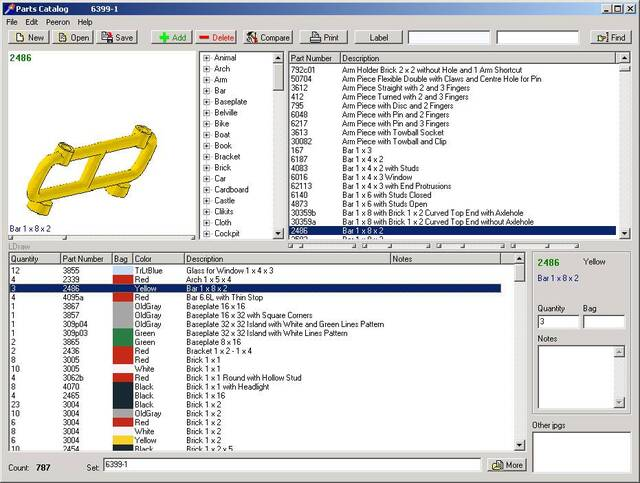
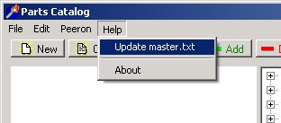
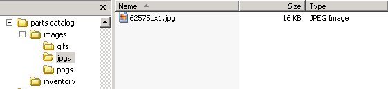
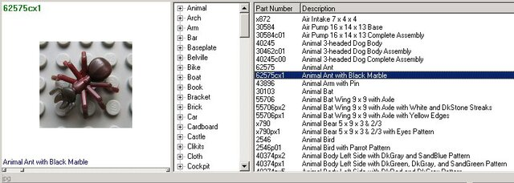
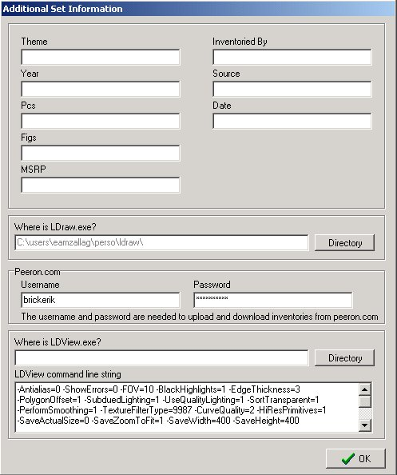
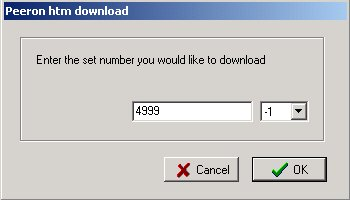
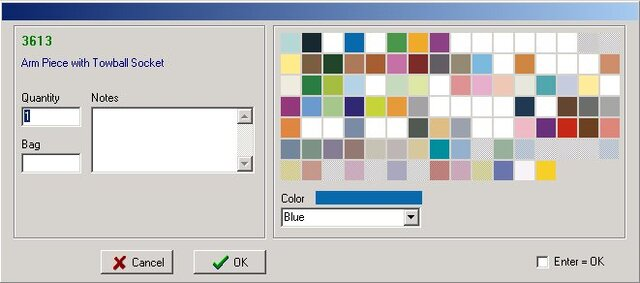
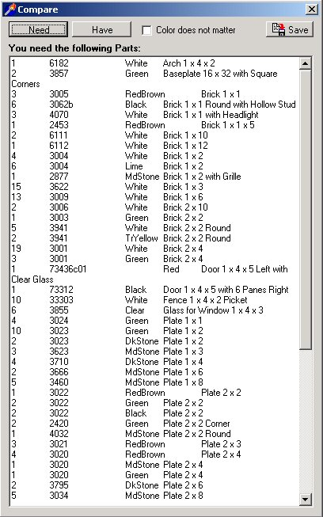

Parts Catalog est un programme utilisé pour inventorier votre collection de pièces LEGO.

Le but principal selon son auteur est la possibilité de comparer deux listes pour voir quelles pièces sont manquantes.

## Installation

Parts Catalog est téléchargeable gratuitement à l’adresse suivante :  
**–** [http://www.bong69.com/pages/software.php](http://www.bong69.com/pages/software.php)  
C’est un logiciel en anglais pour Windows, développé par Bob Kojima. Attention, il vous faut une résolution d’au moins 1024x768. Cet article se base sur la version 0.0.46 de Parts Catalog.

[](https://www.freelug.org/IMG/jpg/inventaire.jpg)

Pour l’installer, pas grand chose à faire, il suffit d’extraire l’archive zip. Une fois lancé, la première chose à faire est de mettre à jour la liste maîtresse des pièces, c’est à dire l’inventaire complet des pièces existantes. Ce fichier, master.txt, est téléchargé depuis [Peeron](http://www.peeron.com/). Pour se faire, se rendre dans le menu Help > Update master.txt.



Par défaut, Parts Catalog ne vient pas avec les images des pièces. Vous pouvez toutefois en télécharger une bonne partie depuis les liens indiqués dans le readme.txt de Parts Catalog. Il faut alors les placer dans le répertoire "images" puis dans le sous-répertoire correspondant au type d’images (gif, jpg, png).



**–** 

[](https://www.freelug.org/IMG/jpg/ajoutjpg2.jpg)

## Options

En cliquant sur le bouton "More" au bas de la fenêtre, vous pouvez spécifier quelques options supplémentaires, notamment le chemin vers le dossier LDraw qui vous permettra de bénéficier du rendu des pièces (du moins celles présentes dans votre librairie LDraw).

Si vous disposez d’un compte sur Peeron (inscription gratuite), vous pouvez également saisir votre login/mot de passe, ce qui vous permettra de télécharger par exemple des inventaires de boîtes.

La partie concernant LDView ne semble pas fonctionnelle.



## Télécharger un inventaire

Si vous avez renseigné la partie identification à Peeron, vous pouvez télécharger un inventaire depuis le menu "Peeron > Download a set inventory".



Saisissez simplement la référence du modèle. Le second chiffre (-1 à -4) permet de préciser la variante dans les quelques rares cas où un même numéro a été attribué à différents modèles.

Parts Catalog se connecte à Peeron et télécharge l’inventaire. Vous devinerez donc qu’il faut être connecté à Internet... Pour les curieux, l’inventaire est enregistré automatiquement dans le répertoire "inventory" de Parts Catalog avec l’extension .inv. Vous pouvez ouvrir ce fichier avec n’importe quel éditeur de texte ou tableur puisqu’il s’agit d’un fichier de données tabulées :

```
3	3010		Black	Brick 1 x 4
6	3185		Black	Fence 1 x 4 x 2
22	4073		Black	Plate 1 x 1 Round
```

Attention, quand vous téléchargez un inventaire, il s’ajoute à la fin de la liste des pièces déjà présentes. Si vous souhaitez avoir uniquement l’inventaire de la boîte choisie, pensez à cliquer sur "New" avant de télécharger.

## Inventorier un modèle

Maintenant, vous souhaitez réaliser l’inventaire un modèle encore non-inventorié ou bien d’un MOC (sans utiliser un logiciel de modélisation), rien de plus simple.

Commencez déjà par vous assurez de travailler sur un nouvel inventaire en cliquant sur "New". Il suffit ensuite de chercher la pièce qui nous intéresse dans les listes à droite à travers les catégories, puis de cliquer sur le bouton "Add". On peut alors préciser la couleur et la quantité, ainsi que des observations.



Si vous connaissez déjà la référence de la pièce, vous pouvez faire une recherche en utilisant le champ de recherche en haut à droite et en cliquant sur le bouton "Find".

Pour retirer une pièce, cliquez sur "Delete".

En cliquant sur "More", vous pouvez précisez quelques informations sur l’inventaire.

Pensez à sauver régulièrement votre travail :) Parts Catalog propose quatre formats d’enregistrement :  
**–** PRN : format texte avec syntaxe Peeron  
**–** inv : format texte (les notes et informations complémentaires ne sont pas présentes)  
**–** csv : format de données séparées par des virgules  
**–** xls : format Excel (en ligne, les types de pièces, en colonne les couleur, le total en bas pour chaque couleur)

Le format le plus exhaustif est PRN, c’est celui proposé par défaut.

## Gérer son inventaire

Le but principal de Parts Catalog est de gérer un inventaire d’une collection.

Deux possibilités s’offrent à l’utilisateur : référencer pièce par pièce, ce qui peut représenter un travail non négligeable ou se baser sur les inventaires des boîtes qu’il possède.

Le premier cas est identique à la démarche d’inventorier un modèle. Dans le second cas, l’idée est de combiner l’inventaire des boîtes en possession ce qui donnera l’inventaire détaillé de la collection.

Pour cela, re-cliquons sur "New" et téléchargeons un premier inventaire de boîte. Ensuite, sans cliquer sur "New", téléchargeons un second inventaire. Celui vient se placer à la suite du premier. Comme certaines pièces peuvent être présentes dans les deux modèles, "Edit > Combine Duplicates" permet de fusionner les inventaires. Vous pouvez ainsi répéter l’opération autant que nécessaire pour ajouter chacun de vos modèles. Pensez encore une fois à sauver régulièrement votre travail. On préfèrera ici le format .inv.

Bien sûr, vous pouvez à tout moment ajouter quelques pièces (provenant d’un vrac par exemple) à cet inventaire.

## Ouvrir un inventaire

Parts Catalog permet également de charger des inventaires déjà enregistrés (heureusement si on veut recharger l’inventaire de sa collection...).

En ouverture, Parts Catalog supporte plusieurs formats. Les quatre formats exportés, mais également une page html enregistrée provenant de Peeron ou bien encore un fichier LDraw de type MPD. A noter toutefois que pour ce dernier type, l’inventaire des pièces des sous modèles ne semblent pas fonctionnel.

Comme pour le téléchargement, ouvrir deux inventaires consécutifs les combine. La commande Multi-open permet d’importer un même inventaire en plusieurs quantités.

## La finalité : comparer des listes de pièces

Mais finalement, une fois ce travail accompli, la fonctionnalité la plus intéressante de Parts Catalog ne réside pas dans sa capacité à faire un simple listing, mais à comparer deux inventaires, ou plus précisément, à calculer les pièces disponibles ou manquantes pour un inventaire au regard d’un autre.

C’est à partir de ce moment qu’on prend conscience de la distinction entre les formats .inv et .prn. Les fichiers .inv représentent un inventaire personnel tandis que les .prn représente un inventaire Peeron.

Charger votre inventaire de pièces ou un inventaire Peeron. En cliquant sur le bouton "Compare", une nouvelle fenêtre s’affiche.

En cliquant sur le bouton "Need" ou "Have", vous devez choisir un inventaire Peeron (les fichiers .inv n’ont pas l’air de marcher).

Le bouton "Need" donne la liste des pièces nécessaires et qui ne sont pas présentes (ou dans des quantités insuffisantes) dans votre inventaire.



Le bouton "Have" donne la liste des pièces nécessaires que vous disposez déjà.

Vous pouvez alors sauver la liste générée.

## Mon utilisation personnelle

L’usage que j’ai de Parts Catalog est finalement très simpliste au regard des capacités de l’outil (que j’ai, je dois avouer, découvertes en écrivant cet article). Je l’utilise pour pointer les pièces nécessaires à la reconstitution d’un modèle. Je télécharge l’inventaire Peeron, puis au fur à mesure que je collecte les pièces, j’indique les quantités manquantes pour chaque pièce.

Cela me permet de reprendre le travail une fois suivante, lors de l’acquisition d’un nouveau vrac par exemple dans lequel je vais trouver des pièces qui viendront compléter le modèle.

Seuls inconvénients, l’absence possible de certaines images et des inventaires incorrects. Dans le premier cas, j’ai souvent la page Peeron ouverte à côté pour avoir toutes les images. Et lorsqu’un inventaire est incorrect, le mieux est de faire parvenir un correctif pour faire en profiter le reste de la communauté.

Certains préfèreront utiliser les inventaires Bricklink. Mon expérience montre que pour les anciennes boîtes (jusqu’en 95 en gros), aussi bien les inventaires de Peeron que de Bricklink sont régulièrement victimes d’erreurs. C’est moins le cas des sets récents pour Bricklink, puisque ces inventaires servent aux revendeurs qui explosent des boîtes pour la revente des pièces au détail.
