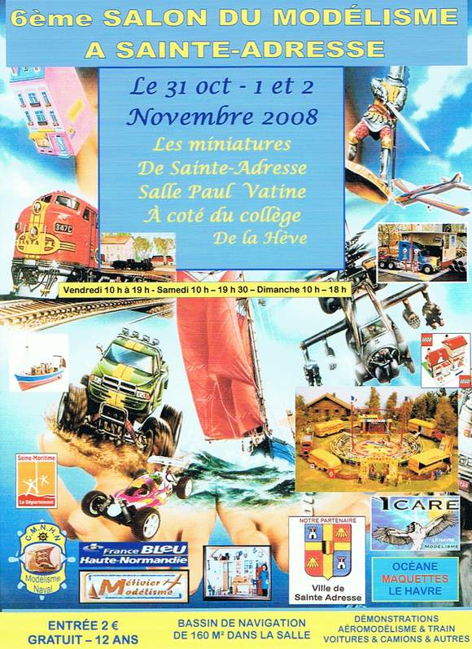

Pour la sixième année consécutive, le C.M.N.H.N (Club de Modélisme Naval de Haute Normandie) organise son salon du modélisme.

Ravis de notre prestation de l’année dernière, nous avons été recontactés.

Cette année, Médérik, Florence et moi serons rejoints par Pierre Laurenge pour réaliser un réseau de trains, exposer des modèles techniques, StarWars, ou autres.

Un bassin nous est accessible pour faire naviguer tout ce qui peut flotter.

**–** Dates d’exposition : du vendredi 31 octobre au dimanche 2 novembre 2008  
**–** Lieu : Salle Paul Vatine, Collège de la Hève, Le Havre - Sainte Adresse (76)  
**–** Tarif : 2€  
**–** Vendredi : 10h-19h  
**–** Samedi : 10h-19h30  
**–** Dimanche : 10h-18h

Coupons d’invitations disponibles, me contacter : breard.pascal at laposte.net

Informations pratiques : Honfleur, Etretat, Fécamp, et Rouen sont à proximité du Havre. De quoi prévoir un petit week-end en famille et venir visiter la Normandie.

A Bientôt.
