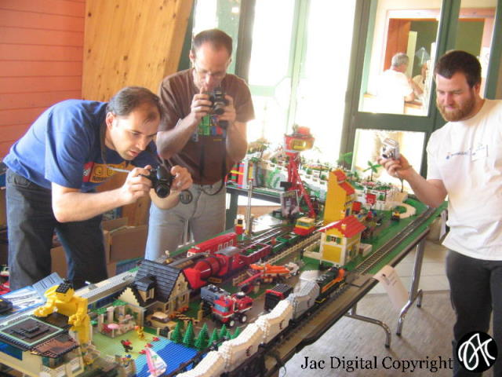
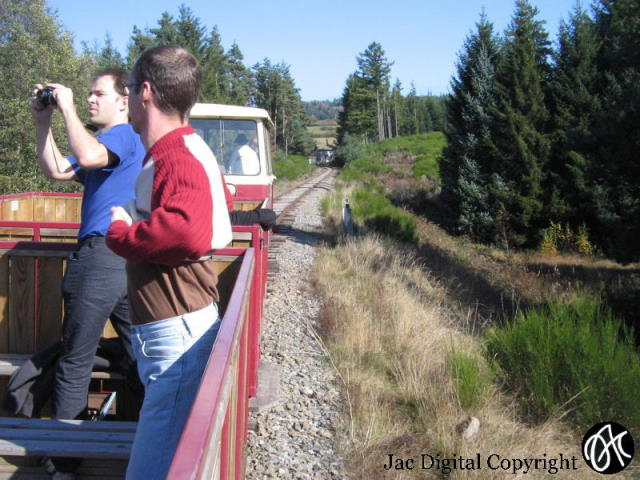
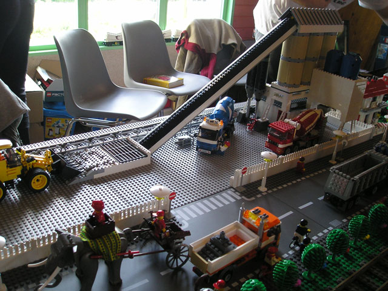
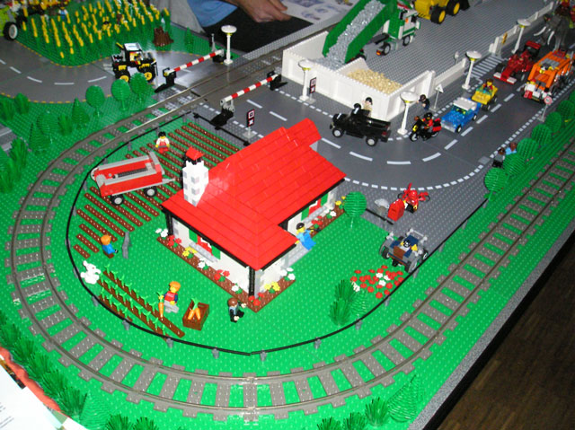
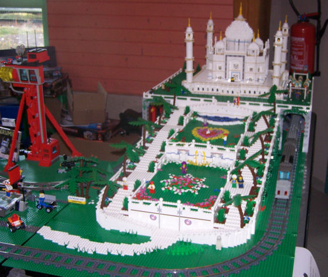
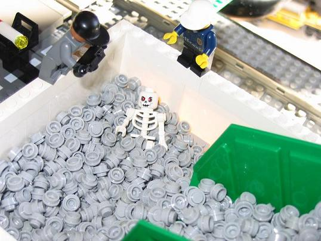
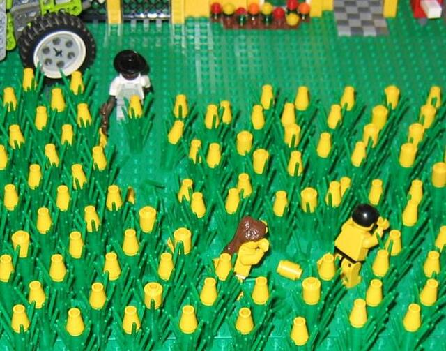

Compte-rendu de notre participation à l’exposition Estivareilles 2008

Nous avons connu, PierreC, Pierrick et moi même, le cousin de Didier (Michel) à l’exposition de Capdenac-Gare. Ils nous avait invité à participer à la première fête du train d’Estivareilles. Et par amitié, nous avons décidé de laisser agir notre Didier pour l’organisation de cette exposition...

Je suis arrivé à l’heure, c’est à dire 7h30, et le premier, après une nuit de labeur dans mon moulin. Didier est arrivé de suite après moi, suivi de Pierre et Pierrick. Installations directe après déchargement, nos tables étant correctement en place. Cela nous a occupé toute la matinée, et même une certaine partie de l’après-midi pour certains. Mais, comme cela a été expliqué lors du week-end, le stand n’est jamais complètement fini. Il y a toujours des choses qui se construisent, et d’autres qui se détruisent. Le Taj Mahal de Pierrick en a d’ailleurs fait les frais. Pourtant, malgré nos circulations de trains et décors changeants, il restera le clou de l’exposition, cité mainte fois par l’organisateur, qui comptait 3000 pièces au début pour sa construction, et qui est monté jusqu’à 10 000, dans l’après-midi du dimanche. Les annonces micro allaient bon train.

**Séance photo des wagons de PierroLego**

Je vous ais bien eu, j’ai pas photografié le train.......

Ce qui me permet de me diriger vers notre ballade du dimanche après-midi, justement. Nous avons honteusement délaissé le stand pour les trains en grandeur nature. Il se trouve qu’Estivareilles est le point de départ du petit train touristique du haut Forez. Et nous avons profité, Didier, Pierrick et moi-même d’un départ de la petite draisine. Ce fut une heure de pur plaisir, dont l’aller dans le petit véhicule de chantier, transformé pour l’occasion en panoramique, et le retour dans des petits wagonnets à l’air libre. Une heure de plaisir et de bonheur, tellement le trajet était sympathique. Nous avons même participé, Pierrick et moi, à la commande manuelle du passage à niveau d’Usson. Un réel plaisir, vous dis-je. Et pour vous en convaincre, je vous laisse contempler les galeries...

**Petit voyage en train**

retour de Ussol dans les wagonnets. La petite ligne est superbe....

D’ailleurs, tout le week-end fut sympathique, et ce malgré mon cruel manque de sommeil. J’ai du fermé les yeux vers 22h30 le samedi soir, et laisser le groupe d’afols discuter dans le salon du superbe petit appartement du gîte, prêté par la ville pour la nuit.

Nous déplorons aussi l’absence d’Erik qui est venu seulement en photos !!!

_Jérôme / JAC_

* * *

Quand on m’a proposé de participer à cette exposition, qui est à moins d’une heure de chez moi, c’est tout naturellement que je me suis lancé dans l’aventure !  
Enfin aventure... je m’entends...

Didier nous a donc présenté un layout, et on a chacun choisi son emplacement. Je me suis attelé à la lourde tâche de faire rentrer ma centrale à béton dans la surface qui m’était destinée. Et j’ai réussi !!

**la centrale**

Voilà, pour la centrale, et puis la maison qui fait le bout de la ligne de train.

**la maison**

Voilà pour ma petite participation.  
En tout cas c’était une sympathique petite exposition, pour une première rien à redire au niveau de l’organisation, repas et logement tout pris en compte et sur place, c’est le top ! Sinon, c’est vrai qu’on était court au niveau de la place, mais on a réussi sans problème à faire encore de belle chose !  
Et puis on s’est encore bien amusé, et aussi rigolé !

Enfin c’était une exposition quoi !!

_Pierre L. / Pierrolego_

* * *

Après un premier échauffement lors de [l’exposition au Toys’r’us de Dijon le 14 juillet dernier](/articles/785/) où j’avais amené quatre camions, j’ai réalisé pour cette exposition mon premier module. Le but était de mettre en valeur le Taj Mahal et de garder une circulation de train. J’ai donc fait ceci :

**Taj Mahal et ses jardins**

Ce qui m’a pris environ 70h et 15000 pièces (Taj inclus)

L’exposition en elle même s’est très bien passée, nous avons était très bien reçus (bravo à l’organisation pour les repas et le logement) et nos collègues modélistes ont étaient très agréable agréables. Je suis toujours surpris par l’attrait que suscite notre stand. Ainsi, s’il est courant de voir des enfants qui ne veulent pas partir de notre diorama, il y a beaucoup de parents (surtout les papas) qui restent et regardent les détails de ce que l’on fait.

_Pierrick / PZ_

* * *

Estivareilles est si près de Lyon que je ne pouvais refuser de venir. Ce fut un grand plaisir d’exposer avec certains de mes compères habituels ainsi qu’avec Didier avec qui j’exposais pour la première fois.

Pour cette exposition j’ai choisi d’amener assez peu de choses car j’étais en pleine préparation pour Orléans. Je me suis donc plutôt rabattu sur l’animation de la ville à l’aide de mes minifigs.

**CSI : LegoCity - Les Experts : LegoVille**

Inspiré par Pascal "Le Gnome" Breard

Encore une fois mes minifigs ont parfois été incontrôlables. Je leur laisse vraiment trop de liberté !

**Get out of my field, damn hippies !!!**

Pour finir je voudrais dire merci aux organisateurs pour ce super accueil ainsi qu’aux membres de FreeLUG qui sont venus nous voir.

_Pierre C. / Tribolego_

* * *

Mes amis ayant déjà cité ci-dessus les points forts de ce week-end, je me contenterais de souligner combien l’enthousiasme et la bonne humeur furent partagés par les organisateurs, participants et visiteurs à cette occasion.

Je ne peux que vous encourager à partager votre passion.

_Didier_

* * *

## Galeries de photos

**–** [Galerie de JérômeJAC](http://photos.freelug.org/main.php/v/JAC/Exposition/Estivareilles-2008/)  
**–** [Galerie de Didier/6Studs](http://photos.freelug.org/main.php/v/6studs/estivareilles08/)  
**–** [Galerie de Pierre Laurenge/PierroLego](http://photos.freelug.org/main.php/v/pierrel/exposition/estivareilles08/)  
**–** [Galerie de Pierre Charles/TriboLego](http://photos.freelug.org/main.php/v/Pierre_13/Estivareilles+2008/)  
**–** [Galerie de Pierrick/PZ](http://photos.freelug.org/main.php/v/-PZ/Exposition/Estivareilles/)
