C’est un designer bien connu chez FreeLUG qui a réalisé ce set. Reconnaissable par ses initiales sur les plaques d’immatriculations, Pierre Normandin nous propose dans cette boîte de construire un camion de transport pour éolienne avec sa voiture pilote. Par ailleurs, nous avons eu droit à la présentation de ce set en avant première par Pierre lors de l’[exposition Fanabriques 2009](/articles/948/).

## La boîte

Ce set est une exclusivité Shop@Home, mais comme d’autres sets, on peut le trouver dans certaines chaînes de magasins. Personnellement je l’ai acheté dans un JouéClub, mais on peut aussi le trouver dans les Toys’R’Us.

**–** Numéro du set : 7747  
**–** Nom de la boîte : le transport de l’éolienne  
**–** Gamme : CITY  
**–** Nombre de pièces : 444  
**–** Nombre de minifigs : 2  
**–** Prix moyen constaté : 60€, [disponible sur le shop](http://shop.lego.com/ByTheme/Product.aspx?p=7747&cn=356&d=9#reviews).

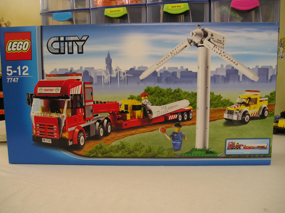

**La boîte**

Une grande boîte pour présenter en entier le camion de transport ainsi que l’éolienne.

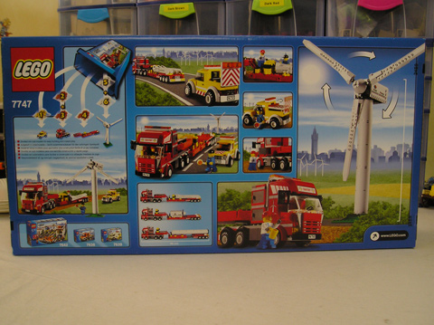

**à l’arrière...**

Derrière, on retrouve les différentes possibilités de transport. On peut voir aussi que le montage se fera en quatre étapes.

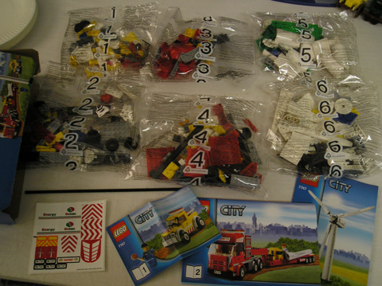

**le contenu...**

Une fois la boîte ouverte, on voit qu’on a droit à six sachets numérotés, trois notices pour les différentes étapes de montage, une planche d’autocollants ainsi qu’un axe Technic de 32.

## Le montage

**La première étape** est évidement consacrée au montage de la voiture pilote. On ouvre donc le premier sachet.

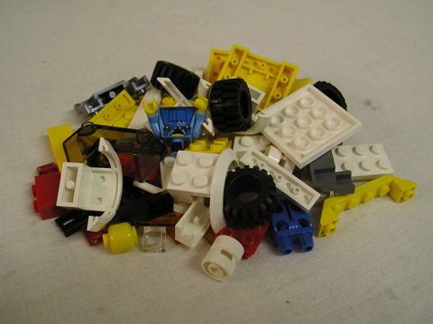

**un tas de briques...**

Puis on se lance dans la construction !

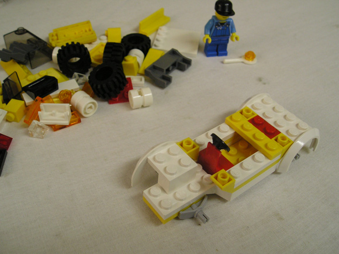

**...ça se construit...**

Et voilà le résultat !

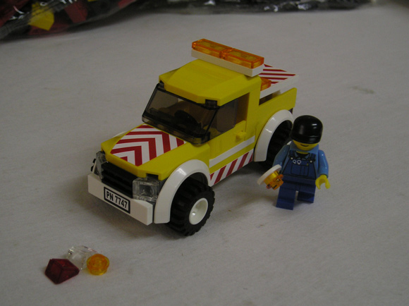

**...et voilà la voiture..!**

Une bien belle voiture pilote. Avec ses portières, et le panneau à l’arrière que l’on peut soit lever soit baisser.

**Seconde étape, le camion.**

Dans le deuxième sachet, on fait la base du tracteur.

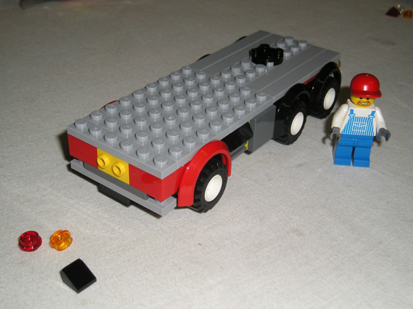

**la base du camion**

Puis avec le troisième sachet, on finit le tracteur.

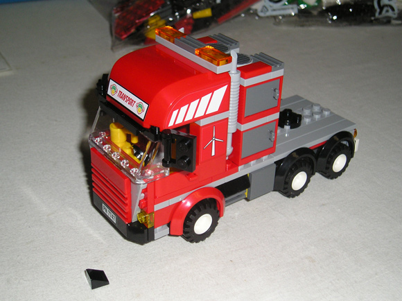

**le tracteur fini**

Un beau gros tracteur, on y retrouve les bases des autres camions sortis dernièrement (l’avant ainsi que le chapeau).

**Troisième étape, la remorque.**

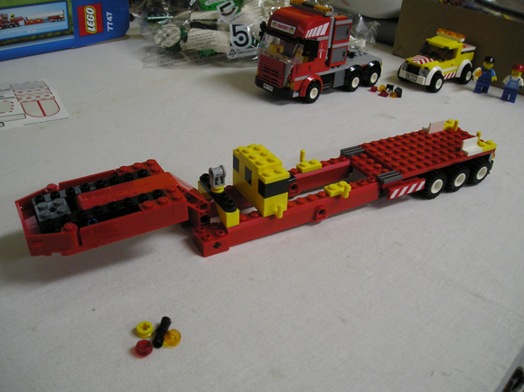

**la remorque**

Une longue remorque, que l’on peut encore rallonger suivant ce que l’on transporte.

**Quatrième et dernière étape, l’éolienne.**

C’est avec le cinquième sachet que l’on monte le mât de l’éolienne.

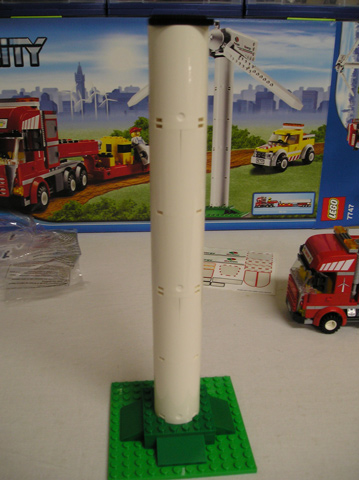

**la base de l’éolienne**

Puis avec le dernier sachet, on fait le rotor ainsi que les trois pales.

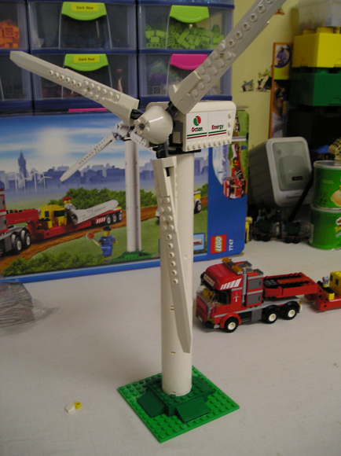

**l’éolienne finie**

Une petite éolienne, mais elle reste réaliste.

Voici donc l’ensemble une fois fini.

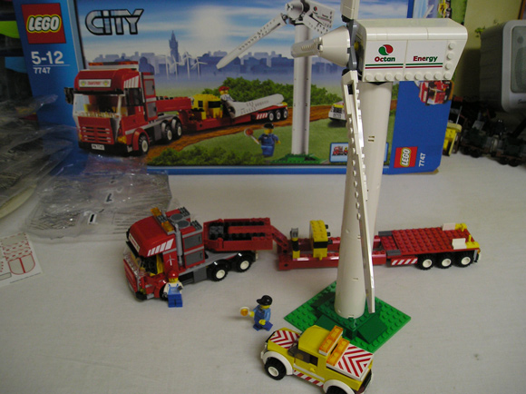

**l’ensemble**

On peut alors commencer à essayer les différentes possibilités de transport. Le camion ne peut pas tout prendre d’un coup.

Donc on commence par amener le mât sur le chantier...

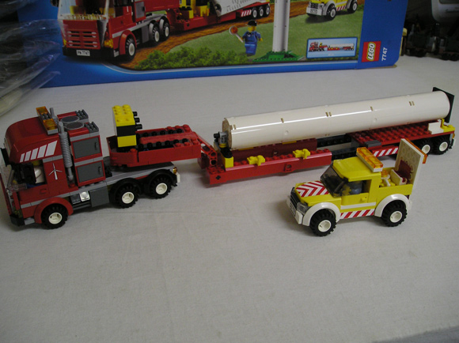

**le transport du mât**

Puis c’est au tour du rotor...

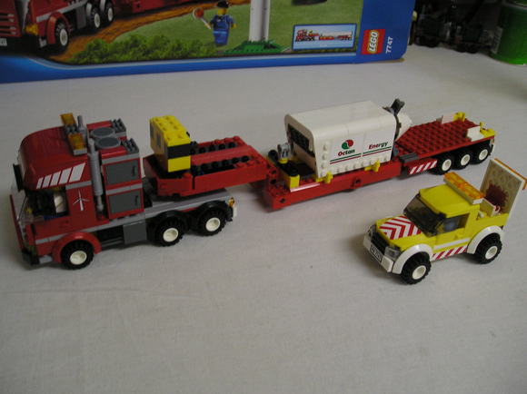

**le transport du rotor**

Et enfin les pales.

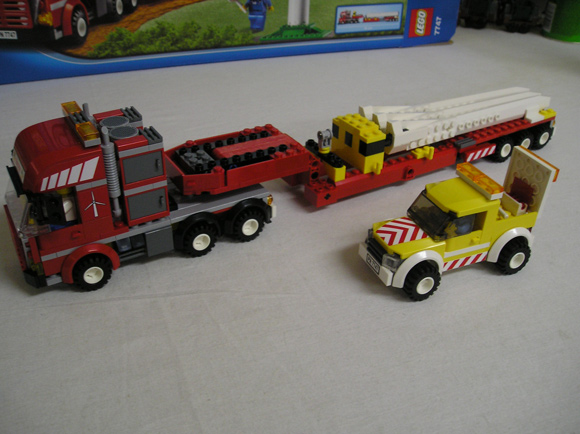

**le transport des pales**

Sans oublier la voiture pilote qui escorte chacun des convois !

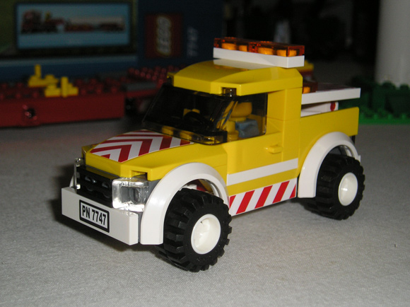

**la voiture pilote**

## Conclusion

Un beau set, qui change avec les classiques pompiers et policiers.

Un camion, une voiture et une éolienne, beaucoup de choses dans un seul set.

Chacune des minifigs a une casquette, cependant ce n’est pas le même design pour les deux, c’est la rouge qui a un nouveau design, la visière est arrondie tandis que sur la noire elle est plate.

A noter la présence de portières aussi bien pour le camion que pour la voiture.

Il y a une plaque d’immatriculation à l’avant et à l’arrière de la voiture et du tracteur ainsi qu’à l’arrière de la remorque. Par contre, c’est la même pour les deux véhicules, c’est un peu bête.

Quelques bémols. Les casiers à l’arrières du tracteur sont vides. Dommage, ils auraient pu mettre des outils voire des cales pour les roues.

Quand le camion est chargé, les deux dernières roues de la remorques ne touchent plus le sol. Cela est du à la pièce utilisée pour allonger la remorque, il y a un peu de jeu entre le mât et la barre Technic, ce qui fait plier la remorque. Tant pis.

60€... peut-être un peu cher, mais c’est le prix pour permettre à sa ville de se mettre à l’énergie verte. ;-)

Personnellement j’ai un petit faible pour la voiture pilote ! Ce pick-up ira parfaitement bien dans la ville.

Pour finir, merci Pierre et puis continue à nous proposer de beaux sets ! ;-)
