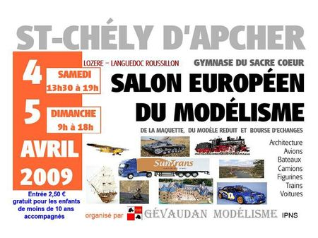

L’équipe de FreeLUG, spécialisée en construction de réseaux ferrés LEGO, a été invitée à prendre part au Salon européen du modélisme de St Chély d’Apcher. C’est aussi un salon de la maquette et modèle réduit qui aura lieu les 4 et 5 avril 2009 dans le département de la Lozère. Nous sommes déjà un petit groupe à placer nos Pierres pour assurer une belle animation à cette nouvelle exposition. Nous vous attendons nombreux entre 13h 30 et 19h le samedi et 9h et 18h, le dimanche.

[Gévaudan Modélisme](http://gevaudanmodelism.canalblog.com/)
