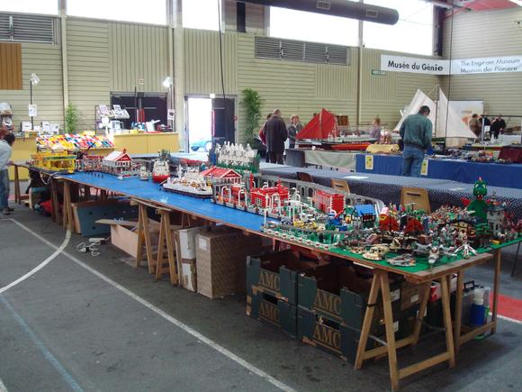
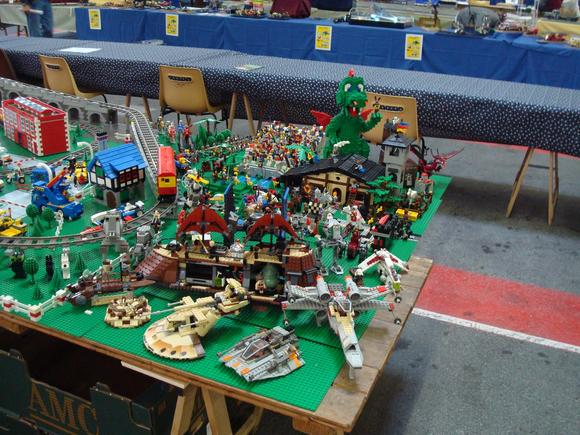
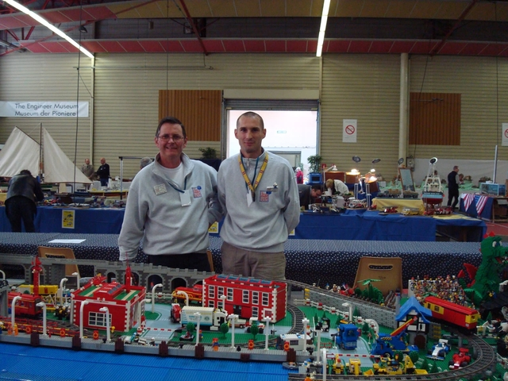

Suite et fin de mon réseau

Le réseau "trains et ferries" que vous connaissez bien est déjà venu [il y a 2 ans à Cholet](/articles/540/) dans une présentation "en cours de construction".

Cette fois-ci, le réseau est terminé et fonctionnel sauf les aiguillages (le public ne saisit pas toujours la fonction des aiguillages. En manuel, les gens comprennent vite alors qu’en automatique, le charme a disparu).

Comme les Allemands, je pourrai fignoler le décor en mettant des tiles un peu partout, des vaches, etc.

Comme toujours, je tire au hasard les personnes qui joueront avec moi(garçons, filles, papa), cette formule est très appréciée du public et surtout des organisateurs qui m’invitent uniquement, ces personnes recherchent le coté interactif entre moi et les autres.

Lors du salon, beaucoup de Freelugiens, de têtes connues et de futurs adhérents sont venus au stand, hélas, je suis trop pris pour pouvoir discuter, je vais engager Brigitte et Alain Eury comme porte-parole de la section Bretagne !!!

Je remercie Stéphane Bodin notre médiévaliste d’avoir partagé avec moi ces deux jours choletais.

Une coupe, une médaille !!! rien , snif !!!!

En conclusion, public formidable, excellent week-end, matériel fiable encore mais pas les tables, beaucoup de raclages sous mes ferries.

[Galeries photos de Stéphane](http://www.brickshelf.com/cgi-bin/gallery.cgi?f=348304)

A bientôt.

Prochain salon dans une semaine au Relecq-Kerhuon.

Jean-Marc de Morlaix.

Quant à moi, je tiens à remercier Jean-Marc et son club de m’avoir accueilli sur leur stand : ce qui m’a enfin permis de ressortir mes LEGO des cartons.  
j’y ai passé un agréable weekend à ne parler que de LEGO.

Stéphane
